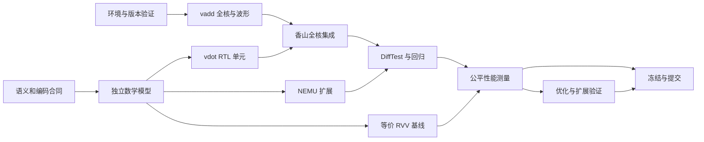

# 整理前开发入口归档（2026-10-23）

本文件保留本次整理开始时七份入口的完整正文，包括当时未提交的修改。当前规则和任务以[AGENTS](../../../AGENTS.md)、[路线](../development-route-current.md)和[协作约定](../collaboration-current.md)为准。本归档不发布任务、不授予推送权限、不证明历史进程仍在运行。

原文件正文按来源分节保存，仅将 Markdown 相对文件链接改为从本归档解析；命令和文本中的路径仍按原文件、原时点解释。各节给出整理前原字节的 SHA-256，原字节备份另保存在本次本地整理记录中。原始 evidence 与既有历史档案未移动或改写。

## 来源索引

- [团队 README：team/README.md](#original-team-readme)
- [根优化入口：OPTIMIZATION.md](#original-optimization)
- [O2 README：team/optimizations/o2/README.md](#original-o2-readme)
- [O2 原优化计划：team/optimizations/o2/NEXT_OPTIMIZATION_PLAN.md](#original-o2-plan)
- [原总体执行计划：team/香山vdot赛题_执行计划.md](#original-execution-plan)
- [原三人分工与协作：team/香山vdot赛题_三人分工与Git协作.md](#original-team-plan)
- [原后续优化方案：team/香山vdot_后续优化方案_20261017.md](#original-optimization-plan)

---

<a id="original-team-readme"></a>

## 原文件：team/README.md

来源字节 SHA-256：4a474fa9ee12f79017b06ccaa6492d0f00440807b9a2a685277e6a43c4ade809

以下均为历史正文，原文中的“当前／下一步”按其原日期阅读。

> **当前开发入口：** 后续开发顺序见[当前开发路线](../development-route-current.md)，通用开发方法见仓库根 AGENTS.md。以下保留原日期的历史记录，实验状态以对应源码和证据为准。

<!-- O2_H1_PUBLICATION_20261021 -->

> 2026-10-21 本批发布：按用户授权将 R0/R1、H1 实现、全核回归及 B0/H1 周期不退化证据交付 GitHub 的 zjhwork。H1 本机验证链完成，96 对正式窗口周期完全一致；R4 独立复现与最终采用待完成。实际发布结果以远端回读回执为准，下文旧发布状态按历史时点阅读。 [发布说明](../o2-h1-publication-20261021.md)。

<!-- B0_H1_PERFORMANCE_COMPLETED_20261021 -->

> 2026-10-21：B0/H1 同镜像周期不退化检查完成。36 次新运行、478 个校验窗口、192 个正式窗口组成的 96 对样本逐项周期完全一致；严格原始日志重审和 Linux/Windows 便携复算通过。H1 本轮没有周期提速，保留此前局部面积收益及部分 STA 路径回退的取舍。H1 本机验证链已齐备，R4 独立复现与最终采用仍待完成。本轮未推送 GitHub，未切换默认模式，未自动开始 R2/R4，正式报告后置。 [结果记录](../../optimizations/o2/result-width/h1/performance/B0_H1_RESULT.md)。下文旧状态按历史时点阅读。

# 当前进度：O2-R1 H1 全核回归通过（2026-10-21）

新 H1 全核构建、14 项作业及严格离线重审通过：13 项正常作业、1 项 bit100 预期拒错与同镜像正常库恢复；117 个唯一功能/异常用例、5,378 条正常 vdot 提交、95 项主机检查和六项两槽覆盖齐全。完整 128 位输出检查保持有效。

结果见[H1 全核回归记录](../../optimizations/o2/result-width/h1/fullcore/H1_FULLCORE_RESULT.md)。当前源码与 repo/build/emu 均为 H1，硬件固定提交 8b5024f；原 O2 B0 构建完整保留，R0 锁仍绑定 B0。为固定构建身份已有两个普通本地提交，未推送 GitHub。

下一项是 B0/H1 同镜像周期不退化检查；本轮没有新性能 A/B 或加速比。此前局部面积收益及参考时序取舍保持原结论。整项 R1 的后续检查、R4 独立复现与最终采用仍待完成，正式报告继续在工程冻结后编写。下方记录均按各自历史时点阅读。

# 当前进度：O2-R1 H1 局部验证完成（2026-10-21）

H1 已实现低32位保存，完整128位结果、独立FU、真实VFEX4父级与参考面积/时序对照已完成。10,022组唯一向量与4+16项观测值负控通过，II=1、无阻塞2拍保持。完整FU面积降低2.33386%，完整父级降低0.137349%，均少96个DFF。部分时序路径回退，1ns参考目标仍未满足。

见[H1实现与验证结果](../../optimizations/o2/result-width/h1/H1_RESULT.md)。下一项为H1全核回归及后续同镜像周期检查；整项R1、独立成员复现和最终采用仍待完成。当前源码是H1候选，已有build/emu仍为B0。本轮未提交或推送，未改R0锁与旧封存证据；下方状态按历史时点阅读。

# 当前进度：O2-R1 映射审查通过（2026-10-21）

R0 本机预检已完成；R1 第一关映射审查通过，H1 低32位候选尚待实现，整项 R1 未完成。两份 O2 网表的高96位各占96个独立DFF；对应独占局部成本约占FU的3.0277%、完整VFEX4的0.1879%，不是新实现的净节省。

见[R1审查与候选条件](../../optimizations/o2/result-width/R1_MAPPING_REVIEW.md)。本轮只做审查与可复算记录，未改生产RTL、默认配置、ISA/NEMU和旧封存证据，未运行新综合/STA/EMU；没有新加速比。12项主机检查及2项真实命令负控通过。本地分支local/o2-r1-result-width-20261021，保留R0未提交材料；未提交或推送，不代签成员ACK。下方按历史时点阅读。

# 当前进度：O2-R0 本机自动验收完成（2026-10-21）

R0 已完成基线固定和本机自动预检（2026-10-21）：100 项主机检查、observe/cost 两种配置、4 项真实命令负控通过。未运行新 EMU 或综合，成员独立复现仍留待 R4/T17。下一项 R1 映射寄存器审查。

见[R0 完成记录](../../optimizations/o2/repro/R0_STATUS.md)与同目录复现说明。本轮本地保存，未提交或推送，不自动开始 R1，不切换默认模式，不代签成员 ACK。下方按历史时点阅读。

# O2 后续执行计划（2026-10-20，待实施）

当前待办见[O2 后续优化执行计划](../../optimizations/o2/NEXT_OPTIMIZATION_PLAN.md)。按 R0 基线与复现准备、R1 结果寄存器收窄、R2 应用内核优化、R3 条件审查、R4 完整回归与独立复现、R5 工程冻结推进。R1/R2 局部筛选可以并行，正式报告仍在工程冻结后编写。

本次只保存计划和更新入口，未修改 RTL、运行新测试、提交或推送。下方保留各历史时点的状态，不表示新的执行结果。

# 最新项目状态与本批发布（2026-10-20）

用户授权将当前项目状况保存为Markdown并发布至cc77-builder/riscv的zjhwork。本批包含已有6项O4提交、O2主线选择和状态快照，允许正常快进上传；最终成功与SHA以远端回读为准。

技术主线采用O2，O0–O4已有对应证据；下一步O5/T17及O2减代价审查，G5最终冻结待完成，T16/T18工程冻结后集中开展。源码默认开关未改，人工ACK待实际成员完成。此次仅整理与发布，不重跑已完成工程或改旧封存载荷。

当前入口：[项目当前状况](../project-status-20261020.md)。下方“未上传/不push/待做”等按历史时点阅读；原始证据保持生成状态。

# 当前主线：O2 两槽弹性 FU（2026-10-20）

按用户“推荐一版并沿用其继续优化”的要求，后续开发采用O2，O1作为冻结对照与回退。G4 batch周期少39.03%，O3应用仅少0.62%–1.50%；完整FU面积+41.41%、VFEX4父级+1.25%。这是一项开发主线选择，最终参赛采用仍须完成O5/T17及G5。

下一步固定O2复现入口、补齐独立复现，同时审查额外性能字段和控制路径成本；后续每次只实施一个有证据支持的优化。工程冻结后再集中编写T16与准备T18。默认源码开关与旧封存证据保持原状，本次只更新计划，未运行新测试或推送GitHub。

详细依据和执行顺序见[O2主线选择](../o2-mainline-decision-20261020.md)。下方保留历史状态与原始计划，不作为当前待办顺序。

# 当前状态：O4结构与参考时序评估完成（本地）

2026-10-20：4项映射/20项STA/140份路径及13项主机检查通过离线复核，结果见optimizations/o4/README.md。
完整FU面积+41.41%，含完整DIV的真实VFEX4面积+1.25%；两版均未满足1ns参考目标，不宣称整核Fmax/功耗。
当前local/o4-cost-20261020，本轮不push、不切换默认。下一项O5/T17独立复现，随后G5最终采用；正式T16后置。
不要重跑已完成O4或改封存证据。下方内容为历史状态/原计划。

# 最新交付：O2与O3成果至zjhwork

2026-10-20用户授权本批普通快进发布，实际成功与SHA以回读为准。[发布范围与下一步](../o2-o3-publication-20261020.md) · [O3完整应用结果](../../workloads/o3-gemv/README.md) · [O1/O2公平性能](../../optimizations/o2/performance/README.md)

O2 G0–G4及O3已完成。O3共56项合格作业（46复用＋10补跑，另2中断记录保留）、1280校验窗口、768正式性能样本；Linux/Windows离线复算通过。G4独立batch128降低39.03%，O3应用reuse/endtoend降低0.62%–1.50%，适用范围分别报告。

下一项O4结构/时序代价，再推进O5/T17队友干净检出复现与G5最终采用。O2默认关闭，T16报告继续后置。本条更新下方“未上传/待做”等历史状态，不修改密封证据。

# 三人团队：项目计划与开发入口

> **2026-10-19 O2 G1/G2 完成，本地保存。** 两槽弹性 FU 与真实 VFEX4＋DIV＋ClockGate 联调通过，连续流 II=1、无阻塞响应 2 拍；完整数据/身份、反压、精确取消、复位及旧模式兼容性通过，41 项主机测试和独立逐拍核验通过。见 [工程记录](../../optimizations/o2/IMPLEMENTATION.md) · [证据](../../optimizations/o2/evidence/20261019-elastic-parent/README.md)。下一步为 G3 观察器适配及全核回归；没有 O2 新整核加速比，默认关闭，未推送 GitHub，下方按历史时点阅读。

> **2026-10-19 O2可行性评估与设计合同完成，本地保存。** [评估与后续步骤](../../optimizations/o2/README.md) · [设计合同](../../optimizations/o2/CONTRACT.md) · [旧轨迹分析](../../optimizations/o2/TRACE_ANALYSIS.md)。推荐下一轮先验证VFEX4两槽弹性原型；本轮未改生产RTL、未运行新EMU、未上传GitHub。O1已有结果继续有效，O2实测收益与最终采用仍待验证，下方状态按历史时点阅读。

> **2026-10-18 O1 成果交付 zjhwork。** 本次包括真实父级联调、全核回归及T14/O1同镜像公平性能比较；batch128周期降低20.02%，相对RVV为1.870×。见 [发布说明](../o1-publication-20261018.md)。本条更新下方未上传状态，实际最终版本以远端回读为准；密封证据保持原样，O1默认关闭，未代签人工ACK。

> **T14/O1 同镜像公平性能比较完成，本地保存。** 独立batch128平均周期 453.25→362.50，降低20.02%；O1相对实测RVV为1.870×。36次主运行、478窗口及完整离线复算通过。见 [性能入口](../../optimizations/o1/performance/README.md) · [证据](../../optimizations/o1/evidence/20261018-performance-ab/README.md)。O1默认关闭，未推送；PPA/T17/人工ACK仍待完成，正式T16报告后置，下方按历史时点阅读。

> **2026-10-18 O1 全核功能与控制回归、严格离线复核通过，本地保存。** 固定硬件 `18c0ce08`、原检查器 `518c0567` 的十二项运行全部符合预期；门禁集成 `d1100020` 后对未修改原日志重审通过，未新增 EMU 运行。正常提交 3,012 条 vdot；117 个唯一功能用例（80 合法、37 异常）、124 次分片执行、bit100 负控及正常恢复通过。控制程序自身满足八项覆盖，同拍交接 303 次，密集程序另有 725 次。见 [全核工程入口](../../optimizations/o1/fullcore/README.md)、[严格日志门禁](../../optimizations/o1/audit/README.md) 和 [完整证据](../../optimizations/o1/evidence/20261018-fullcore-validation/README.md)。本轮全核覆盖 vdot/VIDiv，未覆盖 VFDiv，取消仅观察到 vdot reduce 阶段；尚无新性能 A/B、PPA、T17 或人工 ACK 结论。O1 默认关闭，本轮不推送，正式 T16 报告继续后置；下方状态为历史记录。

> **2026-10-18 真实 VFEX4 父级联调通过，本地保存。** 真实 VDot/VIDiv/VFDivSqrt、Dispatcher、busy 和门控共同验证；DIV 切换、反压、432 组 redirect、27 组 reset、20000 拍随机控制及七项负控通过。O1 同拍交接 10343 次，父级连续 vdot 接受间隔 2 拍。见 [父级工程记录](../../optimizations/o1/parent/README.md)、[证据](../../optimizations/o1/evidence/20261018-parent-validation/README.md) 和 [优化进度](../../../OPTIMIZATION.md)。本轮未推送；O1 全核回归和新性能测量待做，不能用测试总周期比值声称应用加速。下方父级未验证等状态按历史时点阅读。

> **2026-10-18 O0/O1 本地验证完成，交付目标 zjhwork。** 已复用 zjhwork2 成果并修复环境预检、负控假通过及两处 `FuType.vdot.U` 类型比较。实际源码 `db0408aa42afc13e3ff93e865f26a2d5bfb02c93` 的三模式 FU 验证通过，延迟/最小接受间隔为 3/4、2/3、2/2 拍；O0 113 项、O1 26 项主机检查通过。首轮失败与修复后成功日志均保留，见 [O1 入口](../../optimizations/o1/README.md)、[本轮证据](../../optimizations/o1/evidence/20261018-fu-validation/README.md) 和 [优化进度](../../../OPTIMIZATION.md)。O1 默认关闭，真实父级 elaboration、全核 DiffTest 和新性能测量尚未完成；下一步为真实 VFEX4（含 DIV）父级联调。此条更新本轮目标分支，下方协作与交付记录按各自历史时点阅读。

> **2026-10-17 后续优化安排更新。** 见 [香山 vdot 后续优化方案](../../香山vdot_后续优化方案_20261017.md)：先完成工程优化、测试回归与独立复现，工程完成并冻结版本后集中编写 T16 报告及答辩材料。开发期间持续保存命令、版本、日志与原始数据，其余优化路线、性能目标和验收要求不变。此安排更新下方历史记录中的 T16 执行顺序。

> **2026-10-17 四项目统一测试交付至 zjhwork。** 同一香山基础版本/MinimalConfig/VLEN128下，四个实现64个全核镜像、860个窗口通过；正式性能样本384个。四路独立点积加速比：本项目1.496×、Jade2.605×、试水2.322×、Redoop＋dot8适配0.929×。见 [完整结果](../unified-vdot-comparison-20261017.md)、[程序](../../workloads/unified-vdot/README.md) 和 [验证归档](../../evidence/unified-vdot-20261017/README.md)。这是T15后的补充比较，未自动推进T16或新增人工ACK；下方“未上传”等为历史时点快照。

> **T15 成果交付至 zjhwork。** 用户已授权上传成果 `13851b2482603ac9f96c850795c697f4e3a6bf44` 及本次交付入口说明。新增 s16x8/r64 独立参数单元、参考模型、94＋10000 组扩展数据、协议测试和 Linux/Windows 离线核验材料。实际正式验证源码为 `65f6159`，本发布批次只补充说明。见 [T15 报告](../t15-parameter-extension.md) 和 [最新计划进度](../progress-t15-20261017.md)。下方及密封材料中的“未上传”保留为发布前历史记录；人工复核仍待完成，下一项为 T16。

> **2026-10-17 T15 本地自动验收完成，尚未上传。** 已验证 8 对 int16 的独立参数单元，94 定向＋10000 随机完整结果、单请求协议与跨平台离线复核通过。T14/T15 两项 G5 开发验证已具备，下一项是 T16 材料整合；人工复核待完成。见 [T15 报告](../t15-parameter-extension.md) 和 [最新计划进度](../progress-t15-20261017.md)。本轮没有扩展全核 ISA。

> **2026-10-17 T14 成果，本次交付目标 zjhwork。** 用户已授权上传已验收成果 `458b7170bfdf41814dac785b41027114bddd512d`；本次另补充进度说明，不改变硬件或测试数据。**技术主线到 T14，处于 G5；下一项为 T15 参数扩展。** 完整状态见 [T00–T18 进度表](../progress-20261017.md)。团队人工复核、语义歧义确认及最终比赛交付仍待完成；下方和报告中的“未上传”为发布前历史记录。

> **2026-10-17 T14 本地自动验收完成，尚未上传。** 输入拍锁存乘积使 FU 响应 3→2 拍、最小 II 4→3；完整回归、126 次相同镜像运行、1,404 个性能窗口及 Linux/Windows 离线复核通过。128 次独立点积约 1.29×，256 次依赖链约 1.14×，访存场景收益很小。见 [结果与局限](../t14-optimization.md)、[合同](../../spec/t14-ablation.md)、[外部建议评估](../t14-suggestion-review.md) 和 [离线回执](../../evidence/t14-offline-review-20261017/README.md)。默认基础模式保留，团队人工复核及物理时序评估待完成。

> **T13 交付至 zjhwork。** 用户已明确授权将本轮成果上传到 `cc77-builder/riscv` 的 `zjhwork`。代码、报告和验证证据版本为 `4526d857937def29ea1598a7c878aa539e2ef1f6`，本发布批次只补充入口说明，未改变硬件、工作负载或测量数据。见 [性能报告](../t13-performance.md) 和 [离线复核](../../evidence/t13-offline-review-20261015/README.md)。下方及归档中的“未上传”是发布前快照；队友人工复核仍待完成，不能把上传当作人工验收。

> **2026-10-15 T13 本地自动验收完成，未上传 GitHub。** 固定版本的 RVV/vdot 公平周期对照通过 108 次全核功能调用与 1,404 个性能窗口，3 次重放一致。见 [T13 报告](../t13-performance.md)、[测量约定](../../spec/measurement.md) 和 [离线证据](../../evidence/t13-performance-20261015/README.md)。T12 已按用户要求发布到 `zjhwork`；T13 位于独立本地分支 `local/t13-performance-20261015`，待队友复核，未代签 ACK。后续可按计划 G5 选择单一优化做 A/B；PPA、虚拟化及人工签字仍未完成。

> **2026-10-14 历史记录：当时本机 T12 自动回归通过，待人工复核/发布。** 11 项全核运行满足预期，控制压力覆盖和原功能矩阵通过。当前成果仅在独立本地分支 `local/t12-regression`；共享远端进度没有随本地结果自动改变。见 [T12 报告](../t12-regression.md) 和 [完整证据](../../evidence/t12-regression-20261014/README.md)。下方 10 月 13 日及更早文字为历史阶段记录。

> **2026-10-13 历史验收：** T10 最小全核接入和 T11 固定功能矩阵已通过，117唯一用例（80合法/37异常）、vdot bit100差分负控及同镜像正常恢复均有完整原始日志。详见 [当前验收报告](../t10-t11-acceptance-20261013.md) 和 [证据入口](../../evidence/t10-t11-fullcore-20261013/README.md)。下方早期“尚未接入/未实现NEMU”等进度是历史快照，以本段链接的分层状态为准；仍未完成全核乱序控制压力、虚拟化、性能及PPA验收。

> **2026-10-13 历史发布状态：已完成合并发布。** 用户确认双方无人开发后，已将验收候选 `734353d01e963610ac864fdddd81e01e91f521fe` 普通快进发布到团队及 Fork 的 zufan，两端 SHA 回读一致。见 [发布记录](../../merge/2026-10-13-zjhwork-into-zufan.publication.md)；[完整局部验收](../../merge/2026-10-13-zjhwork-into-zufan.codex-review.md)通过组合 22+10000 组、FU 6 类/71258 周期。后续两人共享 zufan，下一班须核对最终 SHA 并记录 ACK/START。

本队以《香山 vdot 赛题：执行计划》和《香山 vdot 赛题：三人分工与 Git 协作》作为项目计划文档，分别安排里程碑、验收标准和三人职责。成员先阅读两份计划，再按认领的任务推进开发。

本目录同时保存本队在 2026-10-09 完成的环境搭建、hello/vadd 源码和阶段一证据，并提供按当前仓库位置运行的脚本。香山硬件基线为 `16ae9ddcda54fc9a2fddffad73174cf793ac7814`。`zjhwork` 已提供 vdot 数学模型、RTL 接口设计、组合算术和已通过控制测试的 FU 包装层；香山全核接入和 NEMU 扩展尚未实现。计划中的后续任务按实际验收结果更新进度。

| 内容 | 入口 |
| --- | --- |
| T14/O1 同镜像公平性能比较 | [结果与复现](../../optimizations/o1/performance/README.md) · [证据](../../optimizations/o1/evidence/20261018-performance-ab/README.md) |
| O1 全核功能与控制回归、严格离线复核 | [工程记录](../../optimizations/o1/fullcore/README.md) · [日志门禁](../../optimizations/o1/audit/README.md) · [证据](../../optimizations/o1/evidence/20261018-fullcore-validation/README.md) |
| O1 真实 VFEX4 父级联调 | [工程记录](../../optimizations/o1/parent/README.md) · [证据](../../optimizations/o1/evidence/20261018-parent-validation/README.md) |
| O0/O1 同拍交接开发与三模式 FU 验证 | [工程入口](../../optimizations/o1/README.md) · [证据](../../optimizations/o1/evidence/20261018-fu-validation/README.md) · [优化进度](../../../OPTIMIZATION.md) |
| 四项目统一测试、公开实现对比与验证记录 | [结果](../unified-vdot-comparison-20261017.md) · [程序](../../workloads/unified-vdot/README.md) · [证据](../../evidence/unified-vdot-20261017/README.md) |
| T15 独立参数扩展、验证结果与边界 | [T15 报告](../t15-parameter-extension.md) · [参数合同](../../spec/t15-parameters.md) |
| T15 原始证据与跨平台核验 | [证据](../../evidence/t15-parameters-20261017/README.md) · [离线复核](../../evidence/t15-offline-review-20261017/README.md) |
| T15 完成后的计划状态 | [最新进度](../progress-t15-20261017.md) |
| T14 单一优化消融、完整数据与局限 | [T14 报告](../t14-optimization.md) |
| T14 原始证据及跨平台核验 | [证据](../../evidence/t14-optimization-20261016/README.md) · [离线复核](../../evidence/t14-offline-review-20261017/README.md) |
| T13 公平周期性能对比、完整数据与局限 | [T13 报告](../t13-performance.md) |
| T13 可搬迁离线复算与原始证据 | [T13 证据包](../../evidence/t13-performance-20261015/README.md) |
| 当前协作机制：无 Actions、共享分支交接、Fork 按需同步 | [三人两线协作机制](../collaboration-current.md) |
| 项目计划：阶段目标、执行步骤与验收标准 | [香山 vdot 赛题：执行计划](../../香山vdot赛题_执行计划.md) |
| 项目计划：A/B/C 分工、评审与 Git 协作 | [香山 vdot 赛题：三人分工与 Git 协作](../../香山vdot赛题_三人分工与Git协作.md) |
| vdot 指令语义、候选编码、测试与待确认问题（第一版草案） | [vdot.vv 规格](../../spec/vdot.md) |
| 独立数学模型、定向/随机测试数据及一键检查（T05） | [vdot 模型与数据](../../models/vdot/README.md) |
| T05 主机检查结果、数据来源与已知边界 | [模型验证记录](../../evidence/model-20261012/README.md) |
| T06 接口草案：VFEX4 接入、逐拍时序、异常与验证矩阵 | [RTL 接口与接入设计](../../spec/rtl-interface.md) |
| T07-A 组合算术 RTL、独立构建和一键验证 | [点积算术单元](../../rtl/vdot/README.md) |
| 22 组定向 + 10,000 组随机完整 128 位比较结果 | [RTL 算术验证证据](../../evidence/rtl-datapath-20261012/README.md) |
| T07-B 真实 FU：反压、取消、身份、异常及一键测试 | [FU 包装层](../../rtl/vdot/FU.md) |
| 6 类场景、71,258 周期、事务守恒和预期拒错 | [FU 验证证据](../../evidence/rtl-fu-20261013/README.md) |
| WSL、工具版本、安装方法、配套依赖 | [环境说明](../environment.md) |
| 构建和运行命令、启动问题、通过标准 | [阶段一说明](../stage1.md) |
| hello/vadd 测试源码 | [workloads/hello-vadd](../../workloads/hello-vadd) |
| 路径可配置的执行脚本 | [scripts](../../scripts) |
| 昨天的通过日志、配置、反汇编和事件 CSV | [历史证据](../../evidence/stage1-20261009) |
| 今天用仓库内脚本重新运行的验证结果 | [脚本验证记录](../../evidence/script-check-20261010/README.md) |
| 源码锁定版本 | [versions.env](../../versions.env) |

## 历史开发进度（T07 时点）

T05 数学模型、T07-A 组合算术和 T07-B 独立 FU 均已有通过证据；T06 人工评审及接入验证仍待完成。FU 在真实香山 Bundle/RobPtr 下通过 10,022 组算术输入、反压、非法配置、取消、复位和随机控制测试。复现运行 `bash team/scripts/check-vdot-fu.sh`；纯算术入口 `bash team/scripts/check-vdot-datapath.sh` 继续保留。下一步按计划推进 NEMU 扩展与 T10 译码/VFEX4 接入，再做全核 DiffTest，见 [RTL 设计第 8 节](../../spec/rtl-interface.md#8-实施顺序三人交接与完成标准)。

## 新成员操作顺序

先接受私有仓库邀请。在 Ubuntu 22.04 / WSL2 的 Linux 文件系统中：

```bash
# 取得团队代码后核对最终 SHA，记录接收，再开始开发
git clone --branch zufan --recurse-submodules https://github.com/cc77-builder/riscv.git
cd riscv
bash team/scripts/prepare-dependencies.sh
# 按 docs/environment.md 安装匹配的工具，已有环境可跳过安装
bash team/scripts/check-environment.sh
export TEAM_EVIDENCE_DIR="$PWD/team/out/my-stage1"
bash team/scripts/stage1.sh nemu
bash team/scripts/stage1.sh emu
bash team/scripts/stage1.sh workload
bash team/scripts/stage1.sh run
```

配套 xs-env 默认位于 `$HOME/riscv-lab/xs-env`。需要放在其他位置时，先 `export TEAM_XS_ENV_ROOT=/你的目录/xs-env`。脚本把当前团队仓库作为 `NOOP_HOME`，配套环境只提供 NEMU、nexus-am、DRAMsim3 及安装工具入口。

历史成员环境路径为 `/home/riscv/riscv-lab/xs-env/XiangShan`，不能假定其他电脑存在同一路径。本次独立本机检出位于 `/home/lizufan/xiangshan-validation-20261013/repo`，只做组合/FU验证，未建立完整 NEMU/全核环境。已有仿真器仅在源码/配置完全对应时复用。

默认采用 MinimalConfig、单核、单仿真线程、JVM 12G、构建并行度 2。`BUILD_JOBS`、`JVM_HEAP` 可显式调整；普通运行不生成波形，使用 `DUMP_WAVE=1 bash team/scripts/stage1.sh run` 可生成 FST。各步骤输出保存到 `team/out/`，不会自动进入 Git。

## Git 协作（2026-10-13 当前约定）

请先阅读 [三人两线协作机制](../collaboration-current.md) 和根目录 [AGENTS.md](../../../AGENTS.md)。目标为 `zufan` 两人共享开发线、`James_Hotten` 另一开发线，`main` 保持稳定；`zjhwork → zufan` 已完成合并发布与局部验收，不自动删旧分支。

两人**独立工作区并行开发/验证**，仅团队共享远端 `zufan` 的 Push 在 START → RELEASE → ACK 协议下错峰进行；所有验收绑定实际 SHA，不强推、不让后续代码静默改变已评审 PR。交接主记录位于团队仓库的一个统一位置，Issue/Discussion 或 Markdown 均可，不强制 Issue。

协作、回归与 Fork 按需同步**均不依赖 GitHub Actions**；源仓库现有 workflow 文件保留作参考。Fork `LiZufan001/riscv` 并非实时自动镜像，正常快进同步前必须比较源/目标分支，不覆盖独有提交。

### 历史说明：旧版单任务功能分支流程（不是当前共享线的默认操作）

**历史用法（合并前记录，不是当前推送指令）：** 从数学模型这一步开始，开发内容曾先提交和推送到 `zjhwork` 分支，暂不合并或推送到 `main`。现有本机仓库使用 `git push team zjhwork`；新克隆仓库使用 `git push origin zjhwork`。其他成员取得本轮内容后，运行 `bash team/scripts/check-vdot-model.sh` 复核。

团队常规协作使用任务分支并通过 Pull Request 合并；该历史阶段以 `zjhwork` 约定为准。需要另开任务分支时，先约定基准分支和合并目标。新成员克隆目录的团队远程是 `origin`；现有本机仿真目录的团队远程是 `team`。

```bash
git switch -c feat/自己的任务名
git add 具体文件
git commit -m "feat: describe the change"
git push -u origin feat/自己的任务名
```

在现有本机仿真目录，将最后一行的 `origin` 换为 `team`。NEMU 源码仍是外部配套仓库；后续修改 NEMU 或香山子模块时，需把其提交推送到团队可访问的对应仓库并更新版本引用。


---

<a id="original-optimization"></a>

## 原文件：OPTIMIZATION.md

来源字节 SHA-256：e0a21e1711b6e1c6ffc47ad197ea86b6137de7fb2ebe54f144b75491718e1393

以下均为历史正文，原文中的“当前／下一步”按其原日期阅读。

<!-- O2_H1_PUBLICATION_20261021 -->

> 2026-10-21 本批发布：按用户授权将 R0/R1、H1 实现、全核回归及 B0/H1 周期不退化证据交付 GitHub 的 zjhwork。H1 本机验证链完成，96 对正式窗口周期完全一致；R4 独立复现与最终采用待完成。实际发布结果以远端回读回执为准，下文旧发布状态按历史时点阅读。 [发布说明](../o2-h1-publication-20261021.md)。

<!-- B0_H1_PERFORMANCE_COMPLETED_20261021 -->

> 2026-10-21：B0/H1 同镜像周期不退化检查完成。36 次新运行、478 个校验窗口、192 个正式窗口组成的 96 对样本逐项周期完全一致；严格原始日志重审和 Linux/Windows 便携复算通过。H1 本轮没有周期提速，保留此前局部面积收益及部分 STA 路径回退的取舍。H1 本机验证链已齐备，R4 独立复现与最终采用仍待完成。本轮未推送 GitHub，未切换默认模式，未自动开始 R2/R4，正式报告后置。 [结果记录](../../optimizations/o2/result-width/h1/performance/B0_H1_RESULT.md)。下文旧状态按历史时点阅读。

# 当前进度：O2-R1 H1 全核回归通过（2026-10-21）

新 H1 全核构建、14 项作业及严格离线重审通过：13 项正常作业、1 项 bit100 预期拒错与同镜像正常库恢复；117 个唯一功能/异常用例、5,378 条正常 vdot 提交、95 项主机检查和六项两槽覆盖齐全。完整 128 位输出检查保持有效。

结果见[H1 全核回归记录](../../optimizations/o2/result-width/h1/fullcore/H1_FULLCORE_RESULT.md)。当前源码与 repo/build/emu 均为 H1，硬件固定提交 8b5024f；原 O2 B0 构建完整保留，R0 锁仍绑定 B0。为固定构建身份已有两个普通本地提交，未推送 GitHub。

下一项是 B0/H1 同镜像周期不退化检查；本轮没有新性能 A/B 或加速比。此前局部面积收益及参考时序取舍保持原结论。整项 R1 的后续检查、R4 独立复现与最终采用仍待完成，正式报告继续在工程冻结后编写。下方记录均按各自历史时点阅读。

# 当前进度：O2-R1 H1 局部验证完成（2026-10-21）

H1 已实现低32位保存，完整128位结果、独立FU、真实VFEX4父级与参考面积/时序对照已完成。10,022组唯一向量与4+16项观测值负控通过，II=1、无阻塞2拍保持。完整FU面积降低2.33386%，完整父级降低0.137349%，均少96个DFF。部分时序路径回退，1ns参考目标仍未满足。

见[H1实现与验证结果](../../optimizations/o2/result-width/h1/H1_RESULT.md)。下一项为H1全核回归及后续同镜像周期检查；整项R1、独立成员复现和最终采用仍待完成。当前源码是H1候选，已有build/emu仍为B0。本轮未提交或推送，未改R0锁与旧封存证据；下方状态按历史时点阅读。

# 当前进度：O2-R1 映射审查通过（2026-10-21）

R0 本机预检已完成；R1 第一关映射审查通过，H1 低32位候选尚待实现，整项 R1 未完成。两份 O2 网表的高96位各占96个独立DFF；对应独占局部成本约占FU的3.0277%、完整VFEX4的0.1879%，不是新实现的净节省。

见[R1审查与候选条件](../../optimizations/o2/result-width/R1_MAPPING_REVIEW.md)。本轮只做审查与可复算记录，未改生产RTL、默认配置、ISA/NEMU和旧封存证据，未运行新综合/STA/EMU；没有新加速比。12项主机检查及2项真实命令负控通过。本地分支local/o2-r1-result-width-20261021，保留R0未提交材料；未提交或推送，不代签成员ACK。下方按历史时点阅读。

# 当前进度：O2-R0 本机自动验收完成（2026-10-21）

R0 已完成基线固定和本机自动预检（2026-10-21）：100 项主机检查、observe/cost 两种配置、4 项真实命令负控通过。未运行新 EMU 或综合，成员独立复现仍留待 R4/T17。下一项 R1 映射寄存器审查。

见[R0 完成记录](../../optimizations/o2/repro/R0_STATUS.md)与同目录复现说明。本轮本地保存，未提交或推送，不自动开始 R1，不切换默认模式，不代签成员 ACK。下方按历史时点阅读。

# O2 后续执行计划（2026-10-20，待实施）

当前待办见[O2 后续优化执行计划](../../optimizations/o2/NEXT_OPTIMIZATION_PLAN.md)。按 R0 基线与复现准备、R1 结果寄存器收窄、R2 应用内核优化、R3 条件审查、R4 完整回归与独立复现、R5 工程冻结推进。R1/R2 局部筛选可以并行，正式报告仍在工程冻结后编写。

本次只保存计划和更新入口，未修改 RTL、运行新测试、提交或推送。下方保留各历史时点的状态，不表示新的执行结果。

# 最新项目状态与本批发布（2026-10-20）

用户授权将当前项目状况保存为Markdown并发布至cc77-builder/riscv的zjhwork。本批包含已有6项O4提交、O2主线选择和状态快照，允许正常快进上传；最终成功与SHA以远端回读为准。

技术主线采用O2，O0–O4已有对应证据；下一步O5/T17及O2减代价审查，G5最终冻结待完成，T16/T18工程冻结后集中开展。源码默认开关未改，人工ACK待实际成员完成。此次仅整理与发布，不重跑已完成工程或改旧封存载荷。

当前入口：[项目当前状况](../project-status-20261020.md)。下方“未上传/不push/待做”等按历史时点阅读；原始证据保持生成状态。

# 当前主线：O2 两槽弹性 FU（2026-10-20）

按用户“推荐一版并沿用其继续优化”的要求，后续开发采用O2，O1作为冻结对照与回退。G4 batch周期少39.03%，O3应用仅少0.62%–1.50%；完整FU面积+41.41%、VFEX4父级+1.25%。这是一项开发主线选择，最终参赛采用仍须完成O5/T17及G5。

下一步固定O2复现入口、补齐独立复现，同时审查额外性能字段和控制路径成本；后续每次只实施一个有证据支持的优化。工程冻结后再集中编写T16与准备T18。默认源码开关与旧封存证据保持原状，本次只更新计划，未运行新测试或推送GitHub。

详细依据和执行顺序见[O2主线选择](../o2-mainline-decision-20261020.md)。下方保留历史状态与原始计划，不作为当前待办顺序。

# 最新优化进度：O2 G4、O3完成；本批交付zjhwork

2026-10-20用户授权发布当前O2/O3成果。见[交付说明](../o2-o3-publication-20261020.md)，实际推送以远端回读为准。密封证据保留其历史状态。

| 工作包 | 当前状态 |
| --- | --- |
| O0吞吐诊断 | 主线诊断已支撑后续实现，完整矩阵的剩余解释不冒称关闭 |
| O1同拍交接 | FU/父级/全核/公平性能已完成并此前发布 |
| O2两槽弹性 | G0–G4完成，尚待G5最终采用评审 |
| O3应用评估 | 四尺寸/三数据集/两软件/两口径已完成，原始日志及双平台复算通过 |
| O4结构与时序代价 | **下一项，待开始** |
| O5/T17 | 自动回归已具备，队友干净检出完整构建运行及人工复核待完成 |
| G5、O6/T16/T18 | 取舍、冻结后再集中报告和演示；不自动执行 |

O3数据复用版endtoend中O2相对O1降低0.62%–1.50%；需要结合O4成本判断采用价值，不能把G4的39.03%等同所有应用收益。O2默认仍关闭。下方保留各历史时点。

# O3应用评估：本轮自动测量及Linux严格重审完成

2026-10-19（任务开始日期），local/o3-gemv-20261019。先读team/workloads/o3-gemv/README.md及对应证据入口。56项合格作业（46项原通过复用、10项恢复补跑，另2项中断尝试保留）、1280窗口、768正式窗口及4项确定性重放通过；Windows原生复算状态另见delivery回执。不要重跑完成campaign或改密封证据。本轮本地保存未push，不自动O4/O5/G5或切换默认模式，正式T16后置。以下为历史状态。

# 当前任务：O3中断恢复进行中（2026-10-20，本地）

原campaign-01在46项通过后中断；两项只有部分日志、无真实完成退出，不能宣称仍在跑或已完成。
当前由resume.py在campaign-02导入46项字节相同证据，仅补跑剩余10项，另2中断尝试保留。
原始campaign-01、镜像和运行源码不修改。恢复编排99f04b9，原execute源码7a642b6，恢复交付工具8aab2ed。
当前进度查/home/riscv/riscv-lab/o3-gemv-20261019/campaign-02/state.json；
恢复启动回执recovery-launch-state.json；新监督根/home/riscv/riscv-lab/o3-gemv-recovery-delivery-20261020。
finish-recovery.py负责通过后的严格复核、封存、Windows复算和本地交付。不要再启动旧launch.py/finish.py或重跑全部测试。
本轮不push，不自动O4/O5/G5/默认切换，正式T16后置。以下状态为历史记录。

# 当前任务：O3 GEMV应用测试进行中（本地）

用户2026-10-19明确授权开始O3。工作分支local/o3-gemv-20261019，基点08fc5b4；
先读team/workloads/o3-gemv/CONTRACT.md及README.md。
26新镜像已编译/ELF审计，22主机检查通过，4项真实O1/O2冒烟已通过；
campaign-01正在正式应用测量，不能提前宣称56项/768正式窗口完成。
运行源码冻结7a642b6，构建软件5fdeba3，后处理工具6df07ca。

原始工作根/home/riscv/riscv-lab/o3-gemv-20261019；
交付监督根/home/riscv/riscv-lab/o3-gemv-delivery-20261019；
Windows入口D:/yanyi/riscv大赛/doc/O3应用测试_20261019。
先查两个state.json和launch-state.json。已经启动的launch.py及finish.py负责继续测量和通过后的严格复核/封存/Windows复算/本地交付；
不要重启已经在跑或完成的campaign，不覆盖原始日志。失败先读真实stderr/退出码，不能静默剔除样本或直接重跑所有任务。

O1/O2复用G4固定硬件，四尺寸(4,8),(8,32),(16,64),(4,13)，两口径/两软件/两方法/三数据集；
不改ISA/NEMU/旧基准和旧证据。最多两个单线程EMU。成果先本地保存，不push、不自动O4/O5/G5/默认切换，正式T16后置。
下文为历史状态。

# 后续优化开发入口

## 当前进度：O1/O2 公平性能测量完成

2026-10-19。独立batch128平均cycles 362.500→221.000，降低39.03%；O2相对自身实测RVV为3.068×。独立batch相对本次新测O1降低39.03%，至少10%的预定工程目标达到。超过2%的场景均值退化调查项：无。

36项新EMU运行、478校验窗口、192正式样本与原始日志严格离线重审通过，见 [G4工程入口](../../optimizations/o2/performance/README.md)。本轮本地保存，未推送；O2默认关闭，无PPA或最终采用结论。下一步G5结合应用、时序/结构和独立复现，正式T16报告后置。

## 前一轮：O2 G3 完成时的进度

2026-10-19，新O2全核EMU的原十二项与两项补充验证已满足预期；117唯一矩阵、bit100差分拒错/正常恢复、原F2v七项、dense十二窗口及六项两槽覆盖均通过，正常程序共5378条vdot提交。95项主机检查及原始日志严格离线重审通过。见 [全核工程入口](../../optimizations/o2/fullcore/README.md) 与 [封存证据](../../optimizations/o2/evidence/20261019-fullcore-validation/README.md)。

本轮仅本地保存，未推送；O2默认关闭。下一步G4公平O1/O2性能对比，本轮没有新增加速比/PPA/最终采用或人工ACK结论，T16报告继续后置。

## 前一轮：O2 G1/G2 完成时的进度

2026-10-19，两槽弹性 FU、局部原子派发及真实占用门控已实现，隔离 FU 与真实 VFEX4/DIV/ClockGate 自动验收通过。连续流 II=1、无阻塞响应 2 拍；父级 13,515 条接受全部终结，16 项观察负控、旧模式回归与独立离线复核通过。见 [实现与复现](../../optimizations/o2/IMPLEMENTATION.md)、[正式证据](../../optimizations/o2/evidence/20261019-elastic-parent/README.md)。

下一步按合同做 O2 两槽全核观察器与 G3 回归，通过后才做 G4 同镜像公平性能对比。尚无 O2 整核加速比、PPA 或最终采用结论；O3/O4/O5、人工 ACK 和 T16 后置安排不变。本轮本地保存，不推送，O2 默认关闭。

## 前一轮：O2可行性评估与设计合同完成

2026-10-19，本轮已完成源码审查、24个旧性能作业/96个正式custom窗口的离线分析及O2合同；[当前判断与下一步](../../optimizations/o2/README.md)。推荐保留VFEX4的不定时延接口，先做两槽弹性FU和真实父级原型；没有O2 RTL或实测提速。O1保留，O3应用/O4时序/O5独立复现仍待推进，T16报告后置。本轮本地保存，不推送。

## 当前发布：O1 成果交付 zjhwork

已获用户授权，交付范围包括真实父级联调、全核回归与同镜像公平性能结果，见 [发布说明](../o1-publication-20261018.md)。下方未上传状态按历史时点阅读；实际发布以远端回读为准。O1默认关闭，后续优化及验证待新任务推进。

## 当前任务：O1公平周期对比完成

独立batch128平均周期 453.25→362.50，降低20.02%；O1相对实测RVV为1.870×。36次主运行及完整离线复算通过，其他场景数据见 [工程入口](../../optimizations/o1/performance/README.md)。

O1默认关闭，成果本地保存，未推送。O2按收益/成本另行决定，O3应用/O4时序与O5/T17复现仍待推进；正式T16报告后置，尚无PPA或人工ACK结论。

## 前一轮：O1 全核功能与控制回归通过，下一步为公平性能 A/B

新全局周期及身份观察器已在固定硬件 `18c0ce08` 的 MinimalConfig 单核 EMU 上完成十二项真实运行，全部符合预期；原检查器 `518c0567` 保持冻结，严格门禁集成提交 `d1100020` 对应的离线全套重审也已通过，原日志未改、未新增 EMU 运行。正常程序共提交 3,012 条 vdot，功能矩阵覆盖 117 个唯一用例（80 合法、37 异常），八分片执行 124 次；bit100 差分负控及同镜像正常恢复通过。控制程序自身满足八项覆盖，303 次同拍交接、62 拍 vdot 写回反压、3 次在途取消；密集程序 12 个窗口通过，另有 725 次交接及 2 次取消。见 [工程入口](../../optimizations/o1/fullcore/README.md)、[协议](../../optimizations/o1/fullcore/SCHEMA.md) 和 [完整证据](../../optimizations/o1/evidence/20261018-fullcore-validation/README.md)。

本轮完成固定配置下的功能、异常和控制验证；全核共享 FU 仅覆盖 vdot/VIDiv，未覆盖 VFDiv，vdot 取消仅观察到 reduce 阶段。下一步按计划开展 T14/O1 同镜像公平周期性能 A/B，现有密集窗口数据不构成新的加速比或 PPA 结论。O1 默认关闭，成果本地保存，不推送 GitHub；正式 T16 报告继续后置，T17 及团队人工 ACK 未完成。下文父级/FU 等状态按各自历史时点阅读。

## 前一轮：O1 真实 VFEX4 父级联调通过，本地保存

2026-10-18，固定源码 `99d5f6c` 的真实 ExeUnit＋VDot/VIDiv/VFDivSqrt＋三个 ClockGate 两模式通过。10022 组 vdot、真实 DIV、全部九种 FU 切换、432 组 redirect、27 组 reset、20000 拍随机控制及七项负控均有原始证据。O1 同拍交接 10343 次，连续 vdot 接受间隔从 T14 的 3 拍变为 2 拍；这是父级指标。

[父级工程记录](../../optimizations/o1/parent/README.md) 与 [证据](../../optimizations/o1/evidence/20261018-parent-validation/README.md) 记录两次前期失败、实际源码/工具/依赖和边界。T14 对照在 reset/redirect 主动抑制 valid，O1 不抑制；两模式总周期不能作为公平加速比。现有 DIV 的取消当拍旧响应及取消后门控行为留待全核验证，不隐去或改变其黄金预期。

本轮未改生产 RTL，成果本地提交，尚未推送 GitHub。`parent_validation_pass=true`，O1 全核回归、观察器适配和性能 A/B 尚未完成。下一步补 O1 观察器并跑全核功能/异常/控制压力，通过后再测同镜像性能。默认 O1 关闭，正式 T16 报告继续后置。


## 前一轮：三模式 FU 本地验证通过（历史）

2026-10-18，按用户要求复用 `zjhwork2@75dce60` 的 O0/O1，在本地修复并验证后准备普通快进上传 `cc77-builder/riscv:zjhwork`。实际构建源码为 `db0408aa42afc13e3ff93e865f26a2d5bfb02c93`；下方 zjhwork2 目标和未验证状态均为历史记录。

本轮将环境激活移到工具检查之前，并用严格负控校验拒绝 `fault escaped`、无关错误和重复标记；首次真实编译又修复 `ExeUnit.scala` 两处 `FuType.vdot` 硬件比较，右侧改为 `FuType.vdot.U`。`fu-01` 的编译失败保留，修复后的 `fu-02` 三模式 Chisel/Verilator 验证通过。原基础版、T14 和 O1 的真实 FU 响应延迟/最小接受间隔分别为 **3/4、2/3、2/2 拍**。

O0 113 项、O1 26 项主机检查通过。O1 接受 13626、响应 13212、取消 388、复位丢弃 26；同拍交接 12237 次、反压 26659 拍。原 10022 算术向量完整结果及控制用例通过，候选与旧模式控制矩阵并非完全相同。四项 C++ 观测值破坏均被严格检出。见 [O1 工程入口](../../optimizations/o1/README.md) 和 [本轮证据](../../optimizations/o1/evidence/20261018-fu-validation/README.md)。

当前 `parent_exu_elaborated=false`、`fullcore_difftest=false`、`performance_measured=false`，O1 默认关闭。下一步是真实 VFEX4 父级（含 DIV）联调，再补观察器、全核回归及公平性能 A/B。本轮没有新的全核加速比；正式 T16 报告仍待工程完成后集中编写。

## 历史：zjhwork2 的 O1 候选实现，尚未运行 RTL 验证

基点 `9e7cce9c9dc090e5280f1a7f8791551612777cc6`；唯一提交目标仍为 `cc77-builder/riscv:zjhwork2`。本批已修改生产 `VDot.scala` 和 `ExeUnit.scala`，新增 elaboration-only 开关 `VDOT_O1_HANDOFF=1`（必须同时设置 `VDOT_T14_FUSED_INPUT=1`）。默认开关为 0，原基础版/T14 分支保留。

候选包括 FU 响应拍接收下一请求、旧写使能寄存、父级只允许 vdot→vdot 交接，以及同拍完成/接受后保持 busy。ISA、乘法/归约、NEMU、原始数据、旧检查器及历史归档没有修改。旧 T12/T13 观察协议不适用于同拍交接，候选暂时拒绝启用这些旧 trace 开关，不能复用其通过记录。

新增真实 FU C++ 测试及三模式运行脚本。17 项主机合同/源码检查通过，C++ 仅用端口声明桩做语法检查通过，shell 语法通过；真实 RTL 脚本因缺少 Mill 明确退出 2。**没有 Chisel elaboration、Verilator、真实父级联调、新整核 DiffTest 或性能结果；不能声称 II=2 已在硬件验证。** 详见 [O1 候选入口](../../optimizations/o1/README.md) 及该目录的 verification.json。

下一步先在匹配环境运行三模式 FU 回归，再补真实 VFEX4 父级测试、O1 观察/时钟映射、完整控制回归与冻结基准 A/B。O0 其他场景仍是待办；本 pilot 的结果足以启动受控候选开发，不等于全部诊断结束。正式 T16 报告继续后置。

## 上一批：性能 batch128 逐拍诊断（历史）

从 `91b94073` 继续，仅写 `zjhwork2`。此次 176,256 字节上传文件与原性能 pilot 完全一致，原严格 trace 入口实际通过。768 次接受—响应—提交、48 条 CSR 采样已关联；发现 **738 次旧响应当拍的 busy 等待，且同一等待请求全部在下一拍被接受**。0 次写回反压；每个正式 128 点积窗口有 125 次上述匹配。

见 [性能轨迹诊断](../../optimizations/o0/PERFORMANCE_TRACE.md) 和 [实际回执](../../optimizations/o0/evidence/20261017-performance-trace/execution.json)。新增逐窗口/动态 ROB 分析器和 16 项离线测试，旧 functional 18 项也重跑通过。此次不再存在性能文件传输阻塞。

**此 pilot 已完成，为 O1 同拍交接原型提供依据；完整 O0 矩阵、O1 RTL/父级验证和新性能 A/B 尚未完成。738 不是可直接节省的周期数。** 本批不改生产 RTL、ISA、NEMU、原检查器和旧封存证据，不产生新加速比。后续优先联合处理 FU/父级 busy/新旧身份，不直接改写回优先级；正式报告仍后置。

## 上一批：上传功能日志重放（历史）

本批基点 `a877e0575ea91392edc7816637e51ae8d1689b36`，唯一发布目标仍是 `cc77-builder/riscv:zjhwork2`。

用户上传的 gzip 经完整摘要比对识别为 **functional-d0-s06-r0**，不是原性能 pilot 的 performance-d0-s06-r0。本批实际解析硬件原始流，关联 12 次功能调用、48 条 CSR 采样、6 条 FU 接受—响应—提交；每条响应 2 拍、提交观测差 4 拍，未观察到 busy 等待/写回反压。18 项离线回归与拒错检查通过。

详见 [本次真实轨迹与边界](../../optimizations/o0/FUNCTIONAL_TRACE.md)。新入口为 `replay_functional_trace.py`；旧性能 pins 和原检查器不变。该运行只有孤立功能调用，不能证明吞吐瓶颈或新加速比。**O0 密集性能诊断未关闭，O1 生产 RTL 未修改。** 下方是此前批次的历史状态，不将本次功能重放当成性能 pilot 已完成。

## 上一批：O0 归档来源核验（历史）

本批在 `492db2d9e2a5041db5e0a7d1dec16555a7e1b205` 上续做，唯一目标仍为 `cc77-builder/riscv:zjhwork2`。

新增 [归档重放入口与边界](../../optimizations/o0/ARCHIVE_REPLAY.md)、[来源校验脚本](../../optimizations/o0/replay_archive.py) 和 [固定 pilot](../../optimizations/o0/pilot-t14-batch128.json)。已实际核对一个 T14 batch128 原始程序流的 12 个窗口及归档身份；新增 52 项主机测试通过，包含真实 O0/T12 解析器的合成轨迹联测。证据见 [本批实际回执](../../optimizations/o0/evidence/20261017-archive-gate/verification.json)。

**真实硬件 stderr 的完整搬运/逐拍重放仍待完成，O0 未关闭；O1 RTL 和新加速比尚未产生。** 默认严格模式缺日志就退出，不用程序 PASS 或已保存的 FU 汇总代替真实轨迹。旧 T14 的 `[465,464,464,464]` 周期样本不与新统一基准的 453.25 直接比较。本批不改生产 RTL、NEMU、ISA、旧检查器、黄金数据和旧封存记录。

## 第一批代码：O0 诊断入口（历史）

用户已明确要求从现有进度建立 `zjhwork2` 并开始优化。2026-10-17 本轮开始时，GitHub 中该分支已存在，且与 `zjhwork` 一样指向 `3d051f0d870945215724bcc579496403e8884aee`，因此直接续做，不重建、不重置分支。

本轮唯一写入目标为 **cc77-builder/riscv:zjhwork2**。不推送 zjhwork/main/zufan/James_Hotten，不覆盖成员成果、不强推。旧 AGENTS/README 中的发布分支是历史约定；本页记录本次用户的新指示，不表示其他成员已 ACK。

- [O0 使用与边界](../../optimizations/o0/README.md)
- [轨迹分析器](../../optimizations/o0/analyze.py)：复用固定 T12 解析和时钟映射，生成事务时间线、接受间隔、响应延迟、反压与父级 busy 等待统计。
- [主机测试](../../optimizations/o0/test_analyze.py)：合成轨迹正反例，不是硬件仿真证据。
- [首批验证记录](../../optimizations/o0/host-check.json)：绑定当时实际测试代码摘要、环境与未运行项。
- [O1 接口变更约定草案](../../optimizations/o1/CONTRACT.md)：规定下一批硬件/父级/检查器必须共同改变的行为，尚不是实现。

首批状态：O0 工具已实现并通过 27 项主机测试；真实基准轨迹诊断、O1 RTL、父级联调与新全核回归仍待运行/实现。未获得新的加速比。首批未改 src/、NEMU、ISA、T05 数据、原 T12 检查器、build.sc 或任何旧封存证据。

按[后续优化方案](../../香山vdot_后续优化方案_20261017.md)推进 O0 → O1；只有收益/接口成本明确后才决定 O2。T14 构建基准需显式设置 `VDOT_T14_FUSED_INPUT=1`，默认仍为基础模式。T15 INT16 仅为独立单元实验。正式 T16 报告继续后置，开发证据持续保存。


---

<a id="original-o2-readme"></a>

## 原文件：team/optimizations/o2/README.md

来源字节 SHA-256：c1a8ed1f68246f5b941a054f7036101a06bf5469f0061883a1c62e2f887d255e

以下均为历史正文，原文中的“当前／下一步”按其原日期阅读。

<!-- O2_H1_PUBLICATION_20261021 -->

> 2026-10-21 本批发布：按用户授权将 R0/R1、H1 实现、全核回归及 B0/H1 周期不退化证据交付 GitHub 的 zjhwork。H1 本机验证链完成，96 对正式窗口周期完全一致；R4 独立复现与最终采用待完成。实际发布结果以远端回读回执为准，下文旧发布状态按历史时点阅读。 [发布说明](../o2-h1-publication-20261021.md)。

<!-- B0_H1_PERFORMANCE_COMPLETED_20261021 -->

> 2026-10-21：B0/H1 同镜像周期不退化检查完成。36 次新运行、478 个校验窗口、192 个正式窗口组成的 96 对样本逐项周期完全一致；严格原始日志重审和 Linux/Windows 便携复算通过。H1 本轮没有周期提速，保留此前局部面积收益及部分 STA 路径回退的取舍。H1 本机验证链已齐备，R4 独立复现与最终采用仍待完成。本轮未推送 GitHub，未切换默认模式，未自动开始 R2/R4，正式报告后置。 [结果记录](../../optimizations/o2/result-width/h1/performance/B0_H1_RESULT.md)。下文旧状态按历史时点阅读。

# 当前进度：O2-R1 H1 全核回归通过（2026-10-21）

新 H1 全核构建、14 项作业及严格离线重审通过：13 项正常作业、1 项 bit100 预期拒错与同镜像正常库恢复；117 个唯一功能/异常用例、5,378 条正常 vdot 提交、95 项主机检查和六项两槽覆盖齐全。完整 128 位输出检查保持有效。

结果见[H1 全核回归记录](../../optimizations/o2/result-width/h1/fullcore/H1_FULLCORE_RESULT.md)。当前源码与 repo/build/emu 均为 H1，硬件固定提交 8b5024f；原 O2 B0 构建完整保留，R0 锁仍绑定 B0。为固定构建身份已有两个普通本地提交，未推送 GitHub。

下一项是 B0/H1 同镜像周期不退化检查；本轮没有新性能 A/B 或加速比。此前局部面积收益及参考时序取舍保持原结论。整项 R1 的后续检查、R4 独立复现与最终采用仍待完成，正式报告继续在工程冻结后编写。下方记录均按各自历史时点阅读。

# 当前进度：O2-R1 H1 局部验证完成（2026-10-21）

H1 已实现低32位保存，完整128位结果、独立FU、真实VFEX4父级与参考面积/时序对照已完成。10,022组唯一向量与4+16项观测值负控通过，II=1、无阻塞2拍保持。完整FU面积降低2.33386%，完整父级降低0.137349%，均少96个DFF。部分时序路径回退，1ns参考目标仍未满足。

见[H1实现与验证结果](../../optimizations/o2/result-width/h1/H1_RESULT.md)。下一项为H1全核回归及后续同镜像周期检查；整项R1、独立成员复现和最终采用仍待完成。当前源码是H1候选，已有build/emu仍为B0。本轮未提交或推送，未改R0锁与旧封存证据；下方状态按历史时点阅读。

# 当前进度：O2-R1 映射审查通过（2026-10-21）

R0 本机预检已完成；R1 第一关映射审查通过，H1 低32位候选尚待实现，整项 R1 未完成。两份 O2 网表的高96位各占96个独立DFF；对应独占局部成本约占FU的3.0277%、完整VFEX4的0.1879%，不是新实现的净节省。

见[R1审查与候选条件](../../optimizations/o2/result-width/R1_MAPPING_REVIEW.md)。本轮只做审查与可复算记录，未改生产RTL、默认配置、ISA/NEMU和旧封存证据，未运行新综合/STA/EMU；没有新加速比。12项主机检查及2项真实命令负控通过。本地分支local/o2-r1-result-width-20261021，保留R0未提交材料；未提交或推送，不代签成员ACK。下方按历史时点阅读。

# 当前进度：O2-R0 本机自动验收完成（2026-10-21）

R0 已完成基线固定和本机自动预检（2026-10-21）：100 项主机检查、observe/cost 两种配置、4 项真实命令负控通过。未运行新 EMU 或综合，成员独立复现仍留待 R4/T17。下一项 R1 映射寄存器审查。

见[R0 完成记录](../../optimizations/o2/repro/R0_STATUS.md)与同目录复现说明。本轮本地保存，未提交或推送，不自动开始 R1，不切换默认模式，不代签成员 ACK。下方按历史时点阅读。

# 2026-10-20发布入口：本批交付zjhwork

用户已明确授权将当前O2 G0–G4及O3成果正常快进发布到cc77-builder/riscv:zjhwork；实际结果以远端回读为准。参阅[交付说明](../o2-o3-publication-20261020.md)。本条更新下方未推送的历史状态，密封材料不改。O3双平台复算通过，下一项O4，随后O5/T17与G5；O2默认关闭，正式T16后置，不自动执行后续任务。

# O2 开发入口

**2026-10-19：G4同镜像公平测量完成。** 独立batch128 362.500→221.000 cycles，降低39.03%，O2相对自身实测RVV 3.068×。全部四场景与取舍见 [G4工程入口](../../optimizations/o2/performance/README.md)。本地保存未推送，默认关闭，G5/PPA/最终采用未完成；T16报告后置。以下为G3及早期历史。

**2026-10-19：G3全核自动验收与严格离线重审通过。** 14项作业满足各自预期，正常程序5378条vdot提交，六项新覆盖完整；见 [全核工程入口](../../optimizations/o2/fullcore/README.md) 和 [证据](../../optimizations/o2/evidence/20261019-fullcore-validation/README.md)。下一步G4公平性能；尚无O2加速比或PPA，默认关闭，本地保存未推送，T16报告后置。

以下为G1/G2完成时的历史说明。

**2026-10-19：两槽弹性 FU 与真实 VFEX4 父级联调（G1/G2）已通过，本地保存。** 连续流 II=1、无阻塞响应 2 拍；41 项主机测试和独立逐拍重算通过。见 [实现与复现](../../optimizations/o2/IMPLEMENTATION.md) · [本轮证据](../../optimizations/o2/evidence/20261019-elastic-parent/README.md)。下一步是 G3 全核观察器与回归，尚无 O2 整核加速比。O2 默认关闭、未推送；正式 T16 报告继续后置。

## 可行性评估与设计合同（历史时点）

以下各段“本轮”均指此前的可行性评估；其中未实现 RTL 等描述保留为当时状态，不覆盖上面的最新进度。

开始日期2026-10-18，续接并完成日期2026-10-19。

本轮任务：从已验证并发布的 O1 版本评估是否值得进入真正多请求在途的 II=1 设计。基点 cd866d52d913f0ba21e50846b8b1ecd15287eacc，分支 local/o2-feasibility-20261018；本轮在本地保存，不自动上传GitHub。正式T16报告继续后置。

**评估判断：有条件进入方案A的隔离FU与真实父级原型（G1/G2），暂不批准为最终采用模式。** O1保留为已验证候选。现有证据支持独立batch仍受接收能力限制，但没有O2实测数据，也没有足够信息预测应用或整核速度。G1/G2通过后，再支付新全核构建、完整回归和性能比较的成本。

[设计合同 v0.1](../../optimizations/o2/CONTRACT.md) · [代码接口审查](../../optimizations/o2/INTERFACE_REVIEW.md) · [旧轨迹离线分析](../../optimizations/o2/TRACE_ANALYSIS.md) · [机器核验](../../optimizations/o2/verification.json)

## 1. 已完成与未完成

本次完成：当前源码约束审查、A/B两条路线比较、已封存T14/O1正式窗口的离线分析、候选状态转移/资源互斥/门控设计和分阶段验收合同。分析工具及测试均保留在本目录，原始日志从O1密封归档读取并校验字节身份。

本次没有修改生产RTL、ISA、NEMU、黄金数据或旧密封证据，没有新EMU运行，没有构建O2，没有测得O2的II/加速比/PPA，也没有代签团队人工ACK。以下“II=1”“两槽弹性”等均是下一轮原型的设计目标。

## 2. 为什么值得有限投入

上一轮同镜像公平对比已经证明：batch128平均周期453.25→362.50，下降20.02%；相对各自实测RVV由1.496×提高到1.870×，其他三个场景均值不变。新分析覆盖两种模式、四场景、每场景3数据集×4正式custom窗口，共24个原有性能作业、96个正式custom窗口；不把RVV窗口或重放当新增独立样本。

| 观察量（每种模式12个正式batch窗口） | T14 | O1 | 含义 |
| --- | ---: | ---: | --- |
| 接受／响应／提交的vdot | 各1536 | 各1536 | 正式窗口中的有效工作量相同 |
| 相邻接受间隔 | 全部1524个为3拍 | 1467/1524为2拍，约96.26% | O1确已改变真实全核接收节奏 |
| vdot请求遇父级busy等待的记录 | 3036 | 1275 | 当前边界仍存在请求等待；不等于可省周期数 |
| 其中最终接受且同窗口提交的请求WAIT | 3036 | 1266 | O1另外9次为接受前取消的投机等待 |
| vdot输出反压／在途取消 | 0／0 | 0／0 | 本组batch未观察到写回反压或已接受vdot取消 |
| 首次到末次接受的平均跨度 | 381拍 | 288.75拍 | 接收跨度缩短；不是整个计时窗口 |

O1剩余间隔分别为2拍1467次、3拍3次、4拍6次、9拍15次、11拍33次。**不能把II=2→1直接换算成batch减半。** 长间隔及计时/循环开销仍存在，既有日志也没有完整记录issue queue需求、仲裁授权和供数原因。

原始batch分配记录比正式接受数多：T14额外12条、O1额外45条。这些不是额外有用点积，等待统计须结合分配代次与最终提交归属阅读；增强版已将O1的1275次WAIT划分为1266次正常提交请求等待和9次接受前取消等待，未知或跨窗口归属均为0；同一请求可能等待多拍，不能把事件数当作不同请求数。具体归属检查见轨迹分析。所有96个选中窗口的已接受vdot都在本窗口完成并提交，无首尾跨界或未提交接受。

chain的实际接受间隔全部7拍，stream主要16拍，两者在这个EXU边界未记录vdot WAIT。进一步放宽FU接收不一定改善它们；不能据此断言整个核心没有其他等待，更不能未经事件证据就将stream命名为带宽/缓存瓶颈。

## 3. 方案选择与成本

| 项目 | A：保留VFEX4的两槽弹性候选 | B：迁往固定时延向量执行路径 |
| --- | --- | --- |
| 主要改动 | 新P/R包装；VFEX4局部分流、真实占用及vdot门控 | FU流水、执行资源映射、固定时延控制与写回预约、受影响向量资源 |
| DIV共享 | 管线排空后切换，保持互斥 | vdot移出DIV路径，但会竞争新路径资源 |
| 外部时延合同 | 保留UncertainLatency及实际写回ready | 必须证明固定完成时刻与写回无冲突 |
| 依赖链收益 | 没有承诺 | 不自动获得快唤醒，需另审配置 |
| 当前取舍 | **首选小范围原型** | 保留备选，不与A叠加 |

A至少涉及五项真实结构改动，不能称为“只开piped”：两份事务身份、逐槽取消、父级真实占用、原子派发、按实际占用开关时钟。尤其当前uncertain门控在一次out.fire后可能关闭另一在途请求所需时钟；当前Dispatcher的all-ready与child.valid也需要在局部候选路径保持父子握手一致。

算术上复用现有8路乘积和归约逻辑，暂不增加乘法器、不压成单拍、不改指令语义。新增两槽控制和ready路径仍有寄存器/组合路径代价，实际面积与时序待O4核验。

## 4. 决策边界

| 决策 | 本轮结论 |
| --- | --- |
| 保留O1 | 是，现有自动验证和公平周期结果有效；默认开关仍关闭 |
| 进入A的G1/G2原型 | 有条件建议进入：范围已限定，真实busy等待支持继续调查 |
| 立即全核大改/改调度 | 否，先让隔离FU与真实父级证明协议和II目标 |
| 采用O2替换O1 | 尚不能决定，必须取得G3/G4及后续复现证据 |
| 推进B | 暂缓；仅A不合适且资源/收益证据支持时另修合同 |
| 宣称真实应用提速/更高主频 | 无证据，O3/O4仍待完成 |

剩余关键未知：上游在两槽候选下能否持续每拍供给、写回能否承受更密的结果、混合DIV等待及公平性、实际GEMV收益、频率/资源代价。当前busy等待只是观察事实，不能从原窗口逐拍减去就宣布O2周期。

## 5. 下一轮可执行顺序

1. **O2-A1：协议原型与隔离FU。** 按合同实现P/R两槽、整包身份、精确取消与新观察器；先完成原22+10000数据和协议反例检查。验证II=1、最早响应2拍以及门控相关状态，不提前改全局调度。
2. **O2-A2：真实VFEX4父级。** 接入局部分流与占用门控，真实DIV/ClockGate参与；覆盖满管线时输出反压、部分取消、ROB环绕、DIV切换与reset。G2失败先定位，禁止直接用全核长运行碰运气。
3. **O2-A3：定向诊断与全核门禁。** G2通过后构建候选；在原功能/异常/控制矩阵上验证，并补固定总工作量的1/2/4路（寄存器允许再8路）、相同/不同输入诊断。新诊断单独命名，不改冻结16镜像。不能把寄存器spill隐藏到计时之外。
4. **O2-A4：公平A/B。** O1与候选使用同一冻结镜像/参考库/配置，实测各自RVV。合同新增的投入目标是batch相对O1再降低至少10%（不高于326.25拍），作为取舍参考而非官方标准；其余场景超过2%均值退化必须调查。
5. **O3/O4/O5并行收尾。** B成员准备公平INT8短GEMV；A核查综合工具/库与路径代价；C准备干净检出复现。最终候选通过后再集中写T16报告及T18演示。

以上是后续工作清单，本轮没有自动开始实施。原计划的2–4个额外工作日仅为O2投入估算，按每人每天3–4小时考虑，不保证全核构建耗时。若需要大改重命名/通用调度/写回，正确性问题超过一天无法缩小范围，或挤占最终复现交付，停止扩展并保留O1。

## 6. 团队交接与复现

- A负责新包装、父级局部接入和门控；B核对语义、异常、元数据合同并准备应用程序；C独立复核新scoreboard、真实证据及干净检出流程。成员尚未在本文件自动认领。
- 核心接口按既有协作约定由另两位成员确认；自动审查只提供技术意见，不代签人工ACK。普通快进发布需当前明确指令，上一轮O1发布授权不自动发布本轮O2材料。
- 本轮验证命令和机器结果见 [证据目录](../../optimizations/o2/evidence/20261018-feasibility)；源码与合同保存本地提交，Windows交付入口为 doc/O2可行性评估_20261018。
- 已有O1归档保持密封。新工具只读归档、独立输出；禁止覆盖原始日志来“修正”新解释。


---

<a id="original-o2-plan"></a>

## 原文件：team/optimizations/o2/NEXT_OPTIMIZATION_PLAN.md

来源字节 SHA-256：8fb4d28c4fbf93f2593119a0d5b9c108f2cbcdf4ecefc745e7bb7fa125fef023

以下均为历史正文，原文中的“当前／下一步”按其原日期阅读。

> **当前开发入口：** 后续开发顺序见[当前开发路线](../development-route-current.md)，通用开发方法见仓库根 AGENTS.md。以下保留原日期的历史记录，实验状态以对应源码和证据为准。

<!-- O2_H1_PUBLICATION_20261021 -->

> 2026-10-21 本批发布：按用户授权将 R0/R1、H1 实现、全核回归及 B0/H1 周期不退化证据交付 GitHub 的 zjhwork。H1 本机验证链完成，96 对正式窗口周期完全一致；R4 独立复现与最终采用待完成。实际发布结果以远端回读回执为准，下文旧发布状态按历史时点阅读。 [发布说明](../o2-h1-publication-20261021.md)。

<!-- B0_H1_PERFORMANCE_COMPLETED_20261021 -->

> 2026-10-21：B0/H1 同镜像周期不退化检查完成。36 次新运行、478 个校验窗口、192 个正式窗口组成的 96 对样本逐项周期完全一致；严格原始日志重审和 Linux/Windows 便携复算通过。H1 本轮没有周期提速，保留此前局部面积收益及部分 STA 路径回退的取舍。H1 本机验证链已齐备，R4 独立复现与最终采用仍待完成。本轮未推送 GitHub，未切换默认模式，未自动开始 R2/R4，正式报告后置。 [结果记录](../../optimizations/o2/result-width/h1/performance/B0_H1_RESULT.md)。下文旧状态按历史时点阅读。

> 2026-10-21 进度：R0本机预检、R1映射审查、H1局部实现/成本验证与全核NEMU差分回归均已完成。全核14项作业、117个唯一用例、5,378条正常vdot提交、95项主机检查及六项两槽覆盖通过。下一项B0/H1同镜像周期不退化检查；整项R1、R4独立复现及最终采用仍待完成。没有本轮新加速比或GitHub推送。见[H1全核结果](../../optimizations/o2/result-width/h1/fullcore/H1_FULLCORE_RESULT.md)。

# 香山 vdot：O2 后续优化执行计划

日期：2026-10-20  
基线：`cc77-builder/riscv` 的 `zjhwork` 已发布提交 `9b6cf074951dbd51e1670c5fbc7111a97c362b3f`。  
状态：**按页首进度推进中的计划**。下文是原始任务安排，不代表各项均已完成或已通过团队复核。

## 1. 目标与取舍

继续以 **O2 两槽弹性 FU** 为开发主线，保留 O1 作为冻结对照与回退。优先完成两件事：

1. 在保持指令语义、两槽并行能力和完整接口行为的前提下，降低 O2 的存储与控制成本。
2. 让 O2 的吞吐优势在实际 GEMV 中更充分地体现，重点解决当前 K=13 场景相对 RVV 仍落后的问题。

同时补齐可复现入口、独立复现和交付检查。正式报告、答辩材料和录屏安排在工程冻结之后；开发过程中照常保存命令、版本、原始日志和失败记录，避免最后无法补证。

本计划新增编号 `O2-R0`～`O2-R5`，是原优化计划的细化，**不重新定义原来的 O0～O6、T00～T18 或 O2 G1～G5**。O2 开发主线已经确定；G5 最终采用与默认配置冻结仍需完成后续验收。

### 1.1 按评分安排优先级

依据[官网赛题入口][official]及此前保存的题目评分表：

| 评分部分 | 分值 | 后续最有价值的工作 |
| --- | ---: | --- |
| 完整性 | 60 | 三阶段交付完整，NEMU/RTL 协同仿真、RVV 基线和延迟分析可复现 |
| 可行性 | 20 | 技术路线清楚；正数、负数、边界、异常和协同仿真证据可信 |
| 探索性 | 10 | 解释吞吐与应用收益的差异，说明软硬件协同验证和性能测量方法 |
| 创新性 | 10 | 有证据的架构/数据通路优化，以及参数或应用扩展能力 |

完整性 60 分具体分为阶段一 15、阶段二 20、阶段三 25；创新性中架构/数据通路优化与扩展潜力各占 5 分。**没有发现公开的“加速比直接换算分数”公式，也没有量化的面积上限或必须达到的时钟频率。** O4 使用的 1 ns 是内部比较约束，不是赛题公布的及格线。

因此，不把全部精力投入单一最高跑分。优先确保已有大项可交付、可复现，再用少量经过公平验证的优化支撑创新与探索得分。这里的优先级是工程判断，不是获奖或具体得分保证。

## 2. 已有基础与真正的问题

下列数字来自已有封存证据，**不是本计划新跑出的结果**。版本、镜像和工具链以各实验 manifest 为准；文档基线提交不等于仿真器构建提交。

### 2.1 性能基础

| 测试 | O1 平均 cycles | O2 平均 cycles | 现有结论 |
| --- | ---: | ---: | --- |
| G4 single | 71.00 | 71.00 | 单次延迟未改善 |
| G4 chain256 | 1857.00 | 1857.00 | 依赖链收益有限 |
| G4 batch128 | 362.50 | 221.00 | 周期减少 39.03%，O2 对 RVV 加速比 3.068× |
| G4 stream64 | 1127.50 | 1127.50 | 数据流场景没有改善 |
| O3 GEMV 4×8，reuse 端到端 | 166.50 | 164.00 | O2 对较快 RVV 为 1.160× |
| O3 GEMV 8×32，reuse 端到端 | 323.50 | 321.50 | O2 对较快 RVV 为 1.035× |
| O3 GEMV 16×64，reuse 端到端 | 856.75 | 847.75 | O2 对较快 RVV 为 1.054× |
| O3 GEMV 4×13，reuse 端到端 | 212.00 | 209.50 | O2 对较快 RVV 为 0.907×，仍落后 |

O2 已在 FU/父级验证中达到无停顿条件下 **II=1、首响应 2 周期**。后续不通过继续压低 II 来设目标；当前发射能力下，要提高应用表现，更应检查数据搬运、配置切换、累加与尾部处理。

O3 已实现输入向量复用、四行交错和静态展开，不能把这些列为尚未实现的新优化。现有 reuse 内核的端到端测量中，O2 相对 O1 周期减少约 0.62%～1.50%，说明 batch 的 39.03% 收益不能直接推广到应用。

### 2.2 结构与参考时序基础

| 指标 | O1 | O2 | 后续用途 |
| --- | ---: | ---: | --- |
| 完整 FU 映射面积，库报告单位 | 12525.142 | 17711.610 | O2 增加 41.41%，值得审查寄存器与控制 |
| 完整 VFEX4 父级映射面积，含 DIV | 281750.392 | 285271.700 | O2 增加 1.25%，不能当作整核面积增长 |
| FU DFF 数 | 1048 | 1838 | 增加 790，其中 577 与额外性能信息保存有关 |
| 父级 ready 路径 arrival | 0.339943 ns | 0.274544 ns | O2 改善，后续应保留 |
| 父级 vdot 输入到寄存器 arrival | 1.516260 ns | 1.540559 ns | O2 略差，需结合具体路径判断 |
| 父级最大门控使能 arrival | 1.785938 ns | 1.915197 ns | 需先定位端点是否属于 VDot |

这些是固定 Nangate45 参考库、理想时钟和给定负载条件下的综合/STA 结果，不是实际流片面积、布局布线后频率或功耗。后续沿用相同边界、库、约束和工具比较，不能通过改变约束制造“改善”。

技术依据见[项目状态][status]、[O2 公平性能比较][g4]、[O3 应用工作负载][o3]和[O4 结构与时序评估][o4]。

## 3. 工作包与推进顺序

| 工作包 | 优先级 | 要做的事 | 必须留下的产物 | 进入下一步的条件 |
| --- | --- | --- | --- | --- |
| O2-R0：基线与复现入口 | P0，先做 | 固定源码、依赖、镜像、配置和证据；清理复现脚本对个人绝对路径的依赖 | 基线清单、配置矩阵、可移植入口、缺失依赖检查 | 能在新输出目录执行预检，输入版本可追溯 |
| O2-R1：结果寄存器收窄 | P1，第一项 RTL 实验 | 先审查综合后的实际寄存器，再试保存低 32 位、输出补零；19 位方案条件推进 | 映射审查、单一改动、验证证据、同条件成本比较 | 保持语义、II/延迟和接口行为，且获得实际改善 |
| O2-R2：应用内核优化 | P1，可并行开发 | 筛选向量 INT32 累加、K=13 安全向量尾部/混合尾部；诊断必要时再调度 | 候选内核、反汇编计数、公平筛选和完整应用结果 | 正确、计时完整、能复现，收益不被更强 RVV 基线消除 |
| O2-R3：元数据/门控条件优化 | P2，先审查再决定 | 查明性能字段消费者和门控关键路径，最多推进一个有证据的候选 | 消费者矩阵、路径归因、修改或放弃记录 | 不破坏现有合同；收益与风险比合理 |
| O2-R4：最终回归与独立复现 | P0，候选稳定后 | 完成 O5/T17；两种配置下的功能、性能、成本证据一致可追溯 | 全回归、独立复现记录、异常注入及恢复、最终清单 | 所有必过项通过；缺陷关闭；真实成员复核完成 |
| O2-R5：G5 冻结与材料收口 | P0，最后做 | 确认最终 O2 版本与默认入口，冻结工程，再开展 O6/T16/T18 | 最终版本表、复现说明、报告、演示和提交材料 | 代码、文档、结果、视频对应同一明确版本 |

执行顺序：

```text
R0 固定可复现基线
  ├─ R1：寄存器审查 → 32 位候选 → 局部验证/映射
  └─ R2：应用诊断 → 最多两个候选 → 小规模筛选
                 ↓
        选择能解释且可复现的改进
                 ↓
        R3：只推进必要的条件优化
                 ↓
        R4：统一回归 + 独立复现
                 ↓
        R5：G5 冻结 → 正式报告和演示
```

R0 先完成复现准备，R4 才对最终候选做完整独立复现，避免每个试验都重复完整构建。R3 可以明确判定“不改”后关闭，不必为了完成编号强行修改。

## 4. 各项优化的设计约束与验收

### 4.1 O2-R0：先让别人能准确运行同一版 O2

当前源码同时保留多种实现，默认开关尚未切换。O2 构建须明确使用：

```bash
export VDOT_T14_FUSED_INPUT=1
export VDOT_O1_HANDOFF=0
export VDOT_O2_ELASTIC=1
```

全核观察/验证配置继续与已有 O2 流程一致：

```bash
export VDOT_O2_TRACE=1
export VDOT_T13_TRACE=1
export VDOT_O1_TRACE=0
export VDOT_T12_TRACE=0
```

成本评估使用相应 trace 全关闭的配置。上述变量影响生成和构建，**不能通过给旧 EMU 临时导出变量来切换已经编译进去的实现**。

具体任务：

1. 记录主仓库、子仓库/NEMU、工具链、补丁、构建配置与镜像散列；区分源码版本、二进制版本和文档版本。
2. 对现有 `fullcore/run_suite.py` 等入口涉及的 T12/T14/dense 路径建立依赖清单。通过参数或配置文件接收路径，缺文件或散列不符时明确失败；不得偷偷换成另一个旧构建。
3. 建立统一的 O2 构建/验证入口与两个配置档：功能/观察档、成本评估档。沿用已有脚本，避免再造一套不兼容流程。
4. 保留当前通过验证的 O2 二进制和全部证据作为 B0；新实验使用新的输出目录，不覆盖封存数据。
5. 先跑预检和配置检查，完整干净构建留到候选确有必要及最终独立复现时进行。

验收：新成员能从说明找到全部依赖；预检能识别缺失路径、错误模式和不匹配镜像；实验记录可确定实际运行的是哪一版 O2。

### 4.2 O2-R1：先试结果寄存器保存 32 位

现状：`VDotElastic.scala` 保存完整 `rPacket`；`VDotDatapath.scala` 的 INT8×8 点积使用 19 位精确和，符号扩展到低 32 位，输出高 96 位清零。O4 对结果数据寄存器的分类仍显示 128 位，值得核对。

第一步先查映射网表中的实际 FF、常量传播及别名，确认是否存在可消除的存储/使能逻辑。**Scala 写成 128 位不自动等于实际多花了 96 个触发器，不能提前承诺节省数量。**

候选 H1：

- R 槽只保存架构结果低 32 位，输出时组合补齐高 96 位零。
- 控制、身份、异常、写使能和性能信息继续遵守现有合同。
- 非法配置结果仍按合同归零；P/R 两槽取消、反压与三事件同拍行为不变。
- 如 H1 没有实际映射收益，保留审查结论并停止，不为同一结果重建完整仿真器。

候选 H1b 仅在 H1 有价值且需要进一步比较时尝试：保存 19 位精确和，输出时符号扩展到 32 位再补高 96 位零。范围为 `[-130048, 131072]`，有符号 18 位无法表示正边界 `131072`。不得错误地将整个 128 位符号扩展。

验收：

1. 已有 22 组定向、10,000 组随机数学向量对完整 128 位输出逐位正确；它们只覆盖其对应测试层级，不能替代全核验证。
2. FU/父级层面保持首响应 2 周期、连续无停顿 II=1、完整输出包停顿稳定。
3. P/R 独立取消、一个存活、同时移动/输出/接收、非法配置、身份绑定及 DIV 切换全部通过。
4. 同边界映射后，面积/寄存器/相关时序至少有可核验的改善；如面积改善伴随时序变差，必须说明取舍，不能只展示一项。
5. 局部筛选通过后再进入全核验证。最终选用前须完成 R4。

预期价值：形成“数学位宽证明—架构输出不变—映射成本变化”的完整证据链，支撑数据通路优化的创新说明。收益大小目前未知。

### 4.3 O2-R2：先解决搬运和尾部，避免重复已有优化

先保存原内核反汇编并统计动态执行的 `vset*`、load、`vmv.x.s`、`addw` 和存储次数，结合已有观察器定位等待。乱序处理器中这些成本存在重叠，不能把独立测得的周期直接线性相减当成归因。

候选 S1：**在向量 INT32 域累加各 dot8 的部分和**。

- 当前每个块将点积结果搬到标量，再执行标量累加；尝试在向量寄存器中累加，减少跨寄存器域搬运，最后直接形成输出。
- 将新增 `vset*`、累加指令、寄存器占用与可能的 spill 一并计入。
- 累加使用至少 INT32 的正确语义；不能用 INT16 累加多个乘积，两个 `(-128)×(-128)` 就可能溢出 INT16。
- RVV 基线获得同等优化机会。仅胜过旧的较慢 RVV，不足以宣称该候选更优。

候选 S2：**K=13 尾部处理**。

- 保留现有标量尾部作为对照。
- 比较“安全读取剩余 5 个元素、显式保证其余 3 个 lane 为零、恢复合法 VL=8，再执行一次 dot8”。
- 可比较 RVV 处理尾部的混合内核，但必须明确标为混合实现。
- 不修改 dot8 指令语义或放宽其合法 VL 条件；零填充、配置切换等开销全部计入对应计时窗口。
- 不允许越界读取下一行或借用未保证为零的填充区，也不能把打包/补零移出计时后宣称端到端收益。

候选 S3 为条件项：只有诊断表明调度是瓶颈时，才比较两行/四行调度和加载交错。四行交错、输入复用和静态展开已经存在，不默认扩大到八行导致寄存器溢出。

筛选方法：

1. 先固定 `4×13` 和 `16×64` 两个形状，检查正确性、反汇编、配置切换和性能；首轮最多两个候选。
2. 对通过筛选的候选运行原有完整 O3 矩阵：4 个形状、3 组数据、core 与端到端两种口径，保留预热和正反执行顺序。
3. 使用原合同的采样安排，保留每个单元格 12 个正式样本；报告均值、离散程度与原始数据，不从中挑最好的一次。
4. 比较所有允许的 RVV 实现中较快者，包括现有可使用动态 VL 的基线。明确公式：`加速比 = 同口径 RVV cycles / vdot cycles`。
5. 仍使用紧凑 A/x 布局和每个输出 16 字节、结果高 96 位为零的合同。新布局可作为额外实验，但不能替代原合同对比。

工程目标：优先让 K=13 对较快 RVV 达到不落后，并争取在预先选定的端到端场景出现稳定收益。能否达到必须由实验判断；只在 core 窗口改善、端到端变慢的候选不作为应用提升成果。

### 4.4 O2-R3：审查元数据和门控，不直接删除字段

**R3a：性能信息保存。**

O4 中新增 790 个 FU DFF 里有 577 个与性能信息保存有关，是重要审查对象。但现有 `perfDebugInfo` 中多项字段被 ROB 等模块使用，O2 观察器和 FU 合同也要求身份及信息随请求正确传递。

先建立字段消费者矩阵：

| 每个字段须记录 | 要回答的问题 |
| --- | --- |
| 生产位置、赋值周期 | 来自输入，还是本 FU 生成？ |
| P 槽/R 槽保存位置 | 两个请求并存时是否各自需要？ |
| ExeUnit、ROB、CtrlBlock、观察器消费者 | 哪些配置下实际读取？ |
| 覆写位置与取消行为 | 是否在读取前必然覆盖？该结论是否适用于全部出口？ |
| 可否改变及验证方法 | 是否影响功能、性能分析、身份绑定或合同？ |

不得把两个槽不同请求的元数据合并为一份，不得整包清零，也不能关闭观察器后声称达到了同合同优化。只有证明字段无消费者或在所有有关路径上必然被正确覆盖，才提出局部修改。

如果只能通过减少诊断能力节省成本，应另建明确配置、修订合同并由团队确认，同时对 O1/O2 使用对称配置比较。该结果单列，不能混入当前完整功能配置的降面积结论。

**R3b：局部门控路径。**

先查 O4 最差门控路径是否真正落在 VDot。如果是 DIV 或其他公共路径，不把改 VDot 门控列为解决方案。

若确认 VDot 门控有瓶颈，可评估用经过正确选择的输入 valid 提前唤醒，降低门控使能对 `fire/ready` 的组合依赖。但要保留取消清理所需的原始占用状态、空槽复位唤醒、父子握手一致和 DIV 互斥。

该候选必须单独通过真实父级验证和成本比较。提前唤醒可能增加时钟活动，没有功耗分析时不能宣称节能。若无法证明路径收益，结束审查，继续现有实现。

## 5. 公平实验矩阵：区分硬件收益和软件收益

| 硬件 / 软件 | 原软件 S0 | 筛选后的软件 S* |
| --- | --- | --- |
| 当前 O2 B0 | 封存基准，按新实验协议需要时补跑 | 隔离软件变化的收益 |
| 改进 O2 H* | 用与 B0 完全相同的 ELF 隔离硬件影响 | 验证组合后的最终表现 |

跨硬件对比必须使用完全相同的 ELF 和数据散列；软件修改后是新的 ELF，应在两版硬件上都运行。O1 保持冻结参考，不因每个小想法反复重建；公开参赛项目的旧比较也不属于本轮必须重跑项。

每份结果同时记录：

- 源码提交和未提交补丁、依赖版本、构建开关、EMU/参考模型/ELF 散列。
- 指令配置、输入布局、计时范围、预热、执行顺序、样本数和原始日志。
- 正确性、完整 128 位结果、异常行为，以及程序与测试进程的实际退出状态。
- cycles、相对较快 RVV 的加速比；成本候选同时记录 FU 与完整父级面积、DFF 和相关路径。

若结果变化接近运行波动，按同一协议重放，避免宣称微小变化已经成立。不能把模拟运行的墙钟时间当作处理器执行周期。

## 6. 验证阶梯与停止条件

### 6.1 从便宜到昂贵推进

1. **静态检查与模型**：接口差异、位宽/符号证明、确定性向量及生成数据一致性。没有语义变化时不重新生成测试数据。
2. **独立 FU**：完整输出、身份绑定、反压、非法配置、取消、两槽并存及三事件同拍。
3. **真实 VFEX4 父级**：VDot/VIDiv/VFDiv 的 9 类切换，排空、停顿、取消与门控/复位交互。
4. **全核与 NEMU**：沿用现有 suite 和 117 个独立用例清单作为基线，检查实际覆盖；恢复已有 G3 正常事件与 bit100 负向注入后恢复验证。
5. **性能与成本**：硬件候选跑 G4 同镜像对比；软件候选跑 O3 公平比较；成本候选沿用 O4 参考流程。
6. **另一名成员独立复现**：干净检出、明确依赖、重新构建并运行验收；保存实际执行者、版本、命令和结论。

现有全核没有注入运行期 reset；独立 FU/父级 reset 通过不能写成全核 reset 已覆盖。O4 主机校验通过也不能替代独立成员复现。

### 6.2 必过项

- 指令编码、INT8×8 点积定义、合法配置、完整 128 位返回与异常行为符合当前合同。
- 任何 stall 下，输出包及所属身份稳定；取消不泄露结果，未被取消的请求不丢失。
- 两槽操作顺序、DIV 切换和精确异常不出现回退。
- O2 无停顿首响应 2 周期、II=1 保持。
- 正常测试全部通过，负向测试确实由预期检查器捕获，随后恢复正常。
- 原始失败、未提升的结果、限制条件如实保留。

### 6.3 停止或回退

- 结果寄存器收窄被综合完全消除差异：记录后关闭，停止大规模构建。
- 元数据存在必要消费者，或缩减会破坏合同：关闭该候选，保留 O2 原字段。
- 门控最差路径与 VDot 无关，或修改无有效改善：关闭该候选。
- 软件收益无法重放、只靠遗漏打包成本或弱化 RVV 基线获得：不采纳。
- 任一正确性、身份或取消问题：暂停性能结论，先修复并重跑受影响层级。
- 单个探索候选连续两个工程工作日仍无法定位问题或形成可验证收益：先归档，回到已验证 B0，避免无限扩大范围。硬件构建等待时间单独记录。

最终可以只合入 R1 或只合入 R2，也可以不合入任何未证明有效的候选。保留正确、完整、可复现的 O2 本身就是有效的工程选择。

## 7. 三人协作与个人电脑资源安排

| 成员角色 | 主责 | 对其他人的依赖 | 复核职责 |
| --- | --- | --- | --- |
| A：RTL 与成本 | R1、R3；位宽、槽位、门控、映射/STA | 接收 C 的父级与全核结果 | 复核 B 的指令配置和硬件归因 |
| B：应用与模型 | R2；标量参考、内核、强 RVV 基线、反汇编分析 | 使用 A/C 提供的固定镜像和模式清单 | 复核 A 的数学正确性和输出语义 |
| C：验证与复现 | R0、R4；运行器、数据校验、证据管理、独立复现组织 | A/B 提交候选与验证命令 | 复核握手、取消、异常和性能口径 |

角色由三名真实成员认领；本计划不代替成员签名或 ACK。普通改动由另一人复核，语义、编码和核心接口改动须另外两人共同确认。

Git 安排：

- 从已验证基线创建独立候选分支，例如 `o2-r1-result-width`、`o2-r2-gemv`、`o2-r0-repro`；分支名是建议，尚未创建。
- 每个提交只处理一个候选或一个验证问题，不把 RTL、软件跑分和结论混成无法拆分的大提交。
- 本地测试通过并完成复核后，再按后续授权集成到 `zjhwork`；不向 `main` 合并。
- 构建目录、波形、缓存和大二进制不进入日常提交；保存可复现源码、manifest、精简证据和原始证据位置。

个人电脑/WSL 上可以并行阅读、编程和小测试，**完整香山构建、全核大回归、完整父级综合优先排队执行**，避免三个重任务争抢内存和 swap。每次大任务开始前核对可用内存、磁盘和其他任务；不要用更大的并发盲目加速。

建议投入：R0 约半天到一天；R1 首轮审查与原型约一到两天；R2 首轮筛选约一到两天，可与 R1 开发并行。R3 严格限时，R4/R5 根据候选数量和本机历史构建耗时排期。这些是工程工作量估计，不是仿真完成时间承诺。

## 8. 扩展与报告安排

已有 T15 独立参数扩展验证为 INT16×8、64 位结果接口，包含 94 组定向和 10,000 组随机验证；它不等于生产全核已经支持 INT16。R4 应检查其可复现性与说明是否完整。

本轮不优先新增生产 ISA 编码、不全面扩大 SEW/VLEN、不重做乘法器架构，也不为补足“扩展潜力”而直接增加整核 INT16 接入。已有 T15 可以作为扩展能力证据，具体得分仍由评审判断。如果 R1/R2/R4 完成后仍有时间，再单独论证新的功能扩展。

工程冻结后，T16/T18 重点呈现：

1. 赛题三阶段要求与实际交付的逐项对应。
2. O1→O2 的吞吐机制、两槽正确性以及成本取舍。
3. batch 明显改善、应用收益较小的原因与本轮优化实测结果。
4. 同镜像/同输入/强 RVV 基线的比较方法。
5. T15 参数扩展与当前生产实现的边界。
6. 其他成员独立复现和最终演示。

未实施、失败或没有明显收益的候选可以作为探索记录，但不能写成已经完成的优化。

## 9. 下一次开始工作的具体入口

建议下一次按顺序完成：

1. **R0 基线清单与复现预检**：锁定当前 O2、依赖、构建开关和已有证据，列出需要消除的绝对路径。
2. **R1 映射寄存器审查**：确认 `rPacket.res.data` 实际存储与使能成本，决定是否实施低 32 位保存。
3. B 同时做 **R2 原内核反汇编计数和 K=13 尾部分析**；先不启动完整应用回归。

第一轮交付应是“可复现的基线 + 一个可解释的小型 RTL 候选 + 两个以内的软件候选”。在它们通过局部筛选前，不开展新的完整全核构建潮。

## 参考

- [官网赛题方向入口][official]
- [官方 XiangShanLab 赛题目录][lab]
- [已发布项目状态快照][status]
- [O2 实现合同][contract]
- [O2 全核复现说明][reproduce]
- [O2 公平性能结果][g4]
- [O3 应用合同与源码目录][o3]
- [O4 结构与时序评估][o4]
- [O2 FU 源码][elastic]及[点积数据通路][datapath]

[official]: https://rv.cie.org.cn/direction?id=8
[lab]: https://github.com/OpenXiangShan/XiangShanLab/tree/master/2026-CIE-RISC-V-Contest-Application-Track
[status]: https://github.com/cc77-builder/riscv/blob/9b6cf074951dbd51e1670c5fbc7111a97c362b3f/team/docs/project-status-20261020.md
[contract]: https://github.com/cc77-builder/riscv/blob/9b6cf074951dbd51e1670c5fbc7111a97c362b3f/team/optimizations/o2/CONTRACT.md
[reproduce]: https://github.com/cc77-builder/riscv/blob/9b6cf074951dbd51e1670c5fbc7111a97c362b3f/team/optimizations/o2/fullcore/REPRODUCE.md
[g4]: https://github.com/cc77-builder/riscv/blob/9b6cf074951dbd51e1670c5fbc7111a97c362b3f/team/optimizations/o2/performance/README.md
[o3]: https://github.com/cc77-builder/riscv/tree/9b6cf074951dbd51e1670c5fbc7111a97c362b3f/team/workloads/o3-gemv
[o4]: https://github.com/cc77-builder/riscv/blob/9b6cf074951dbd51e1670c5fbc7111a97c362b3f/team/optimizations/o4/O4结构与时序评估.md
[elastic]: https://github.com/cc77-builder/riscv/blob/9b6cf074951dbd51e1670c5fbc7111a97c362b3f/src/main/scala/xiangshan/backend/fu/wrapper/VDotElastic.scala
[datapath]: https://github.com/cc77-builder/riscv/blob/9b6cf074951dbd51e1670c5fbc7111a97c362b3f/src/main/scala/xiangshan/backend/fu/vector/VDotDatapath.scala


---

<a id="original-execution-plan"></a>

## 原文件：team/香山vdot赛题_执行计划.md

来源字节 SHA-256：643fd4f7b8b77e9e278a1188637c2c4e616d8cc13721f416b7c5201a6ccfeca1

以下均为历史正文，原文中的“当前／下一步”按其原日期阅读。

> **当前开发入口：** 后续开发顺序见[当前开发路线](../development-route-current.md)，通用开发方法见仓库根 AGENTS.md。以下保留原日期的历史记录，实验状态以对应源码和证据为准。

# 香山 vdot 赛题：执行计划

> **T15 交付进度（2026-10-17）：** T15 独立单元参数扩展已通过自动验收，用户已授权本批次上传至 zjhwork。T14/T15 的 G5 开发验证工作均完成；下一项为 T16 材料整合。详见 [最新进度](../progress-t15-20261017.md)。人工复核仍待完成；下方原阶段状态按历史时点保留。

> **实际进度（2026-10-17）：** T14 单一优化及消融已通过自动验收，当前位于 G5，T15 参数扩展尚未开始。完整完成项、待确认项及后续任务见 [项目进度表](../progress-20261017.md)；下文原计划和排期保留。

目标：在香山昆明湖 V2 上完成 vdot 自定义向量点积指令的设计、实现、协同验证和性能分析，并用可复现证据争取各评分项的优秀档。  
编制与联网核查日期：2026-10-09。  
配套文档：[三人分工与 Git 协作](../../香山vdot赛题_三人分工与Git协作.md)。

角色：A—RTL，B—语义/NEMU/baseline，C—验证/性能/集成交付。已知团队只有个人电脑，可用 Linux/WSL2；暂按每人每日 3–4 小时规划。下面是实施计划，**不是已经完成的开发或测试报告**。所列新脚本、新程序和新增模块需要团队按任务实现；构建命令已根据仓库和官方文档核对，但尚未在三位成员电脑上运行。

## 1. 总体策略与时间边界

官网当前报名及材料提交截止为 **2026-11-08 23:59:59，北京时间**。内部安排 **11 月 7 日完成提交**，11 月 8 日只处理提交补救。来源：[香山赛道](https://rv.cie.org.cn/direction?id=8)，2026-10-09 另通过官网公开接口核对。

先交付正确、完整、能复现的三阶段作品，再进行一项有数据支撑的硬件优化和一项可验证的扩展。完整性占 60 分，可行性占 20 分，探索性占 10 分，创新性占 10 分；九项详细证据清单见分工文档。内部可以按“争取 90 分以上的作品质量”检查，但不能把自评当作官方分数或获奖保证。

首版范围建议限定为：**单核、固定的昆明湖 V2 兼容基线、官方要求的点积语义、一条自定义指令、现有 RVV 组合基线、NEMU+RTL 协同仿真。** 额外模型演示、复杂编译器后端、FPGA 或完整大模型部署不进入首版关键路径。

本计划中的“阶段一/二/三”指赛题的技术递进阶段，并不等同于赛事的预赛、选拔赛、总决赛时间。高完成度目标是在首次截止前完成全部三个技术阶段。

## 2. 仓库调查结论与候选版本

### 2.1 两个入口仓库分别做什么

- **xs-env** 组织 XiangShan、NEMU、nexus-am 等子模块及开发环境。真正的处理器实现主要在 `XiangShan/`，参考模型在 `NEMU/`。
- **XiangShanLab** 提供课程、练习、比赛说明和提交入口。当前比赛目录为 `2026-CIE-RISC-V-Contest-Application-Track/`。
- 当前 xs-env 的 `setup.sh` 负责初始化等准备工作；`env-test.sh` 使用 NutShell。两者不能代替本项目所需的昆明湖向量程序验收。

来源：[xs-env 固定版本](https://github.com/OpenXiangShan/xs-env/tree/b0b506481e839a5df8a580e76f5aa246dc60fe7c)、[setup.sh](https://github.com/OpenXiangShan/xs-env/blob/b0b506481e839a5df8a580e76f5aa246dc60fe7c/setup.sh)、[env-test.sh](https://github.com/OpenXiangShan/xs-env/blob/b0b506481e839a5df8a580e76f5aa246dc60fe7c/env-test.sh)、[研习仓库比赛入口](https://github.com/OpenXiangShan/XiangShanLab/blob/master/2026-CIE-RISC-V-Contest-Application-Track/README.md)。

### 2.2 先锁定整组版本，再做兼容性验收

2026-10-09 读取官方仓库得到以下快照，建议作为首轮环境验证的**候选组合**：

| 仓库 | 固定提交 SHA |
| --- | --- |
| xs-env | `b0b506481e839a5df8a580e76f5aa246dc60fe7c` |
| XiangShan | `16ae9ddcda54fc9a2fddffad73174cf793ac7814` |
| NEMU | `a48a11f208ff81ad765591d83271d1b339fb3861` |
| nexus-am | `086a238062fdfb3281b745a537b361983d0154b5` |
| XiangShan/difftest | `62e4540c03c03aa947bdb67f4b6bf66f1a29c5d0` |
| XiangShan/yunsuan | `cadd3c2f43096e253d61296b33ac697be8354e29` |
| XiangShanLab，研习/提交资料快照 | `047b4479583f6c813c98f88992448ca3a88d36ad` |

当前 XiangShan 默认分支已是 `kunminghu-v3`，但上表 xs-env 固定的 XiangShan 提交属于 V2 分支历史。**不要直接克隆 XiangShan 默认最新分支，也不要把最新 V2 与旧 NEMU 任意混搭。** 若命题方提供特定教学提交，以该指定组合优先，并重新通过 G0。

C 在 `team/env/lock.md` 中记录所有顶层和递归子模块 SHA、工具版本、配置和来源。后续只升级确有必要的依赖；升级必须走独立 PR 和完整回归。正式提交前单独重新核对最新赛规/提交说明，不因此随意升级处理器源码。

版本依据：[xs-env 子模块配置](https://github.com/OpenXiangShan/xs-env/blob/b0b506481e839a5df8a580e76f5aa246dc60fe7c/.gitmodules)、[XiangShan 固定树](https://github.com/OpenXiangShan/XiangShan/tree/16ae9ddcda54fc9a2fddffad73174cf793ac7814)、[该提交与 V2 的比较](https://github.com/OpenXiangShan/XiangShan/compare/16ae9ddcda54fc9a2fddffad73174cf793ac7814...kunminghu-v2)。

## 3. 里程碑与依赖关系

| 门槛 | 日期 | 必须完成的结果 | 未通过时的处理 |
| --- | --- | --- | --- |
| G0 环境与合同 | 10/09–10/12 | 主机器能做向量全核冒烟；版本锁定；语义合同确认状态明确 | 当天处理资源/版本问题，继续模型和单元工作 |
| G1 阶段一 | 10/13–10/15 | hello、部署日志、vadd 波形与执行说明 | 不同时展开大量硬件改动，先获得可用调试基线 |
| G2 单元与参考模型 | 10/16–10/19 | vdot 单元与 NEMU 分别通过定向测试 | 用独立模型定位；暂不做性能优化 |
| G3 阶段二与差分接通 | 10/20–10/24，故障检出最迟 10/25 | 全核 vdot 正/负/边界通过，接通真实 DiffTest | 优先解决译码、状态和写回问题 |
| G4 阶段三 | 10/25–10/29 | 回归通过、等价 baseline、延迟与吞吐报告 | 暂停扩展，把完整三阶段做稳 |
| G5 优化与扩展 | 10/30–11/02 | 一项消融优化、一个额外参数配置验证 | 可撤回优化，保留稳定完整版本 |
| G6 冻结与复现 | 11/03–11/05 | 新目录复现通过、报告与版本一致 | 只修影响交付的缺陷 |
| G7 演示与提交 | 11/06–11/07 | 演示、作品仓库、加密信息 PR 和比赛系统提交 | 11/08 仅作提交补救 |



图中的 RTL、NEMU、baseline 可并行推进，但共同依赖语义合同。优化不应阻塞稳定版本的提交。

## 4. G0：个人电脑准备、版本锁定和语义确认

### 4.1 第一件事是核查资源

官方环境文档列出 Ubuntu 22.04 LTS、最低 32 GB 内存、推荐 64 GB 及以上、至少 20 GB 磁盘。团队建议另留 **80–120 GB 空闲 SSD**，用于依赖、构建和少量波形，这是工程预留值，不是官方新要求。[官方环境要求](https://docs.xiangshan.cc/zh-cn/latest/tools/xsenv/)。

| 实际资源 | 计划安排 |
| --- | --- |
| 至少一台机器可向 Linux 提供约 32 GB 以上可用内存 | 作为主构建机，先单线程构建，再根据峰值内存调整 |
| 物理内存 32 GB 的 Windows 电脑 | 注意宿主系统还要占内存；不能等同于 WSL 获得 32 GB，先测实际配额和构建峰值 |
| 全部机器低于 32 GB | 模型、NEMU和小单元照常开发；尽早向实验室/命题方询问可用构建资源，或评估内存升级和临时计算资源 |
| 只有 8–16 GB 且无额外资源 | 全核构建属于关键风险，不能承诺靠 swap 一定解决；10/12 前必须落实可运行方案 |

不需要为了这道题优先购买 FPGA 或 RISC-V 板卡。核心交付可围绕软件仿真完成。算力不足时也不能把单元仿真包装成已经完成全核验证。

三人各执行并记录资源信息：

```powershell
# Windows PowerShell：只读检查
Get-CimInstance Win32_ComputerSystem | Select-Object TotalPhysicalMemory
Get-CimInstance Win32_Processor | Select-Object Name,NumberOfCores,NumberOfLogicalProcessors
Get-PSDrive -PSProvider FileSystem
wsl --status
wsl --list --verbose
```

尚未安装 WSL 时，先用 `wsl --list --online` 确认发行版名称，再按微软文档安装 Ubuntu 22.04，例如管理员 PowerShell 下执行 `wsl --install -d Ubuntu-22.04`。安装和重启由成员在自己的电脑上进行。使用 WSL2；内存/swap 配额根据机器实际资源配置，给 Windows 留出空间。[微软安装文档](https://learn.microsoft.com/en-us/windows/wsl/install)、[WSL 资源配置](https://learn.microsoft.com/en-us/windows/wsl/wsl-config)。

源码与构建放在 WSL 的 Linux 文件系统，例如 `~/riscv-lab/`，以减少跨文件系统开销。当前 Windows 目录可继续保存方案文档，不建议直接在 `/mnt/d/` 的共享工作树中进行大规模 Linux 构建。[微软文件存储建议](https://learn.microsoft.com/en-us/windows/wsl/filesystems)。

```bash
# 以下 Linux 检查和后续构建均在 Ubuntu/WSL2 Bash 中执行。
uname -a
lsb_release -ds
nproc
free -h
df -h .
```

### 4.2 环境安装与候选构建命令

A 负责主机器，C 同步记录，B 同时准备小型向量冒烟程序。以下命令用于候选基线；正式团队仓库建立后，改从团队顶层库检出相同提交组合。

```bash
mkdir -p ~/riscv-lab
cd ~/riscv-lab
git clone https://github.com/OpenXiangShan/xs-env.git
cd xs-env
git checkout --detach b0b506481e839a5df8a580e76f5aa246dc60fe7c
git submodule update --init --recursive

# 先检查该版本安装脚本；按其要求安装依赖。
less setup-tools.sh
sudo -s ./setup-tools.sh
# 锁定版本安装脚本使用以下工具路径；sudo 子进程的 export 不会传回当前 shell。
# 若实际安装路径不同，按安装日志调整后再执行。
export JAVA_HOME=/opt/graalvm-jdk-21
export PATH="$JAVA_HOME/bin:/usr/local/llvm/bin:$PATH"
source ./setup.sh
source ./env.sh

git rev-parse HEAD
git submodule status --recursive
verilator --version
java -version
clang --version
mill --version
```

环境入口设置 `XS_PROJECT_ROOT`、`NOOP_HOME`、`NEMU_HOME`、`AM_HOME` 等项目路径，不负责补全安装工具的 PATH。验证工具可用后，将所需工具路径配置到用户自己的 shell 初始化文件；后续每个终端使用环境前，在顶层重新 `source ./env.sh`。根据本次候选版本及实际生成的工具记录编译器、Mill、Java、Verilator 等版本，不混装另一篇教程的版本号。依据：[锁定版本环境说明](https://github.com/OpenXiangShan/xs-env/blob/b0b506481e839a5df8a580e76f5aa246dc60fe7c/README.md)、[JDK 安装脚本](https://github.com/OpenXiangShan/xs-env/blob/b0b506481e839a5df8a580e76f5aa246dc60fe7c/install-scripts/jdk.sh)。

先构建参考模型，再构建仿真器：

```bash
cd "$NEMU_HOME"
make riscv64-xs-ref_defconfig
make -j1

cd "$NOOP_HOME"
make emu CONFIG=MinimalConfig EMU_THREADS=1 JVM_XMX=12G -j1
./build/emu --help
```

候选 NEMU 配置已在源码中启用 RVV、向量 CSR 检查及共享参考模型。候选 XiangShan 的 `Parameters.scala` 设置 VLEN=128、HasVPU=true，`MinimalConfig` 没有将其关闭，**2026-10-09 已在本机完成 hello/vadd + NEMU DiffTest 验收；其他组员仍须使用相同启动镜像复现**。[NEMU 配置](https://github.com/OpenXiangShan/NEMU/blob/a48a11f208ff81ad765591d83271d1b339fb3861/configs/riscv64-xs-ref_defconfig)、[参数](https://github.com/OpenXiangShan/XiangShan/blob/16ae9ddcda54fc9a2fddffad73174cf793ac7814/src/main/scala/xiangshan/Parameters.scala)、[配置](https://github.com/OpenXiangShan/XiangShan/blob/16ae9ddcda54fc9a2fddffad73174cf793ac7814/src/main/scala/top/Configs.scala)。

`-j1` 控制构建并行度，`EMU_THREADS=1` 控制仿真器线程配置，二者用途不同。通过后可尝试 `-j2` 并记录峰值内存。不要直接照搬服务器上的 `-j32`。

通过 `/usr/bin/time -v` 等方式记录重型构建耗时和峰值内存；保证日志命令不掩盖编译失败。若使用 `tee`，脚本应开启 `set -o pipefail`。第一次先不输出全程波形。

### 4.3 最小向量冒烟验收

B 在 `team/workloads/hello-vadd/` 编写程序和 Makefile，使用锁定的 nexus-am、`ARCH=riscv64-xs` 构建；程序需要：

1. 完成必要的裸机启动和向量状态启用。
2. 设置合法 `vtype/vl`，加载两组小整数。
3. 执行 `vadd.vv`，将结果保存到内存并逐项核对。
4. 正常输出结果并通过仿真环境退出机制结束。

用实际交叉工具链反汇编，确认二进制含目标向量指令，而不是被编译器转换成标量循环。编译参数、ABI、启动代码与 ISA 支持要匹配。

```bash
# 模板：先由 B 实现 workload 和 Makefile，再替换实际产物路径。
cd "$XS_PROJECT_ROOT"
make -C team/workloads/hello-vadd ARCH=riscv64-xs

cd "$NOOP_HOME"
./build/emu -i <向量冒烟程序的绝对路径.bin> \
  --flash <两端共用的启动镜像.bin> --ram-size=128MB \
  --diff "$NEMU_HOME/build/riscv64-nemu-interpreter-so"
```

**G0 环境验收：** 有向量指令、运行结果正确、没有非法指令或未解释的差分错误；保存构建和运行命令、日志、版本、仿真配置和资源记录。`env-test.sh` 通过不能替代此验收。

**2026-10-09 实机补充：** 本机 WSL 已配置 20 GB 内存 / 16 GB swap，构建务必限制 `JVM_XMX`，避免使用 Makefile 默认的 40G。已编译阶段一测试位于 `/home/riscv/riscv-lab/workloads/hello-vadd`，Windows 归档位于 `doc/阶段一材料/workloads/hello-vadd`。固定 NEMU 与 DiffTest 的默认 flash 不同，运行必须显式传入共同的 `boot-flash.bin`；否则会在启动 ROM 阶段产生差分错误。使用本次 [构建与运行记录](../stage1.md) 和保存的脚本复现，不再直接套用缺少 flash 参数的模板。

### 4.4 同步完成指令语义合同

B 起草，三人共同复核，保存在 `team/spec/vdot.md`。当前官网示例使用 **8 对 int8**，不能因为 VLEN=128 就擅自改为 16 对；目的寄存器“第一个元素”具体位宽也需要确认。

| 合同项目 | 必须决定的内容 |
| --- | --- |
| 元素范围 | 参与计算的 lane 数及编号；源寄存器高半部分是否忽略 |
| 数值规则 | 有符号 int8、从零累加、是否精确累加、内部与结果位宽 |
| 结果布局 | 写入 `vd` 的具体位段；其他位如何清零；是否符号扩展 |
| 向量状态 | `vl`、SEW、LMUL、mask、`vstart` 的合法范围和不支持时的行为 |
| 副作用 | `vstart/vxsat/vxrm/vcsr` 等状态是否变化 |
| 编码 | opcode/funct、源目的寄存器字段、保留字段 |
| 寄存器别名 | `vd=vs1`、`vd=vs2`、`vs1=vs2` 的处理 |
| 硬件接口 | 请求/响应、反压、flush、标识、延迟与吞吐 |

明确的数学边界：8×127×127=129032；8×(-128)×127=-130048；8×(-128)×(-128)=131072。因此精确结果至少需要 19 位有符号表示。**32 位累加是候选工程方案；“低 32 位写结果、高 96 位清零”只能作为待确认建议，不是官网已明确规定。**

10/09 提出歧义清单并通过比赛咨询渠道确认，归档来源和答复。若 10/12 尚未得到答复，把内部原型假设显式登记、将位宽和 lane 数做成可调整参数，继续独立模型和单元工作；不得将未答复自动解释为官方认可，也不应在最终材料中隐藏假设。

## 5. G1：先完成可展示的阶段一

目标日期：10/15。A 主导波形和路径，B 主导程序，C 整理证据。

### 5.1 学习顺序

先掌握 Git/子模块与基本构建，再读 RVV 的寄存器、SEW/LMUL/VL、向量加载/存储和算术操作；随后跟踪一条 vadd。Chisel 学习只先覆盖 Bundle、Module、位宽、有符号运算、寄存器和握手接口。

阅读入口：[开发环境课程](https://github.com/OpenXiangShan/XiangShanLab/tree/master/xiangshan-course/docs/1-xiangshan-development-environment)、[编程课程](https://github.com/OpenXiangShan/XiangShanLab/tree/master/xiangshan-course/docs)、[官方 RVV 规范](https://docs.riscv.org/reference/isa/v20260120/unpriv/v-st-ext.html)。每学一个知识点，都在小程序或短波形中找到对应证据。

### 5.2 阶段一交付清单

- 按赛题要求输出 `hello xiangshan，我是xxx，IPaddress`，将 xxx 替换为团队/个人标识，IPaddress 替换为实际环境 IP；记录输出来自主机环境还是目标程序，按操作手册要求展示，不伪造运行来源。
- 完整部署与运行日志；除了最终成功截图，也记录重要问题和修复过程。
- 向量加法执行过程文档：指令字/PC、源数据、译码、发射、执行、写回、提交及最终结果。
- 一段可复现的操作录屏，能看到程序运行与主要结果。

### 5.3 短窗口波形

在独立调试工作目录或确认重新构建的配置中加入 FST 支持：

```bash
cd "$NOOP_HOME"
make emu CONFIG=MinimalConfig EMU_THREADS=1 EMU_TRACE=fst JVM_XMX=12G -j1
./build/emu -i <实际程序.bin> \
  --flash <两端共用的启动镜像.bin> --ram-size=128MB \
  --diff "$NEMU_HOME/build/riscv64-nemu-interpreter-so" \
  --dump-wave -b <开始周期> -e <结束周期>
```

周期窗口先由运行日志确定。配置变化后核对仿真器确实重新构建，不混用旧产物。报告中的信号名称以实际生成 RTL 为准；给信号附含义、位宽、所在模块和对应源码，避免只贴一张看不清的波形。

**G1 验收：** B/C 中至少一人从 A 的说明重跑程序；三人能够指着波形说明 vadd 从输入到提交的过程。阶段一材料先形成可提交版本，再继续深化。

## 6. G2：独立模型、RTL 单元和 NEMU 并行实现

目标日期：10/19。先做可验证的最小实现，再接入整个处理器。

### 6.1 B：数学模型与 NEMU

数学模型使用明确的有符号整数计算，先生成数值结果，再按合同编码到目的寄存器。不要照抄 RTL 的分组、截断或树形求和过程，保留参考实现的独立性。

NEMU 先读全体源操作数，再写目的，避免 `vd` 与源重叠时覆盖未读数据。配置检查、异常和 CSR 副作用都按合同实现。以下为锁定提交中的源码入口，而非要求全部修改：

| NEMU 相对路径 | 查看内容 |
| --- | --- |
| `src/isa/riscv64/instr/decode.c` | 主 opcode 分派 |
| `src/isa/riscv64/instr/rvv/decode.h` | 向量子译码 |
| `src/isa/riscv64/instr/rvv/exec.h` | 向量执行入口组织 |
| `src/isa/riscv64/instr/rvv/vcompute.h`、`vcompute_impl.c` | 向量运算入口与实现 |
| `src/isa/riscv64/instr/rvv/vreg.h`、`vreg_impl.c` | 向量寄存器访问 |
| `src/isa/riscv64/include/isa-all-instr.h` | 指令执行入口的声明组织 |
| `src/isa/riscv64/difftest/ref.c` | 参考状态同步 |

来源：[锁定 NEMU 的 RVV 目录](https://github.com/OpenXiangShan/NEMU/tree/a48a11f208ff81ad765591d83271d1b339fb3861/src/isa/riscv64/instr/rvv)、[主译码](https://github.com/OpenXiangShan/NEMU/blob/a48a11f208ff81ad765591d83271d1b339fb3861/src/isa/riscv64/instr/decode.c)。

自定义编码由合同集中管理。起步使用 `.insn` 或其他工具链支持的编码封装，检查实际机器码；不把修改 GCC/LLVM 后端作为首版前置条件。使用 custom 主 opcode 时，A/B 都要检查主译码与向量预分类；不能只在 RVV 子表新增一行。

第 4 节的 `riscv64-xs-ref_defconfig` 构建产物是供 DiffTest 加载的共享库，不是可以直接执行测试程序的 NEMU 命令。G2 优先在同一 NEMU 提交的独立工作目录构建 standalone 解释器，避免覆盖全核正在使用的共享库配置：

```bash
# 模板：独立工作目录已检出与共享库相同的 NEMU 源码提交。
(
  set -e
  cd "<NEMU独立工作目录>"
  export NEMU_HOME="$PWD"
  make riscv64-xs_defconfig
  make -j1
  ./build/riscv64-nemu-interpreter --help
  ./build/riscv64-nemu-interpreter -b "<测试程序绝对路径.bin>"
)
```

该配置启用 RVV；B 的裸机程序负责合法启动、启用向量状态、执行测试、存出完整结果并检查退出结果。先以 vadd 冒烟验证启动和设备地址，再跑 vdot。保存两个构建的配置和 SHA，G3 仍须重验实际共享库路径。来源：[standalone 配置](https://github.com/OpenXiangShan/NEMU/blob/a48a11f208ff81ad765591d83271d1b339fb3861/configs/riscv64-xs_defconfig)、[运行参数与初始化](https://github.com/OpenXiangShan/NEMU/blob/a48a11f208ff81ad765591d83271d1b339fb3861/src/monitor/monitor.c)。

若需要在 G2 直接测试共享参考库，可另做 `team/tests/nemu-driver/`：按锁定版本的 `difftest_init_v2`、`difftest_memcpy`、`difftest_regcpy`、`difftest_exec` 等接口初始化、加载、有限步执行并读取结果。严格匹配状态结构与复制方向，不猜测 ABI；不要把编写完整驱动变成首版额外前置任务。来源：[参考接口实现](https://github.com/OpenXiangShan/NEMU/blob/a48a11f208ff81ad765591d83271d1b339fb3861/src/cpu/difftest/ref.c)。

### 6.2 A：独立 vdot 运算单元

推荐结构为输入拆分与符号解释、乘积生成、扩展累加、结果布局、控制接口。具体乘法资源数量和流水级先选容易验证的方案，保留后续优化空间。

- 显式处理有符号乘法和中间位宽，禁止依靠不清楚的默认截断。
- 将 `elementBits`、`pairs`、`accBits` 等参数集中定义，参与元素数按合同设置，不自动等于 VLEN/SEW。
- 先验证算术和全宽清零，再加入/验证握手、反压及取消请求。
- 复用香山现有向量寄存器、发射、写回体系，不将 vdot 绕到一个与向量路径无关的外置演示模块。

### 6.3 C：便宜测试先行

为数学模型、RTL 单元、NEMU 使用同一输入集合，但预期值只来自独立模型。建议先完成下表定向测试，然后增加固定种子的随机测试；随机数量是团队计划目标，不是官方规定。

| 用例类 | 最小代表例及目的 |
| --- | --- |
| 正数 | 全 1 点积为 8；[1…8] 与自身点积为 204 |
| 负数 | 全 -1 与全 1 为 -8；全 -1 与自身为 8 |
| 边界 | 129032、-130048、131072；全零和零乘任意输入 |
| 符号混合 | 正负抵消、正负交替 |
| lane 定位 | 每个参与 lane 单独非零，识别遗漏/交换 |
| 不参与位 | 若合同为 8 项，改动源高半部分不应影响结果 |
| 完整写回 | 先把 `vd` 填成非零，检查结果及其余清零位 |
| 寄存器别名 | 合同允许的源目的重叠 |
| 控制 | 连续请求、反压、取消后禁止错误结果 |
| 配置边界 | 按合同测试合法/非法 `vl/vtype/mask/vstart` |

**G2 验收：** 数学模型、RTL 单元与 NEMU 分别通过全部定向用例；至少一个固定随机种子可重跑；失败时能打印输入、期望、实际值和版本。接口、编码和语义没有未记录的临时改动。

## 7. G3：接入香山全核，完成阶段二并接通 DiffTest

目标日期：10/24 全核正/负/边界通过，最迟 10/25 验证差分机制确实能检出错误。

### 7.1 A 的源码阅读和接入顺序

以下路径相对于锁定版本的 `XiangShan/`。先跟踪一条已工作的向量乘法/归约指令，再决定复用现有执行单元还是增加单元；不是要求逐个文件都修改。

| 顺序 | 源码入口 | 要查清的问题 |
| --- | --- | --- |
| 1 | `src/main/scala/xiangshan/backend/decode/Instructions.scala` | 新指令匹配位和现有指令是否冲突 |
| 2 | `backend/decode/isa/bitfield/RiscvInst.scala`、`backend/decode/DecodeUnit.scala` | 自定义主 opcode 能否被正确分类并进入向量路径 |
| 3 | `backend/decode/VecDecoder.scala` | 源寄存器、向量目的、操作类型、旧目的依赖等译码控制 |
| 4 | `backend/decode/UopInfoGen.scala`、`VecExceptionGen.scala` | LMUL/微操作拆分和不支持配置的处理 |
| 5 | `backend/fu/FuType.scala`、`FuConfig.scala` | 单元选择、源类型、延迟、写回及流水属性 |
| 6 | `src/main/scala/xiangshan/Parameters.scala` | 执行队列和向量执行端口的配置 |
| 7 | `backend/fu/wrapper/VIMacU.scala`、`VIPU.scala` | 实际启用的向量乘法/归约包装和运算单元接口 |
| 8 | `backend/fu/vector/VecPipedFuncUnit.scala`、`Mgu.scala` | 向量功能单元接口及 mask/tail 合并对结果的影响 |

表中以 `backend/` 开头的路径，完整前缀均为 `src/main/scala/xiangshan/`。特别注意：本版本的 `backend/fu/vector/VIMacU.scala` 等存在旧代码/注释，不能只按文件名修改；应从 `FuConfig.scala` 中实际实例化关系跟到 `wrapper/` 下的实现。

来源：[锁定版本译码目录](https://github.com/OpenXiangShan/XiangShan/tree/16ae9ddcda54fc9a2fddffad73174cf793ac7814/src/main/scala/xiangshan/backend/decode)、[FuConfig](https://github.com/OpenXiangShan/XiangShan/blob/16ae9ddcda54fc9a2fddffad73174cf793ac7814/src/main/scala/xiangshan/backend/fu/FuConfig.scala)、[实际 wrapper 目录](https://github.com/OpenXiangShan/XiangShan/tree/16ae9ddcda54fc9a2fddffad73174cf793ac7814/src/main/scala/xiangshan/backend/fu/wrapper)、[向量公共实现目录](https://github.com/OpenXiangShan/XiangShan/tree/16ae9ddcda54fc9a2fddffad73174cf793ac7814/src/main/scala/xiangshan/backend/fu/vector)。

实施顺序：

1. 用反汇编和译码日志确认同一个机器码在 RTL 与 NEMU 中都被识别为 vdot。
2. 只运行一个无寄存器重叠的正数例子，检查操作数完整进入单元。
3. 接入 G2 已验证的算术逻辑，核对全宽目的寄存器和写回使能。
4. 核对声明延迟、valid/ready、请求身份和 flush/kill，避免数值正确但写错指令。
5. 运行负数、边界和目的预填非零用例，再加入别名、连续指令和数据依赖。
6. 检查现有向量指令仍正常执行，再合入团队主线。

不能只实现最终低位结果而让通用 mask/tail 合并把其他位恢复成旧值；也不能忽略多微操作情形中的重复写回。首版不支持的配置应按合同明确拒绝，不能静默产生另一种结果。

### 7.2 B/C 联合验证参考模型确实参与比较

参考模型不是只负责“让程序继续跑”。C 需确认当前构建启用了向量寄存器状态比较，B 确认 NEMU 维护相关状态。锁定 DiffTest 的 `difftest.cpp` 包含 `CONFIG_DIFFTEST_ARCHVECREGSTATE`、`arch_vecreg` 和向量写回相关路径；NEMU 的 `difftest/ref.c` 包含向量 CSR 同步逻辑。配置与实际生成的状态接口要同时核对。

来源：[DiffTest 比较实现](https://github.com/OpenXiangShan/difftest/blob/62e4540c03c03aa947bdb67f4b6bf66f1a29c5d0/src/test/csrc/difftest/difftest.cpp)、[NEMU 状态同步](https://github.com/OpenXiangShan/NEMU/blob/a48a11f208ff81ad765591d83271d1b339fb3861/src/isa/riscv64/difftest/ref.c)。

在临时故障分支做一次可控实验：

1. 正确实现运行指定用例，保存通过日志。
2. 故意改变 RTL 或参考模型的一处 vdot 结果，使**非结果位或高 64 位**与合同不符，重新构建相应产物。
3. 确认 DiffTest 在对应指令附近报告向量状态失配，并保存 PC、期望值和实际值。
4. 若报告声称覆盖向量 CSR，再对一项应比较的 CSR 做独立故障检出实验。
5. 恢复正确实现，确认 SHA/工作区与构建产物一致，重新运行通过；故障代码不得进入发布版本。

不通过跳过 vdot、屏蔽向量比较或不检查目的高位来获得“通过”。允许在调试时暂时隔离问题，但正式通过必须恢复约定的完整比较。

**G3 验收：** 同一机器码、同一输入在全核 RTL 与 NEMU 中一致；正数、负数和边界测试有全宽结果证据；受控错误能被 DiffTest 检出；阶段二设计文档和源码路径对应实际实现。

## 8. G4：回归、等价 RVV 基线与公平性能实验

目标日期：10/29。先证明功能等价，再计算加速比。

### 8.1 C 建立分层回归

下列数量是适合三人起步的内部目标，不是官方门槛；根据实测成本调整，并说明覆盖范围。优先保证不同错误类型能被发现，而非追求一个大的用例计数。

| 层次 | 运行内容 | 建议频率与规模 |
| --- | --- | --- |
| 数学/编码检查 | 数值边界、结果编码、机器码一致性 | 每次相关 PR；全部定向用例 |
| RTL 单元 | 算术、反压、连续请求、取消 | 每次 RTL PR；定向集合及累计至少 10000 组固定种子随机输入 |
| NEMU | 指令识别、语义、合法/非法配置 | 每次参考模型 PR；定向集合及至少 1000 组固定种子输入 |
| 全核 DiffTest | 代表性算术、全宽写回、别名、依赖、控制与旧指令回归 | 集成时冒烟，夜间完整回归；约 200 组有代表性的输入可打包在一个或少数程序中 |
| 性能 | 相同输入上的 baseline/vdot，基础版/优化版 | 正确性通过后，对固定版本集中测量 |

不能用 200 组纯随机算术代替别名、异常或取消覆盖。特殊控制场景可主要在单元层可控复现，全核补充能够触发的代表例，并在覆盖表中写清层次。全核日志要能定位到具体测试编号，避免只留下一个总 PASS。

回归保留原来的 vadd、乘法和归约用例；共享译码、写回或合并逻辑的修改可能影响旧指令。每次失败先缩减到一个固定输入/短指令序列，再修复和增加对应回归。

### 8.2 B 实现真正等价的向量组合基线

官方要求使用已有 RISC-V 向量指令组合完成相同功能。C 标量循环可用作额外正确性参考，不能代替计分所需的 RVV baseline。

推荐验证以下思路，而不是直接把它当作已经能运行的汇编：

1. 按合同设置输入配置、参与 lane 数和初态。
2. 用有符号扩宽乘法 `vwmul.vv`，将 int8 乘积保存在足够宽的元素中。
3. 调整相应向量配置，以零为归约初值，通过扩宽归约 `vwredsum.vs` 得到足够宽的总和。
4. 将结果放到与 vdot 完全相同的目的位段，清零合同要求的其余位；满足要求的最终 CSR/寄存器状态。
5. 正确处理 LMUL/EMUL、寄存器组占用及别名限制，用反汇编和测试确认所有指令合法。

普通 e8 `vmul` 再 e8 `vredsum` 可能截断乘积与总和，不是本题精确点积的等价实现。扩宽操作和向量类型切换也不是零成本，应记录真实序列。具体尾部策略、状态恢复和指令数由最终合同决定。

来源：[RISC-V 官方向量指令规范](https://docs.riscv.org/reference/isa/v20260120/unpriv/v-st-ext.html)。上述组合是团队实施建议，需以锁定平台支持情况和实际汇编结果验收。

等价性验收至少检查：相同输入、参与元素数、符号解释、所有目的位、允许的寄存器破坏范围和合同要求的 CSR 状态。全部边界用例都要同时经过 baseline 与 vdot。

### 8.3 C 按四个口径测量，报告中分开呈现

| 口径 | 起止事件/比较对象 | 能说明什么 |
| --- | --- | --- |
| 功能单元延迟 | 操作数被接受到结果有效；注明是否含反压 | 算术与流水本身的代价 |
| 完整等价序列延迟 | 相同规定初态到相同可观察结果完成；包含必要配置/清零/恢复 | 官方 baseline 与专用单元的延迟比较依据 |
| 独立点积吞吐 | 多个互不依赖点积的稳定完成速率，注明并发与寄存器安排 | 流水并行处理能力 |
| 可选小内核 | 含实际载入/计算/存储的短点积循环 | 端到端收益及数据搬运影响 |

乱序核上“发射、写回、提交”不是同一事件。利用波形/日志中的 PC、指令序号或请求身份关联被测指令；报告明确选用哪一组事件，不把某条指令的写回与另一条的发射相减。

`rdcycle` 可辅助测量，但前后放两条计数指令不自动保证所需排序；应通过平台实际行为和波形校准测量边界。不能把一批重叠执行的平均周期叫作单次依赖延迟。若给出循环测量，报告循环控制开销、依赖链设计和测量开销的处理方法。

实验分为以下步骤：

1. 固定 CPU 配置、各仓库 SHA、编译选项、输入、种子、缓存/预热条件和仿真选项。
2. 先验证两条路径都通过正确性检查，再运行计时版本。
3. 对不同输入及冷/暖条件分别记录，不只展示最有利样本；确定性仿真重复 3 次主要用于确认可复现，并非自动获得统计显著性。
4. 若另报“已配置好向量状态”的核心计算收益，同时报告包含必要设置的完整序列收益，标明适用场景。
5. 保存原始周期数并由脚本计算：`加速比 = baseline 周期 / vdot 周期`；周期减少比例为 `1 - vdot 周期 / baseline 周期`。
6. C 生成表格/图，A 从流水深度、资源、发射限制和依赖解释差异，B 复核两边工作量相同。

如果加速比不大或小于 1，先检查固定开销、调度和瓶颈，真实报告后再决定优化。Verilator 的宿主运行秒数只用来安排资源，不能当作处理器执行性能；没有综合/时序数据时不声称面积、功耗或主频提升。

建议 CSV 字段：

```text
run_id,variant,top_sha,rtl_sha,nemu_sha,config,test_id,seed,
measurement_scope,start_event,end_event,cycles,repeat,correct,log_path
```

**G4 验收：** 阶段三要求的 NEMU 扩展、有效协同仿真、等价向量 baseline 和延迟分析都有源码、运行命令及原始数据；另一位成员能重新算出报告中的加速比。

## 9. G5：用一项可信优化争取创新分

10/30 才进入本阶段，前提是 G4 已通过；11/02 截止。创新性占 10 分，不应以失去完整性与验证为代价。

### 9.1 主优化：围绕已测瓶颈选择一个方案

A 先画出基础版数据通路和关键依赖，C 给出 G4 的周期证据，然后从以下候选中选一个：

| 候选 | 适用前提 | 必须展示的代价与证据 |
| --- | --- | --- |
| 位宽明确的平衡归约树 | 基础版存在较长的串行累加依赖 | 树深、各级位宽、实际延迟；不能仅把“用了加法树”称为原创 |
| 增加或重排流水级 | 时序/级间组合路径或启动间隔是主要问题 | 单次延迟、吞吐、级数及取消/反压回归，不能只报吞吐提高 |
| 复用现有乘法资源或调整并行度 | 专用并行单元成本明显、接口允许复用 | 周期与结构资源数量的取舍；未综合时不把结构计数等同于面积 |

不要三条路线同时重写。基础版和优化版保持完全相同的 ISA 合同、测试与测量边界；分别固定提交或标签，保存两者结果。只有等价回归全过、收益或权衡能解释，才把优化并入最终版本。

建议消融表包含：实现版本、改变的唯一设计点、结果正确性、FU 延迟、完整序列延迟、吞吐、结构资源计数、已知代价。无 EDA 条件时，把探索重点放在可观察的周期与数据通路分析。

### 9.2 扩展：证明参数化能力，但区分验证层次

优先保持最终确认的基础合同稳定；当前官方图示为 `SEW=8、8 对输入、VLEN=128`，结果位段等仍按第 4.4 节确认。在独立单元层增加**一个**参数配置，例如更宽的元素或更多的乘加项。若选择 8 对 int16，数学结果需要至少 35 位有符号数；16 对 int8 至少需要 20 位。计算位宽时同时检查最大正值和最小负值，不能简单使用经验公式少留一位。

每个扩展都应包含参数约束、独立模型、边界测试和资源/周期对照。报告明确标注：

- 仅实现并验证了单元参数扩展；或
- 已完成扩展编码、全核译码、NEMU、DiffTest 和软件调用。

只有第二种才可宣称完整处理器支持扩展 ISA。单元支持更多位宽并不代表香山的 VLEN 配置已成功改变。原题未要求的 mask、多种 LMUL、任意 VL、大模型端到端部署，不在截止前临时加入。

### 9.3 停止条件

出现以下任何一项即暂停新优化：G4 未完成、引入无法在一天内定位的回归、需要大范围修改发射/重命名体系、关键波形与报告来不及复核。将探索结论写入报告，保留稳定版本。11/03 起原则上不再加入新功能。

## 10. 把计划落实为脚本和日常任务

以下是**待团队实现的统一接口建议**，不是现有仓库命令。C 创建骨架，A/B 补各自构建与运行入口。脚本从团队仓库根目录运行，失败返回非零值，不把失败日志中的一条 PASS 当成整体通过。

| 计划脚本 | 负责人 | 输入、输出与完成条件 |
| --- | --- | --- |
| `team/scripts/check-env.sh` | C/A | 检查版本、子模块、环境路径和资源，生成环境记录，不自动替用户重装工具 |
| `team/scripts/build.sh` | A/B | 明确选择模型/单元/参考模型/全核目标，保存命令、版本、耗时和退出码 |
| `team/scripts/test-unit.sh` | A/C | 定向集、随机种子、断言，输出失败最小案例 |
| `team/scripts/run-diff.sh` | B/C | 固定 RTL+NEMU+workload 配套版本，执行真实差分并汇总通过/失败 |
| `team/scripts/run-bench.sh` | C/B | 正确性先行，分别运行 baseline/vdot，生成原始 CSV 和运行元数据 |
| `team/scripts/summarize.py` | C | 从 CSV 重新生成报告表格/图，拒绝缺失或失败样本被误记为加速结果 |
| `team/scripts/check-release.sh` | C | 检查必需文档、证据、版本、递归子模块与链接，生成缺项清单 |

不要一次写完框架再开发功能。G0 做环境和最小构建入口，G2 增加单元/NEMU 测试，G3 增加差分，G4 增加性能，G6 增加交付检查。脚本帮助重复执行已经确认的流程，不隐藏尚未理解的步骤。

个人电脑建议运行策略：

- 提交前跑轻量模型/编码检查和与改动相关的单元测试；C 在 PR 中核对结果。
- 全核任务由主构建机排队执行，每次记录输入 SHA；不能在同一个构建目录里边运行边切分支。
- 基础版、优化版使用独立工作目录或明确清理并重建，避免旧产物污染对比。
- 夜间回归设置超时与磁盘配额；先跑不带波形的测试，只给失败案例/指定演示窗口生成波形。
- 公共 GitHub Actions 可选用于轻量检查；不要默认免费 runner 能完成香山全量构建。自建 runner 只处理团队可信分支，不自动执行陌生 PR。
- 大型二进制和波形存到有索引的制品位置；仓库保留产生方式、校验和和可访问链接，评委需要的关键小型证据直接纳入交付。

## 11. G6/G7：冻结、重新复现和按官方流程交付

### 11.1 11/03–11/05：干净复现，冻结源代码

C 建立候选发布标签，例如 `v0.9-stage3-complete`；A/B 复核后建立最终标签，例如 `v1.0-cie2026-submission`。标签对应团队顶层库，顶层 gitlink 固定所有子库提交。

由非主开发者在新目录执行以下步骤：

1. 检出最终标签并递归初始化子模块，核对锁文件与实际 SHA。
2. 从文档完成环境检查、必要构建、hello/vadd、vdot 代表用例、DiffTest 和 baseline/vdot 实验。
3. 对比日志、全宽结果、周期口径及报告表格；有差异则说明原因或修正文档。
4. 确认团队修改的 XiangShan、NEMU 及任何嵌套子库均可访问，不能只有本机未推送 commit。
5. 在没有 GitHub 登录凭据的独立环境测试公开 HTTPS 克隆及递归子模块，防止“队员能拉、评委不能拉”。

GitHub 自动源码压缩包和顶层 `git archive` 通常不带子模块工作树内容，不能把它们当作完整作品源码。若还需上传完整源码包，先在新目录递归检出固定版本，再打包实际子模块文件。

```bash
# Ubuntu Bash 模板：替换团队 URL 和最终标签，保存为独立脚本执行。
set -euo pipefail
TEAM_REPO="https://github.com/<团队>/<顶层仓库>.git"
FINAL_TAG="v1.0-cie2026-submission"
release_tmp="$(mktemp -d)"

git clone --branch "$FINAL_TAG" --recurse-submodules "$TEAM_REPO" "$release_tmp/source"
git -C "$release_tmp/source" submodule sync --recursive
git -C "$release_tmp/source" submodule update --init --recursive
git -C "$release_tmp/source" rev-parse HEAD > "$release_tmp/top-sha.txt"
git -C "$release_tmp/source" submodule status --recursive > "$release_tmp/submodules.txt"
git -C "$release_tmp/source" status --porcelain --untracked-files=all > "$release_tmp/status.txt"
test ! -s "$release_tmp/status.txt" || { echo "源码工作区不干净，停止打包"; exit 1; }
if grep -Eq '^[-+U]' "$release_tmp/submodules.txt"; then
  echo "子模块未初始化、偏离版本或有冲突，停止打包"
  exit 1
fi
test "$(git -C "$release_tmp/source" rev-parse HEAD)" = \
     "$(git -C "$release_tmp/source" rev-parse "refs/tags/$FINAL_TAG^{commit}")"

# 在构建前打源码包，排除所有名为 .git 的目录/文件，保留实际源码。
tar --exclude='.git' -czf "$release_tmp/source.tar.gz" -C "$release_tmp" source
sha256sum "$release_tmp/source.tar.gz" > "$release_tmp/source.tar.gz.sha256"
tar -tzf "$release_tmp/source.tar.gz" > "$release_tmp/archive-files.txt"
```

检查包中确有修改后的 RTL、NEMU 和所需嵌套库源码。部分构建流程依赖 Git 元数据，因此主要复现路径仍为固定标签的递归 Git 克隆；若声称压缩包可独立构建，必须单独完成该路径验收。最终一并保存/交付源码包、`top-sha.txt`、`submodules.txt`、归档清单和 SHA256，它们在上例中不是全部包含在 tar 包内。不把代码打包当作运行复现。

### 11.2 需要交出的证据包

| 官方要求 | 建议交付位置与内容 | 检查人 |
| --- | --- | --- |
| 阶段一文档 | `team/docs/stage1.md`：环境、hello、日志、vadd 执行路径和波形 | B |
| 阶段二文档 | `team/docs/stage2.md`：指令合同、编码、微架构、RTL 对照、正/负/边界 | C |
| 阶段三文档 | `team/docs/stage3.md`：NEMU、DiffTest、baseline、延迟、机制和限制 | A |
| 测试与性能原始证据 | `team/results/` 索引、CSV、小日志、复现命令、关键波形及制品链接 | 三人交叉检查 |
| 三阶段视频 | 环境操作；设计讲解；波形与性能分析，各自对应同一最终版本 | C |
| 开源代码 | 顶层仓库 README、最终 tag、递归子模块、许可证和上游来源 | B/C |
| 提交信息 | 加密后的 `submission.asc` 及官方入口要求的信息 | C 操作，A/B 核对 |
| 答辩材料 | 与最终源码/数据一致的 PPT；按照最终通知调整时长 | 三人 |

README 第一屏说明题目、实现范围、版本、运行入口、结果摘要和文档导航。把尚未支持或未经验证的配置集中写清楚；不让评委从大量日志中猜测完成了什么。若网页不接受 Markdown，按当时允许格式导出，不只上传无法预览的原始文件。

### 11.3 研习仓库的提交操作

调研时，比赛目录为 `2026-CIE-RISC-V-Contest-Application-Track/`。官方指南要求提交含团队信息、作品仓库 URL 等字段的文本，通过 `submit.sh` 加密后提交 PR。**该脚本加密的是提交信息，不是整个源代码，也不会替你上传作品仓库或完成官网提交。**

当前资料存在两个需要执行前复核的细节：指南有 `base: main` 表述，但仓库当前默认分支是 `master`；公开仓库要求与模板中的个别“私有”措辞不一致。按明确的公开作品要求准备可访问代码，PR 目标以提交时上游实际分支和最新公告为准。不要因文案差异把代码只放在评委无权访问的私库。

以下流程由 C 在正式交付时执行，本次编写计划没有替团队建库、推送或提交：

1. Fork XiangShanLab，建立独立提交分支并进入比赛目录。
2. 阅读该版本 `SUBMISSION_GUIDE.md`、`submit.sh` 和公钥位置，安装/确认 GPG。
3. 在本地编写 UTF-8 的 `my_submission.txt`。按官方模板填写 `team-name`、`repo-url`、`github-username`、`contact-email`、不超过 100 字的 `project-description`，以及所需可选成员信息；备注最终标签/提交 SHA。
4. 从比赛目录运行脚本，按交互提示生成密文；先核对文本中的 URL、身份和最终版本。此前试生成过同名密文时先移到仓库外备份，避免本次生成失败后误提交旧文件。
5. 只提交本队密文，检查暂存列表，确保没有公开上传明文联系方式等提交表内容。

```bash
# 当前目录：XiangShanLab/2026-CIE-RISC-V-Contest-Application-Track
submission_path="01_参赛选手提交区/<团队名>/submission.asc"
if [ -e "$submission_path" ]; then
  submission_backup_dir="$(mktemp -d)"
  mv -- "$submission_path" "$submission_backup_dir/submission.asc"
  echo "旧密文备份：$submission_backup_dir/submission.asc"
fi
source ./submit.sh my_submission.txt
test -s "$submission_path" || { echo "未生成本次密文，请检查脚本输出"; exit 1; }
git add -- "$submission_path"
git diff --cached --name-only
git diff --cached --check
git diff --cached -- "$submission_path"
# 核对后再 commit、push，并按指南创建 PR。
```

上述 `test -s` 只检查本次产物存在，不能证明密文对应信息正确；还须核对本次输入文本、脚本/GPG 成功输出及新生成文件。脚本通过不代表仓库可访问或功能正确；这些由 G6 复现证明。不要向 PR 附上私钥或明文提交表。PR 标题按指南形如 `[2026CIE大赛] 团队名称 - 项目名称`；正文按模板填写完成阶段、功能概述和链接，评审区留给评委。

来源：[提交指南](https://github.com/OpenXiangShan/XiangShanLab/blob/master/2026-CIE-RISC-V-Contest-Application-Track/SUBMISSION_GUIDE.md)、[实际加密脚本](https://github.com/OpenXiangShan/XiangShanLab/blob/master/2026-CIE-RISC-V-Contest-Application-Track/submit.sh)、[比赛目录](https://github.com/OpenXiangShan/XiangShanLab/tree/master/2026-CIE-RISC-V-Contest-Application-Track)。正式操作前重读最新版。

### 11.4 11/06–11/07：演示与最终检查

三人各录一段自己能解释的内容，由 C 合并整理；所有演示均显示版本或与实验清单关联。优先使用短小、清晰的真实日志和波形，不在正式录制时临时重编整核。若需回放预先生成的仿真结果，要明确说明来源。

- [ ] 15/20/25 分三阶段完整性都有相应源码、文档、视频和结果。
- [ ] 正/负/边界、全宽清零、别名、控制等测试可定位到证据。
- [ ] 协同仿真是真实状态比较，受控错误检出有记录。
- [ ] baseline 功能等价，延迟与吞吐口径分开，报告数据能复算。
- [ ] 优化和扩展的实际验证层次、收益与代价写清楚。
- [ ] 新目录递归克隆通过，最终标签与报告/视频一致。
- [ ] GitHub 作品库可访问，提交信息 PR 链接已记录。
- [ ] 比赛系统相应位置上传文档、视频和代码链接；不把 GitHub PR 当作全部提交完成。
- [ ] 保存官网提交状态、材料清单与时间记录，三人共同复核没有漏项。

## 12. 风险、降级与后续赛程

| 风险/触发点 | 立即行动 | 应保留的结果 |
| --- | --- | --- |
| 10/12 仍不能全核构建或运行向量程序 | 区分资源不足与版本问题；降低构建并行度，核对固定组合，尽快落实额外可用算力 | 环境日志、独立模型、单元和 NEMU 工作；不声称全核通过 |
| 官方语义尚未答复 | 维护已确认/假设清单，采用集中参数和位段定义，推进不依赖歧义部分 | 问题清单、假设版本与变更记录 |
| RTL 与 NEMU 同时出同一个错 | 引入独立数学模型、人工算出的边界和故障检出实验 | 多条独立证据链 |
| 10/24 全核仍失配 | A/B/C 一起缩减用例，检查编码、源值、微操作、写回、CSR，不追加优化 | 能复现的最小失败与已通过阶段 |
| 10/29 基线或性能仍不可信 | 优先补足完整阶段三；取消非必要扩展 | 等价性与诚实性能结论 |
| 优化收益不足或引入回归 | 回退到稳定实现，保留实验和原因分析 | 正确完整作品、可解释的取舍 |
| 波形爆盘或仿真过慢 | 不带波形跑回归；失败定位后只抓短窗口 | 最小可复现输入和关键窗口 |
| 某成员临时无法投入 | 使用分工文档的备份角色；交接当前 SHA、失败用例和下一步 | 可独立运行的交接记录 |
| 提交入口、格式或日期变动 | 以官网/命题方最新通知为准，更新交付清单，不随意改硬件基线 | 新旧要求差异与最终提交凭证 |

后续若进入选拔/决赛，依据通知在首次提交版本上继续：优先扩大有针对性的覆盖、补充综合/时序证据或有代表性的小内核实验，再考虑更广的 SEW/VLEN 或工具链支持。当前官网阶段时间字段并非完全统一，本计划不把后续评审时间误写成新增开发截止日。每一轮保留独立发布标签和报告，不能覆盖首次提交记录。

## 13. 从今天开始的 48 小时清单

**第 1 天：** 三人登记资源和可投入时间；C 建立任务与证据目录；A 安装/检查 Linux 环境、检出候选版本；B 写语义问题清单和独立数学模型，准备最小向量冒烟程序。

**第 2 天：** A 构建 NEMU/香山并记录资源峰值；B 完成冒烟程序、反汇编核对和关键边界期望；C 固定全部版本、写可重跑命令、让另一位成员试跑轻量检查。若全核构建已经暴露明显资源瓶颈，当天处理，不拖到正式 RTL 集成。

48 小时内暂不改复杂发射逻辑、不改编译器后端、不做完整 LLM 部署。第一份有价值的成果应是：**环境可验证、语义可讨论、测试可重复、三人的代码有明确接口。** 此后按 G0–G7 逐项验收推进。

## 14. 主要依据与使用方式

- [第二届大赛香山赛道及题目](https://rv.cie.org.cn/direction?id=8)：题目范围、阶段交付、评分及当前截止时间；本次另核对公开接口 `https://api.rv.cie.org.cn/api/race/detail?id=8` 和该赛道题目列表，用户截图用于交叉核对。
- [xs-env](https://github.com/OpenXiangShan/xs-env)：环境组织、子模块和启动脚本，本文具体版本见第 2 节。
- [XiangShanLab 比赛入口](https://github.com/OpenXiangShan/XiangShanLab/tree/master/2026-CIE-RISC-V-Contest-Application-Track)：学习与提交要求。
- [香山官方环境文档](https://docs.xiangshan.cc/zh-cn/latest/tools/xsenv/)：平台资源与环境说明。
- [RISC-V 官方向量规范](https://docs.riscv.org/reference/isa/v20260120/unpriv/v-st-ext.html)：向量配置、扩宽乘法、归约与相关状态的依据。
- [Git submodule 官方文档](https://git-scm.com/docs/git-submodule)：递归依赖与固定版本协作。

官网要求、静态源码事实、团队建议和待确认语义在文中分别标明。资源评估、里程碑和测试数量是本团队执行建议；实际开发完成情况只能由后续提交与运行证据证明。


---

<a id="original-team-plan"></a>

## 原文件：team/香山vdot赛题_三人分工与Git协作.md

来源字节 SHA-256：52173cbeabcca8b075eee20bfa6643f1db3a2ab5d1034540a70f5c1173f20972

以下均为历史正文，原文中的“当前／下一步”按其原日期阅读。

> **当前开发入口：** 后续开发顺序见[当前开发路线](../development-route-current.md)，通用开发方法见仓库根 AGENTS.md。以下保留原日期的历史记录，实验状态以对应源码和证据为准。

# 香山 vdot 赛题：三人分工与 Git 协作

> **T15 交付进度（2026-10-17）：** T15 独立单元参数扩展已通过自动验收，用户已授权本批次上传至 zjhwork。T14/T15 的 G5 开发验证工作均完成；下一项为 T16 材料整合。详见 [最新进度](../progress-t15-20261017.md)。人工复核仍待完成；下方原阶段状态按历史时点保留。

> **实际进度（2026-10-17）：** T14 单一优化及消融已通过自动验收，当前位于 G5，T15 参数扩展尚未开始。完整完成项、待确认项及后续任务见 [项目进度表](../progress-20261017.md)；下文原计划和排期保留。

> **2026-10-13 当前约定优先：** zjhwork→zufan 合并已发布到团队及 Fork，G-M1/G-M2/G-M3 已通过，见 [发布记录](../../merge/2026-10-13-zjhwork-into-zufan.publication.md)。下一位核对最终 SHA 并记录接收后，两人各用独立工作区在共享 zufan 按 START→RELEASE→ACK 错峰 Push；另一开发线 James_Hotten，main 稳定线。具体职责和当班推送者以真实认领为准。本文旧 A/B/C 排期与按任务建分支命令是历史方案，不自动成为当前班次或推送授权。详见 [当前协作约定](../collaboration-current.md)。

适用赛事：第二届 CIE 全国 RISC-V 高水平创新及应用大赛，香山社区应用赛道。  
题目：面向边缘 AI 大语言模型推理的 RISC-V 自定义 vdot 指令设计，基于香山昆明湖 V2。  
编制日期：2026-10-09。配套文档：[循序渐进执行计划](../../香山vdot赛题_执行计划.md)。阶段一实机结果见 [构建与运行记录](../stage1.md)。

**推荐分工：A 负责 RTL 与微架构，B 负责指令语义、NEMU 与软件基线，C 负责差分验证、性能实验与集成交付。三人都写代码，也分别完成自己模块的文档和演示。**

已知条件是三人参赛、只有个人电脑、可安装 Linux/WSL2。成员姓名、技能和每天可用时间尚未确定，暂以 A/B/C 代称，按每人每天约 3–4 小时安排。正式启动时按能力认领角色；若三人都没有 Chisel/处理器项目经验，应先通过执行计划中的环境和向量程序验收，再承诺后续进度。

## 1. 以评分证据组织工作

官网评分权重如下。内部目标是让每一项都有代码、运行记录和可解释的证据，再争取优秀档。完成条目不等于自动得到满分，官网也未公布“某个加速比保证获奖”的门槛。

| 评分项 | 分值 | 牵头 | 必须拿出的证据 |
| --- | ---: | --- | --- |
| 阶段一完整性 | 15 | A | 环境验证、操作日志、vadd 指令执行过程与波形 |
| 阶段二完整性 | 20 | A | 指令设计、真实接入香山的 RTL、正数/负数/边界测试 |
| 阶段三完整性 | 25 | B、C | NEMU 扩展、协同仿真、现有向量指令基线、延迟分析 |
| 技术路径合理性 | 10 | A | 现有向量通路的复用位置、接口和实现说明 |
| 功能验证有效性 | 10 | C | 独立预期值、测试矩阵、差分失败检测和回归记录 |
| 微架构优化分析 | 5 | C | 相同口径的性能数据、波形与瓶颈解释 |
| 软硬件协同理解 | 5 | B | 参考模型、提交状态比较机制、差异定位案例 |
| 设计优化独特性 | 5 | A | 一项明确优化及基本版、优化版的对照证据 |
| 扩展应用潜力 | 5 | B、A | 参数化边界、一个额外配置的验证和适用范围 |

**工作顺序：先形成完整三阶段成果和有效验证，再用实验支撑优化与扩展。** 前七项合计占 90 分权重，值得优先投入。来源：[官网赛题与评分](https://rv.cie.org.cn/direction?id=8)，已与用户提供的评分截图核对。

## 2. 三人的职责和边界

### 2.1 成员 A：RTL 与微架构负责人

适合有数字电路、Verilog 或体系结构基础的成员；需要补齐 Scala/Chisel、香山后端及向量执行接口。

**主责代码：** XiangShan 子仓库中的解码、功能单元配置、向量功能单元包装、vdot 运算通路及必要的调度/写回适配。只改实际使用路径，先由源码调用关系和波形确认。

| 时段 | A 的具体任务 | 交付与验收 |
| --- | --- | --- |
| 10/09–10/12 | 盘点三台电脑；锁定候选版本；在最强机器编译带向量的香山配置 | 保存工具版本、构建命令、资源记录；能运行向量冒烟程序 |
| 10/13–10/15 | 跟踪 vadd 的译码、发射、执行、写回、提交路径 | 带周期标注的波形和源码位置，由 B/C 复讲确认 |
| 10/16–10/19 | 按三人确认的合同实现 vdot 单元及硬件解码 | 单元定向测试通过；握手、位宽、符号和清零行为明确 |
| 10/20–10/24 | 接入全核；处理依赖、写回、反压和 flush | 同一自定义指令在香山全核得到正确结果，旧向量程序正常 |
| 10/25–10/29 | 与 B/C 定位差分问题，解释硬件延迟来源 | 差分回归通过；每个性能结果能对应到实际执行事件 |
| 10/30–11/02 | 完成一个有价值的数据通路或流水组织优化 | 保留基本版；有消融数据；优化版没有破坏正确性 |
| 11/03–11/07 | 冻结 RTL、完善设计说明、参与干净环境复现与答辩 | 设计、代码、波形、发布 SHA 一致 |

**A 必须讲清楚：** 为什么这样划分乘法与归约；结果如何回到向量寄存器；依赖如何处理；错误路径是否可能写回；优化收益来自哪个周期或资源变化。

**评审搭档：** B 审查数值和指令语义，C 审查集成、回归和测量影响。

### 2.2 成员 B：指令语义、NEMU 与软件基线负责人

适合 C/C++、汇编或软件调试较强的成员；需要补齐 RVV、NEMU 解码执行及差分参考模型概念。

**主责代码：** NEMU 子仓库的自定义指令支持，以及顶层 `team/spec/`、`team/oracle/`、`team/workloads/`。B 主导数学模型、汇编包装和等价 RVV 基线，避免把这些难点全部堆给 C。

| 时段 | B 的具体任务 | 交付与验收 |
| --- | --- | --- |
| 10/09–10/12 | 整理语义疑问；准备最小 vadd 冒烟程序；与 A/C 确认输入、结果布局、编码和异常范围 | `team/spec/vdot.md` 标明确认状态；冒烟程序交 A 验收环境 |
| 10/13–10/15 | 编写 hello/vadd 程序、独立数学模型和定向测试数据 | 程序实际在目标仿真环境运行；预期值可独立计算 |
| 10/16–10/19 | 实现 NEMU 解码和执行；用 `.insn` 等方式封装自定义编码 | 模型与 NEMU 一致；反汇编/机器码检查通过 |
| 10/20–10/24 | 实现等价 RVV 基线；检查寄存器组、位宽、尾部清零及 CSR 状态 | 基线、数学模型、vdot 对相同输入产生相同完整输出 |
| 10/25–10/29 | 与 C 验证差分状态；定位参考模型、编码、CSR 与 RTL 的差异 | 解释一个完整排错案例；禁止用跳过指令掩盖不一致 |
| 10/30–11/02 | 支持优化回归；准备一个参数扩展的模型与测试 | 给出新增配置预期值，明确单元级/全核支持范围 |
| 11/03–11/07 | 完善 ISA、NEMU、baseline 文档，复核版本与测试结论 | 另一成员可独立编译和运行 B 的程序 |

**B 必须讲清楚：** 示例中的 8 对 int8 如何解释；为什么累加不能只有 8 位；NEMU 如何识别新编码；基线为何等价；差分测试究竟比较什么状态。

**评审搭档：** A 审查编码与硬件接口，C 审查测试完整性及 baseline 的公平性。

### 2.3 成员 C：验证、性能与集成交付负责人

适合 Python、Linux、Git 和自动化较强的成员；需要理解香山提交事件、DiffTest、波形及周期测量。

**主责代码：** `team/tests/`、`team/scripts/`、`team/results/`、自动回归和性能数据处理；负责顶层仓库集成和子模块指针更新。默认复用现有 DiffTest，只有发现必要缺口才增加适配。

| 时段 | C 的具体任务 | 交付与验收 |
| --- | --- | --- |
| 10/09–10/12 | 建立 Git 规则、任务列表、环境记录和实验目录；记录版本 | 三人能检出同一版本；仓库和脚本职责明确 |
| 10/13–10/15 | 建立测试矩阵与日志采集；验证 vadd 结果；试走提交脚本流程 | 阶段一证据可追溯；提交信息加密产物在本地生成成功 |
| 10/16–10/19 | 接入 A 的单元测试和 B 的模型；固定随机种子；保存失败用例 | 能一键复现失败；通过数与总数清楚 |
| 10/20–10/24，故障检出最迟 10/25 | 搭建全核 DiffTest 回归；验证向量状态比较确实生效 | 主动注入的错误会被捕获；恢复后回归通过 |
| 10/25–10/29 | 组织定向/随机回归，编写周期采集、统计及对照实验脚本 | 原始 CSV、SHA、参数、波形及报告能相互对应 |
| 10/30–11/02 | 比较基本版/优化版；开展扩展验证；登记收益与代价 | 加速比可复算，延迟与吞吐分开报告 |
| 11/03–11/07 | 干净克隆复现、证据索引、录屏组织、发布与提交清单 | 评委能访问全部必要代码；资料覆盖九项评分 |

**C 必须讲清楚：** 哪些用例验证什么；向量高位和 CSR 是否被比较；周期从哪里计到哪里；为什么仿真宿主机的秒数不能作为 CPU 加速结论。

**评审搭档：** A 审查硬件事件和测试场景，B 审查输入、期望值与统计口径。报告由三人分别主笔，C 只负责统一结构和证据索引。

## 3. 可直接建立为 Git Issue 的任务清单

日期为建议最晚完成时间；具体阶段门槛见配套计划。任务关闭需要关联 PR/commit 和通过证据。

| ID | 工作包 | 主责 | 复核 | 依赖 | 截止 | 完成标准 |
| --- | --- | --- | --- | --- | --- | --- |
| T00 | 官网要求、评分与提交要求登记 | C | A/B | 无 | 10/09 | 每项要求有出处与交付位置 |
| T01 | 机器资源与候选版本验收 | A | C | 无 | 10/12 | 目标向量程序在全核仿真运行 |
| T02 | 团队仓库、分支、权限和版本锁 | C | A | 无 | 10/11 | 三人检出同一子模块组合 |
| T03 | 语义与编码合同 | B | A/C | T00 | 10/12 | 位宽、lane、结果格式和配置行为明确 |
| T04 | hello、vadd 与执行路径材料 | A/B | C | T01 | 10/15 | 输出、波形、源码解释齐全 |
| T05 | 数学模型与测试数据 | B | C | T03 | 10/15 | 定向预期值独立核算 |
| T06 | 自定义编码与硬件接入设计 | A | B | T03/T04 | 10/16 | 两侧解码、汇编包装编码一致 |
| T07 | vdot 功能单元 | A | B/C | T05/T06 | 10/19 | 算术与控制接口单元测试通过 |
| T08 | NEMU 指令扩展 | B | A/C | T03/T05 | 10/19 | 独立执行与模型结果一致 |
| T09 | RVV 等价 baseline | B | C | T03/T05 | 10/22 | 完整目标状态与 vdot 等价 |
| T10 | 香山全核集成 | A | B/C | T07 | 10/24 | 自定义程序实际执行并写回 |
| T11 | DiffTest 接入与故障检出 | C | B | T08/T10 | 10/25 | 人为不一致可被检测，恢复后通过 |
| T12 | 完整回归与失败用例闭环 | C | A/B | T11 | 10/27 | 关键用例无未解释失败 |
| T13 | 延迟、吞吐与开销实验 | C | A/B | T09/T12 | 10/29 | 原始数据可复算；测量边界明确 |
| T14 | 一项硬件优化及消融 | A | B/C | T13 | 11/01 | 正确性保持，收益和代价均有记录 |
| T15 | 一项参数扩展验证 | B/A | C | T12 | 11/02 | 新配置有测试，不夸大全核支持 |
| T16 | 三阶段报告与答辩初稿 | 各自负责章节，C 汇总 | 三人 | 持续 | 11/04 | 代码、图、数据和叙述版本一致 |
| T17 | 干净检出、匿名访问、发布检查 | C | B | T12/T13/T16；已采用的优化和扩展也需通过 | 11/05 | 新目录完成复现，所有子模块可获取 |
| T18 | 录屏、彩排、最终提交 | C 操作，A/B 核对 | 三人 | T17 | 11/07 | GitHub 与比赛系统要求均有提交记录 |

## 4. 建议的 Git 仓库组织

### 4.1 顶层采用 xs-env 的团队版本

让原有环境目录保持兼容，团队代码集中在自己的仓库中管理：

| 仓库 | 用途 | 主要维护人 |
| --- | --- | --- |
| `cie2026-<团队>-vdot` | 基于 xs-env 固定版本建立的作品顶层库，管理环境、子模块和团队材料 | C |
| `xiangshan-vdot` | 基于指定 XiangShan 提交建立的团队修改库 | A |
| `nemu-vdot` | 基于配套 NEMU 提交建立的团队修改库 | B |
| `<账号>/XiangShanLab` | 从官方 fork 的提交入口，保存提交信息的加密产物 | C |

前三个仓库是开发与复现的主体，第四个用于官方提交流程。指南明确要求作品库 public；计划按此准备可公开访问的代码及修改子模块。日常访问控制、联系方式等由团队自行管理。**本次只制定计划，没有创建或发布任何远程仓库。**

```text
cie2026-<团队>-vdot/          # xs-env 的团队版本
├── XiangShan/              # Git 子模块，指向团队 xiangshan-vdot
├── NEMU/                   # Git 子模块，指向团队 nemu-vdot
├── nexus-am/               # 固定上游版本，尽量保持不改
├── env.sh                  # 上游环境入口
├── setup.sh
├── .gitmodules
├── team/                   # 团队新增目录，下面均为计划建立
│   ├── env/                # 基线锁定、配置、依赖、环境记录
│   ├── spec/               # 指令语义、编码、RTL 接口
│   ├── oracle/             # 独立数学模型
│   ├── workloads/          # hello/vadd、vdot、baseline、benchmark
│   ├── tests/              # 定向用例、随机生成、回归
│   ├── scripts/            # 环境检查、构建、测试、测量、发版
│   ├── results/            # 小体积原始 CSV、结果摘要、失败记录
│   ├── docs/               # 三阶段报告、图和讲解稿
│   └── evidence/           # 评分项到文件、commit、日志的索引
└── out-team/               # 本地产物，忽略：日志、波形、构建产物
```

如必须修改 `XiangShan/difftest`、`XiangShan/yunsuan` 或 `nexus-am`，应为修改建立可访问的团队仓库并锁定指针，或制定明确的补丁应用流程。不能只在本机修改后假定顶层提交已经保存了源码。

涉及嵌套子模块时，按最深层向上提交：先推送 difftest/yunsuan 的代码，再在 XiangShan 内更新相应 `.gitmodules` 和指针、测试并推送 XiangShan，最后更新顶层的 XiangShan 指针。顶层 `.gitmodules` 无法代替 XiangShan 内部的嵌套 URL 配置。

### 4.2 三人独立检出，主分支保持可复现

- 前三个开发仓库使用 `main` 作为团队集成分支；XiangShanLab 提交 fork 以上游实际默认分支为准，调研时为 `master`。
- 功能分支按任务命名，如 `feat/T07-vdot-unit`、`feat/T08-nemu-vdot`、`test/T11-difftest`。
- 三人使用独立克隆或工作目录，即使共用一台电脑也分别创建目录；重型构建排队，不能同时写同一个 `build/`。
- 普通 PR 至少由另一人复核；语义、编码、核心接口的变更由另两人共同确认。
- 平台支持时启用分支保护和必过检查，否则按同样标准人工把关。
- C 负责顶层子模块指针的集成，A/B 不同时更新顶层指针，减少跨仓库冲突。
- `main` 上只集成可解释、可验证的改动。提交前后留下测试结果；失败实验保留在实验分支。

### 4.3 子模块协作的关键顺序

**先推送子仓库的代码，再更新顶层指针，最后验证干净检出。** 顶层只记录子仓库 commit，不会自动把子仓库中的未提交修改一并保存。

初次接入由 C 更新 `.gitmodules` 中 XiangShan/NEMU 的 URL，使其指向团队仓库；不能只修改个人机器的 Git 配置。其他成员执行同步后检出锁定版本。

下列命令均为今后在 Linux/WSL2 Bash 中执行的模板，替换占位符后使用；本次未执行这些开发操作。

```bash
# 获取团队版本；所有子模块 commit 必须已经推送。
git clone --recurse-submodules https://github.com/<团队>/cie2026-<团队>-vdot.git
cd cie2026-<团队>-vdot
git submodule sync --recursive
git submodule update --init --recursive
git submodule status --recursive
```

```bash
# A 在 XiangShan 子仓库中开发。子模块通常处于 detached HEAD，先建分支。
cd XiangShan
git switch -c feat/T07-vdot-unit
# 编辑、测试后，显式添加实际改动文件。
git add <修改文件1> <修改文件2>
git diff --cached --check
git commit -m "feat(vdot): implement signed dot-product unit"
git push -u origin feat/T07-vdot-unit
# 发起团队内部 PR，审查通过后合入该子仓库 main。
```

```bash
# C 在顶层集成已合并的子仓库提交；先确保工作区干净。
git switch main
git pull --ff-only
git switch -c integrate/T07-vdot-unit
git -C XiangShan fetch origin
git -C XiangShan checkout --detach <已合入的XiangShan提交SHA>
git -C XiangShan submodule sync --recursive
git -C XiangShan submodule update --init --recursive
# 执行与此次修改有关的构建/回归，保存结果，再提交指针。
git add XiangShan
git commit -m "build: pin verified vdot RTL revision"
git push -u origin integrate/T07-vdot-unit
```

NEMU 使用相同流程。跨 RTL/NEMU 的编码更新应先形成配套 PR，再由 C 在同一个顶层集成 PR 中同时更新两个指针。查出不一致时退回已验证组合，避免混用新 RTL 与旧参考模型。

切到新的 XiangShan SHA 后，只在该子仓库内初始化它的嵌套子模块；在顶层指针尚未更新时从顶层运行 `submodule update XiangShan`，会把它检回旧指针。

固定版本复现使用 `git submodule update --init --recursive`，不要加入 `--remote`。发布时检查递归状态：`-` 是未初始化，`+` 是偏离顶层记录，`U` 是冲突，均需处理。依据：[Git submodule 官方说明](https://git-scm.com/docs/git-submodule)。

### 4.4 每个 PR 的必填内容

```markdown
关联任务：Txx
解决的问题：
改动文件与原因：
是否改变语义、编码、接口或版本锁：
依赖的其他仓库 PR/commit：
验证命令：
验证结果与证据路径：
已知限制：
```

验收时要能回答：这次改动为何必要、如何证明正确、如何让另一人复现。自动生成的 Verilog、FST/VCD、整套 build 目录和工具下载缓存不进入日常 Git 历史；小型测试源文件、固定种子、必要 CSV 和图表应保留。

## 5. 三人必须共同签字确认的接口

### 5.1 指令语义合同

B 起草，A/C 复核，放在 `team/spec/vdot.md`。至少包含输入 lane 数、符号解释、累加位宽、目的寄存器位段、清零范围、`vl/vtype/LMUL/mask/vstart`、CSR 副作用、编码以及源目的寄存器重叠行为。

官网图示的 VLEN=128、SEW=8 与 `range(8)` 不能自行合并成“16 项点积”；`vd[0]` 也没有充分说明结果字段位宽。八项精确 int8 点积最大可达 131072，需要至少 19 位有符号表示。团队可提出 32 位累加/结果布局方案，但必须标明是否得到命题方确认。

待确认事项由 B 汇总为一份清单，通过比赛已有咨询渠道询问并归档答复。确认期间，A 做向量路径和参数化算术单元，B 做独立模型，C 做测试和环境，继续推进不依赖歧义的工作。

### 5.2 RTL 与验证接口

A 起草 `team/spec/rtl-interface.md`，C 复核：输入接受条件、输出有效条件、反压、请求身份、flush/kill、声明延迟与吞吐、结果位段和异常处理。

不把“算出一个正确整数”当成接入全核完成。验证还要覆盖旧指令正常执行、结果依赖、源目的别名、连续请求，以及 flush 后不发生错误写回。

### 5.3 性能实验合同

C 起草 `team/spec/measurement.md`，A/B 复核：被测版本、配置、输入初态、起止事件、baseline 等价性、必要的向量配置/清零开销、采样方法和加速比算法。

分别报告功能单元延迟、完整等价序列延迟、独立任务吞吐；保留原始周期数。不能把 Verilator 在个人电脑上运行的秒数当作处理器速度，也不能用吞吐均值代替依赖延迟。

## 6. 每日协作与卡点处理

- 每天开始用 10–15 分钟对齐“昨天证据、今天交付、当前阻塞”。讨论以 Issue 和失败日志为依据。
- 每人每日约 45 分钟定向学习、90–120 分钟实现、30–45 分钟测试与记录；学习围绕当天要完成的功能展开。
- 每两天一次集成；接口问题当天对齐，不等到周末再合代码。
- 单个问题独立排查超过 90 分钟，将命令、版本、最小复现和错误位置写入 Issue，邀请搭档共同定位。
- 每个阶段门槛由一位非作者运行复核；无法复现的任务不能关闭。
- 资源受限时：A 的机器优先做全核构建，B 做模型/NEMU，C 做测试数据和报告；夜间运行有限规模回归，避免三台电脑重复全量构建。

共享资料按如下方式记录，便于 C 最后汇总而无需重做实验：

```text
评分项 → 任务ID → PR/commit → 运行命令 → 原始日志/CSV → 波形/图 → 报告章节
```

## 7. 交付、展示与人员备份

| 成员 | 报告主笔 | 答辩内容 | 备份角色 |
| --- | --- | --- | --- |
| A | 数据通路、香山接入、优化设计 | vadd/vdot 波形、微架构取舍 | 能运行 B 的基线和 NEMU |
| B | ISA 合同、数学模型、NEMU、baseline | 位宽/语义、编码、等价性、协同机制 | 能定位 A 的译码和写回路径 |
| C | 测试、性能、复现和交付索引 | 验证充分性、实验口径、结果复算 | 能从锁定版本完成构建与发版 |

建议以 10 分钟内部演示准备素材：A 约 4 分钟，B 约 3 分钟，C 约 3 分钟，再根据官方最终时长调整。三人都要能回答基本语义、测试和测量问题，不能只会讲自己的一页 PPT。

最终交付由 C 操作，A/B 逐项核对。官方脚本加密的是**含作品仓库 URL 的提交信息**；公开作品仓库、加密信息 PR、比赛系统的文档/视频上传是不同交付环节。详见配套计划及[官方提交指南](https://github.com/OpenXiangShan/XiangShanLab/blob/master/2026-CIE-RISC-V-Contest-Application-Track/SUBMISSION_GUIDE.md)、[实际脚本](https://github.com/OpenXiangShan/XiangShanLab/blob/master/2026-CIE-RISC-V-Contest-Application-Track/submit.sh)。

## 8. 使用这份分工的第一天

1. 用真实姓名替换 A/B/C，选一位成员负责比赛账号和提交操作。
2. 三人登记机器 CPU、内存、空闲磁盘和每日可投入时间；A 选出主构建机。
3. C 建立 T00–T18 任务，A/B 认领模块；仅在团队准备好后创建实际远程仓库。
4. B 开始语义合同；A 开始候选环境；C 开始 Git 和证据目录。
5. 按配套计划的 G0 验收，确认平台可用，再继续正式 RTL 集成。

参考入口：[xs-env](https://github.com/OpenXiangShan/xs-env)、[XiangShanLab](https://github.com/OpenXiangShan/XiangShanLab)、[开发环境课程](https://github.com/OpenXiangShan/XiangShanLab/tree/master/xiangshan-course/docs/1-xiangshan-development-environment)、[官方环境文档](https://docs.xiangshan.cc/zh-cn/latest/tools/xsenv/)。仓库路径、构建候选命令及版本快照详见配套执行计划。


---

<a id="original-optimization-plan"></a>

## 原文件：team/香山vdot_后续优化方案_20261017.md

来源字节 SHA-256：e095b22f077cf98c4617f4f7d463c2b9f933e3e02190cefc6ddd6e87585a2573

以下均为历史正文，原文中的“当前／下一步”按其原日期阅读。

<!-- O2_H1_PUBLICATION_20261021 -->

> 2026-10-21 本批发布：按用户授权将 R0/R1、H1 实现、全核回归及 B0/H1 周期不退化证据交付 GitHub 的 zjhwork。H1 本机验证链完成，96 对正式窗口周期完全一致；R4 独立复现与最终采用待完成。实际发布结果以远端回读回执为准，下文旧发布状态按历史时点阅读。 [发布说明](../o2-h1-publication-20261021.md)。

<!-- B0_H1_PERFORMANCE_COMPLETED_20261021 -->

> 2026-10-21：B0/H1 同镜像周期不退化检查完成。36 次新运行、478 个校验窗口、192 个正式窗口组成的 96 对样本逐项周期完全一致；严格原始日志重审和 Linux/Windows 便携复算通过。H1 本轮没有周期提速，保留此前局部面积收益及部分 STA 路径回退的取舍。H1 本机验证链已齐备，R4 独立复现与最终采用仍待完成。本轮未推送 GitHub，未切换默认模式，未自动开始 R2/R4，正式报告后置。 [结果记录](../../optimizations/o2/result-width/h1/performance/B0_H1_RESULT.md)。下文旧状态按历史时点阅读。

# 当前进度：O2-R1 H1 全核回归通过（2026-10-21）

新 H1 全核构建、14 项作业及严格离线重审通过：13 项正常作业、1 项 bit100 预期拒错与同镜像正常库恢复；117 个唯一功能/异常用例、5,378 条正常 vdot 提交、95 项主机检查和六项两槽覆盖齐全。完整 128 位输出检查保持有效。

结果见[H1 全核回归记录](../../optimizations/o2/result-width/h1/fullcore/H1_FULLCORE_RESULT.md)。当前源码与 repo/build/emu 均为 H1，硬件固定提交 8b5024f；原 O2 B0 构建完整保留，R0 锁仍绑定 B0。为固定构建身份已有两个普通本地提交，未推送 GitHub。

下一项是 B0/H1 同镜像周期不退化检查；本轮没有新性能 A/B 或加速比。此前局部面积收益及参考时序取舍保持原结论。整项 R1 的后续检查、R4 独立复现与最终采用仍待完成，正式报告继续在工程冻结后编写。下方记录均按各自历史时点阅读。

# 当前进度：O2-R1 H1 局部验证完成（2026-10-21）

H1 已实现低32位保存，完整128位结果、独立FU、真实VFEX4父级与参考面积/时序对照已完成。10,022组唯一向量与4+16项观测值负控通过，II=1、无阻塞2拍保持。完整FU面积降低2.33386%，完整父级降低0.137349%，均少96个DFF。部分时序路径回退，1ns参考目标仍未满足。

见[H1实现与验证结果](../../optimizations/o2/result-width/h1/H1_RESULT.md)。下一项为H1全核回归及后续同镜像周期检查；整项R1、独立成员复现和最终采用仍待完成。当前源码是H1候选，已有build/emu仍为B0。本轮未提交或推送，未改R0锁与旧封存证据；下方状态按历史时点阅读。

# 当前进度：O2-R1 映射审查通过（2026-10-21）

R0 本机预检已完成；R1 第一关映射审查通过，H1 低32位候选尚待实现，整项 R1 未完成。两份 O2 网表的高96位各占96个独立DFF；对应独占局部成本约占FU的3.0277%、完整VFEX4的0.1879%，不是新实现的净节省。

见[R1审查与候选条件](../../optimizations/o2/result-width/R1_MAPPING_REVIEW.md)。本轮只做审查与可复算记录，未改生产RTL、默认配置、ISA/NEMU和旧封存证据，未运行新综合/STA/EMU；没有新加速比。12项主机检查及2项真实命令负控通过。本地分支local/o2-r1-result-width-20261021，保留R0未提交材料；未提交或推送，不代签成员ACK。下方按历史时点阅读。

# 当前进度：O2-R0 本机自动验收完成（2026-10-21）

R0 已完成基线固定和本机自动预检（2026-10-21）：100 项主机检查、observe/cost 两种配置、4 项真实命令负控通过。未运行新 EMU 或综合，成员独立复现仍留待 R4/T17。下一项 R1 映射寄存器审查。

见[R0 完成记录](../../optimizations/o2/repro/R0_STATUS.md)与同目录复现说明。本轮本地保存，未提交或推送，不自动开始 R1，不切换默认模式，不代签成员 ACK。下方按历史时点阅读。

# O2 后续执行计划（2026-10-20，待实施）

当前待办见[O2 后续优化执行计划](../../optimizations/o2/NEXT_OPTIMIZATION_PLAN.md)。按 R0 基线与复现准备、R1 结果寄存器收窄、R2 应用内核优化、R3 条件审查、R4 完整回归与独立复现、R5 工程冻结推进。R1/R2 局部筛选可以并行，正式报告仍在工程冻结后编写。

本次只保存计划和更新入口，未修改 RTL、运行新测试、提交或推送。下方保留各历史时点的状态，不表示新的执行结果。

# 最新项目状态与本批发布（2026-10-20）

用户授权将当前项目状况保存为Markdown并发布至cc77-builder/riscv的zjhwork。本批包含已有6项O4提交、O2主线选择和状态快照，允许正常快进上传；最终成功与SHA以远端回读为准。

技术主线采用O2，O0–O4已有对应证据；下一步O5/T17及O2减代价审查，G5最终冻结待完成，T16/T18工程冻结后集中开展。源码默认开关未改，人工ACK待实际成员完成。此次仅整理与发布，不重跑已完成工程或改旧封存载荷。

当前入口：[项目当前状况](../project-status-20261020.md)。下方“未上传/不push/待做”等按历史时点阅读；原始证据保持生成状态。

# 当前主线：O2 两槽弹性 FU（2026-10-20）

按用户“推荐一版并沿用其继续优化”的要求，后续开发采用O2，O1作为冻结对照与回退。G4 batch周期少39.03%，O3应用仅少0.62%–1.50%；完整FU面积+41.41%、VFEX4父级+1.25%。这是一项开发主线选择，最终参赛采用仍须完成O5/T17及G5。

下一步固定O2复现入口、补齐独立复现，同时审查额外性能字段和控制路径成本；后续每次只实施一个有证据支持的优化。工程冻结后再集中编写T16与准备T18。默认源码开关与旧封存证据保持原状，本次只更新计划，未运行新测试或推送GitHub。

详细依据和执行顺序见[O2主线选择](../o2-mainline-decision-20261020.md)。下方保留历史状态与原始计划，不作为当前待办顺序。

# 当前状态：O4结构与参考时序评估完成（本地）

2026-10-20：4项映射/20项STA/140份路径及13项主机检查通过离线复核，结果见optimizations/o4/README.md。
完整FU面积+41.41%，含完整DIV的真实VFEX4面积+1.25%；两版均未满足1ns参考目标，不宣称整核Fmax/功耗。
当前local/o4-cost-20261020，本轮不push、不切换默认。下一项O5/T17独立复现，随后G5最终采用；正式T16后置。
不要重跑已完成O4或改封存证据。下方内容为历史状态/原计划。

# 香山 vdot 后续优化方案

编制日期：2026-10-17。依据：本轮四项目统一全核测试、当前生产 RTL、T12–T15 验证材料及原三人执行计划。

修订说明：按团队安排，先完成工程优化、测试回归和独立复现，工程完成并冻结版本后，再集中编写 T16 三阶段报告与答辩材料。开发期间继续保存命令、版本、日志、原始数据和必要的设计记录；其余技术路线、性能目标及验收要求不变。

分析起点为 `cc77-builder/riscv` 的 `zjhwork` 提交 `d7bbd94caf08c8c4fbaf58fbe874f1b22804a963`。本文件是后续工作建议，尚未实施这些优化，也不代表成员已认领或完成复核。

**建议主线：先定位吞吐限制，再改善 FU 接收间隔，并准备 T17 独立复现；工程完成后集中编写 T16 报告与答辩材料。** 应用小内核和时序证据放在下一层，暂不扩大生产指令语义。

## 1. 本轮数据说明了什么

以下为窗口平均周期，包含循环和计时边界开销；每格括号内是相对该实现上实测 RVV 基线的加速比。统一条件为固定香山上游 `16ae9dd`、MinimalConfig、单核、VLEN=128，每场景每方法 3 个数据集 × 4 轮正式测量。

| 场景 | 本项目 T14 | Jade | 试水 | Redoop，含 dot8 适配 |
|---|---:|---:|---:|---:|
| 单次点积 | 71（1.201×） | 70（1.218×） | 71（1.201×） | 90.25（0.953×） |
| 256 次依赖链 | 1857（2.930×） | 1601.25（3.398×） | 1857（2.930×） | 3673（1.481×） |
| 四路独立点积 × 32 轮 | 453.25（1.496×） | 260.25（2.605×） | 292（2.322×） | 744.75（0.929×） |
| 加载/计算/存储 64 次 | 1127.5（1.005×） | 1126.25（1.006×） | 1127.5（1.005×） | 1155.5（0.981×） |

结果来源：[已发布的统一测试报告](https://github.com/cc77-builder/riscv/blob/d7bbd94caf08c8c4fbaf58fbe874f1b22804a963/team/docs/unified-vdot-comparison-20261017.md)。完整数据见 [完整 result.json](https://github.com/cc77-builder/riscv/blob/d7bbd94caf08c8c4fbaf58fbe874f1b22804a963/team/evidence/unified-vdot-20261017/archive/结果/result.json)。

### 1.1 最值得投入的是独立请求吞吐

在同一四路测试中，Jade 相比我们少用 **42.58%** 周期，试水少用 **35.58%**。试水与我们的依赖链周期相同，但独立点积明显更快，这支持优先研究请求重叠、发射和完成接口。

当前源码也支持这个方向：我们的融合输入模式最早响应为 2 拍，最小接受间隔为 3 拍，且不允许响应与接收新请求同拍发生。这里的接受间隔简称 II。**这是明确的结构限制，但还不能把四路窗口的全部差距都归因于它。** 共享执行资源、唤醒、发射和循环开销也参与全核周期。

### 1.2 继续压单条延迟，优先级低于改善吞吐

Jade 的依赖链比我们少用 13.77% 周期，说明进一步降低依赖路径延迟有价值；但单次窗口只差 1 cycle，不能据此证明整体设计差距很大。

将乘法和全部归约压到一拍，可能增加组合路径。当前归约已经是三级平衡树，不能把“改成平衡树”再次列为尚未做的创新；也不能仅凭仿真周期少一拍就宣称芯片实际更快。

### 1.3 加载/存储场景几乎没有收益，需要单独解释

三种原生 dot8 实现的 stream 都约为 1.005×，说明该程序里仅优化算术部分的端到端收益有限。**目前没有足够证据把它直接命名为缓存瓶颈或带宽瓶颈。** 后续要区分加载、存储、循环控制、状态设置、调度和运算等待。

现有 batch4 是同一组输入产生四个独立目的结果，并非四组不同输入的应用。因此需要增加带数据复用的实际小内核，验证吞吐提升是否能转化为应用收益。

### 1.4 这组数据的比较边界

- Redoop 原生是分 lane 的 dot4 累加；当前数字包含完成统一 dot8/full128 合同的适配成本，不能据此否定它原生矩阵运算的价值。
- 单次窗口不等于 FU 固有延迟，窗口 cycles/dot 不等于硬件 II；相同周期也不代表相同主频。
- 当前共同 RVV 算法是公平固定的对照，但没有证明它已经最优。后续应用优化必须允许 RVV 一侧进行同等程度的软件优化。
- 测量内核及输入输出布局已固定，窗口外辅助代码和微架构状态尚未完全隔离；不对 1 cycle 等微小差异作强排名。
- 四项目共 64 个镜像、860 个验证窗口、384 个正式性能样本通过；10,022 组大样本参考检查另在 NEMU 完成，不混称为全核 RTL 验证。
- T14 旧报告中的 batch 464 cycles 与本轮 453.25 cycles 使用不同测试程序，不能相减宣称又完成了一次硬件优化。

## 2. 整体项目判断与优先级

项目已经具备规范、独立模型、算术单元、FU、全核接入、NEMU、DiffTest、回归和性能对照的技术链路。T14 优化和 T15 参数扩展已有自动验收证据，当前重点是提高吞吐并形成完整、可复现的比赛作品。

仍需补齐：团队人工复核、语义疑问的外部确认状态、T16 三阶段报告与答辩初稿、T17 队友干净检出后的完整构建运行、T18 录屏和彩排提交。T15 只是独立 s16x8/r64 参数单元验证，生产全核仍为 INT8 指令。

用户提供的评分表中，完整性 60 分、可行性 20 分、探索性 10 分、创新性 10 分。因此，提高加速比只是作品质量的一部分，现有评分表没有给出“加速比达到某值就拿多少分”的公式。以下任务号 `O0–O6` 是新增优化子任务，不替换原来的 T16–T18。

| 优先级 | 工作包 | 主要产出 | 建议投入与前置条件 |
|---|---|---|---|
| P0 | O0：固定比较版本、定位吞吐限制 | 握手/发射/完成轨迹，候选接口时序图 | 0.5–1 个工作日，立即开始 |
| P0，并行 | T17 准备：梳理复现入口、保存工程证据 | 版本与日志索引，队友复现问题清单 | 随开发持续记录；T16 报告待工程完成后集中编写 |
| P1 | O1：研究响应与新请求同拍完成 | 目标 II=2 的候选及消融数据 | 1–2 日设计和单元验证，再安排全核验证；依赖 O0 |
| P2，条件触发 | O2：真正允许多请求在途的流水线 | 目标 II=1 的候选、逐级身份与取消验证 | 额外 2–4 日；仅在 O1 收益或范围评估后决定 |
| P1/P2，与 RTL 并行 | O3：有数据复用的 INT8 小内核 | 不同输入批量点积、短 GEMV，强 RVV 对照 | 1–2 日准备与测量；先跑已验证 T14 |
| P2 | O4：结构与时序代价分析 | 同约束综合结果或明确的路径分析 | 约 1 日先确认工具和库是否具备 |
| P0，候选采用前 | O5：完整回归与独立复现 | 新候选 T12/T13 等价门禁及 T17 回执 | 预留 1–2 日；发现问题另留修复时间 |
| P0，工程完成后 | O6：整理报告、答辩与演示 | 最终版本清单、报告、录屏、提交清单 | 工程完成并通过 O5 后集中开展，预留 1–2 日；对应 T16–T18 |

估时以原计划“每人每天约 3–4 小时”为排期假设，不是构建耗时保证。三人并行时无需将表内时间机械相加；资源不足时先取消 O2，保留稳定 T14 和完整交付。

## 3. O0：先回答请求为什么没有连续进入 FU

### 3.1 固定基准，防止测到另一种硬件

本轮比较使用 `VDOT_T14_FUSED_INPUT=1`；当前源码默认仍是 `0`。后续必须把选项、源码 SHA、依赖 SHA、EMU/NEMU/ELF 的 SHA256 和命令一起归档，且以实际握手轨迹核验所选模式。

保留当前四项目测试和封存证据作为基准。新的诊断程序使用新目录和版本号，旧程序、旧 CSV 和原始日志不覆盖。当前工作区为：

`/home/riscv/riscv-lab/unified-vdot-benchmark-20261017/repo`

该路径是分析基准，后续实施使用单独工作树和输出目录。Windows 根目录只是材料目录，不能直接在此构建完整香山。

### 3.2 最小诊断矩阵

| 实验 | 目的 | 观测量 |
|---|---|---|
| FU 持续输入有效、输出无反压 | 测单元接收能力 | 每次 in.fire、最早 out.valid、out.fire、事务身份 |
| 1/2/4 路独立目的结果，总点积数固定为 256；寄存器预算允许时再测 8 路 | 判断依赖并行度增加后在哪里饱和 | 全核周期、实际接受间隔分布、退休数；固定并核查寄存器使用 |
| 相同输入与不同输入两组 | 排除只对重复同输入有效的改善 | 全宽结果、内核反汇编、输入输出布局 |
| 输出持续反压、共享 VFEX 混合指令 | 定位等待来自哪里 | busy、FU ready/valid、仲裁请求/授权、写回停顿、被取消事务 |
| stream 的加载/计算/存储及循环对照 | 判断端到端限制 | 同步轨迹与可获得的访存/发射事件，不只看窗口总数 |

单独的加载或控制对照改变了乱序重叠，不能将其周期简单相减，当作各部分严格可加的成本。若现有观察器没有所需信号，只新增必要的观察逻辑，并保存未改数据通路的证据；不输出全程巨大波形。

不同输入和更多独立链会增加向量寄存器需求，RVV 还需要临时寄存器。先检查两侧分配，避免一侧发生未计入或未说明的 spill；寄存器不够时减小展开度，不能通过隐藏访存让对照失真。

**O0 交付：** 一张带周期标记的接受—计算—响应图、一张空拍原因表、实际观察到的原因及尚未确认的解释。没有观测到的写回阻塞，不作为提高写回优先级的依据。

## 4. O1：优先评估 II=2，消除请求之间的空拍

### 4.1 预期行为与改动范围

保持现有 INT8 语义、低 32 位结果/高 96 位清零、8 个乘法器和平衡归约。目标是在旧请求的结果成功交付时，同拍接收下一请求，维持最早响应延迟 2 拍，将理想连续接受间隔由 3 拍降为 2 拍。

首个原型仅允许“旧请求为 vdot、旧响应本拍成功、新请求也为 vdot、没有 reset/redirect”的同拍交接，仍保持最多一笔未完成请求。不开放 vdot 与除法同时在途。该优化主要帮助独立 batch；RAW 依赖链的下一条仍要等上条结果和唤醒，所以不预期 chain256 自动同步变快。

这是接口优化，不能只把 `VDot.scala` 中的 `in.ready` 改为“空闲或响应”。至少共同检查：

| 位置 | 当前限制或风险 | 候选必须保证 |
|---|---|---|
| `VDot.scala` | idle 才 ready；respond 完成后下一拍才 idle | 响应成功且未取消时，安全更新为新事务；旧结果不能被新输入覆盖 |
| `ExeUnit.scala` | 非流水 FU 的父级 busy 门控；完成与接受更新有优先级 | 父级确实允许本次重叠；同拍完成+接收后仍记录新请求在途 |
| `VecNonPipedFuncUnit.scala` / `FuncUnit.scala` | 写使能存在 DataHoldBypass，ROB/pdest 等另有寄存器 | 输出全部字段属于旧请求，新请求身份只用于新事务 |
| 共享执行/写回、时钟使能 | 输出 ready 反馈可能扩大组合路径 | 无组合环、无丢请求，不意外改变其他 FU 行为 |

源码依据：[VDot 包装层](https://github.com/cc77-builder/riscv/blob/d7bbd94caf08c8c4fbaf58fbe874f1b22804a963/src/main/scala/xiangshan/backend/fu/wrapper/VDot.scala)、[此前对同拍接收方案的审查](https://github.com/cc77-builder/riscv/blob/d7bbd94caf08c8c4fbaf58fbe874f1b22804a963/team/docs/t14-suggestion-review.md)。

保留旧模式作为对照；候选改动尽量限制在 vdot 相关路径。若必须改变通用 ExeUnit 行为，扩大回归到受影响的其他功能单元。若评估发现 II=2 已需要大范围更换调度/接口，不为这个中间目标强行改造：重新比较 O2 的统一流水方案或停止本轮硬件扩展。

### 4.2 接口验证必须先于全核构建

沿用 22 组定向和 10,000 组随机的完整 128 位数值检查；另补真正针对新接口的测试：

- 同拍旧响应/新接受，连续多次发生；新旧目的寄存器、ROB、向量写使能故意取不同值。
- 普通向量目的与 v0 目的交替，合法/非法请求交替，确认异常和写使能不串到邻近事务。
- out.ready 反压期间输入持续变化，旧结果与元数据保持；恢复 ready 时恰好接收新请求。
- redirect 在运算期、响应停顿期、拟重叠拍到达；区分目标事务应取消与不应取消，覆盖 ROB 环绕。
- reset 与响应/输入重叠；取消事务不得出现后续写回，不能重复响应或无故丢失事务。
- 真实 FU 与父级 ExeUnit 接口一起验证；只通过隔离 FU 不足以证明全核可达到 II=2。
- 父级测试加入 vdot 与向量除法的切换，确认只放行允许的同拍交接，仍满足各 FU 输出有效信号最多一个为真的约束。
- 注入结果位或目的身份错误，确认检查器拒绝；记录事务守恒：接受数等于响应数、取消数、复位丢弃数与仍在途数之和。

现有测试包含“输出有效时不可接收”和固定 II 的断言；新增协议必须明确替换其适用范围并保留旧模式检查，不能靠删除失败断言获得通过。trace 也要读取正确的旧响应身份，避免 DataHoldBypass 让日志把旧结果标成新请求。

### 4.3 目标与采用条件

以下是预先设定的工程目标，不是已经得到的结果，也不是官方评分标准：

| 指标 | 当前 | 下一步目标 |
|---|---:|---|
| 无反压 FU 最早响应 | 2 拍 | 保持 2 拍 |
| 无取消连续接受 II | 3 拍 | O1 目标 ≤2 拍，须在父级联调中成立 |
| 冻结 batch128 窗口 | 453.25 cycles | 优先争取降低至少 20%，即 ≤362.60 cycles |
| 相同 RVV 周期假设下 batch 加速比 | 1.496× | 若 RVV 仍为 678，362.60 对应约 1.870×；2× 对应 ≤339 cycles |
| 依赖链与 stream | 1857 / 1127.5 cycles | 不能以明显、无法解释的退化换取 batch 单项好看 |
| 正确性与取消/异常 | 既有覆盖通过 | 零新增失配，所有新协议场景确实触发 |

实际加速比必须使用候选上实测的 RVV 周期。20% 是决定是否值得继续投入的目标，不是将略小收益一律判为错误的门槛；是否采用要结合改动复杂度、时序代价和应用收益。任一保留场景均值退化超过 2%，先调查并保留原因记录，待工程完成后写入最终报告；2% 只是工程复核触发线，不代表统计显著性或自动允许的回退。

理论 II 从 3 降到 2 只表示 FU 接收能力提高，不能直接宣称全核快 1.5 倍。首次候选若没有明显收益，先检查新接口是否真正生效，以及发射/唤醒是否成为限制，不连续叠加未经验证的改动。

## 5. O2：有条件地推进 II=1 流水线

这一步以每拍接收一条独立请求为目标，允许多条请求同时处在乘积、归约和响应阶段。每级必须各自保存 valid、数据、ROB/pdest、写使能和异常状态，处理反压及按年龄取消，不能继续依赖一份单请求元数据。

同时核对 FuConfig 的 piped/latency 描述、发射和唤醒规则、写回端口预留及 ExeUnit 接入。仅把算术模块分成两级、把 `piped` 改为 true，不等于实现了正确流水线。固定延迟方案和弹性 ready/valid 方案要按当前香山接口选择，不能把二者的时序假设混用。

当前 vdot 与 VFdiv/VIdiv 共用 VFEX4；`ExeUnit.scala` 要求各 FU 的 out.valid 为 one-hot，结果经选择器输出、ready 广播，没有允许多个 FU 同拍完成的独立输出仲裁。在原位置流水化必须明确“vdot 管线未排空时能否接除法”等资源规则；另一候选是接入已有固定时延向量执行路径，并重新检查端口、唤醒和写回预留。先比较这两种接入成本，再选一种实现。

另外，整个 EXU 的 FU 都有固定时延，才满足 `latencyCertain`；VFEX4 含不定时延除法，只改 VDotCfg 的 latency 无法使它变为固定时延单元。若还要改善依赖链，须单独研究固定时延唤醒/旁路及发射队列约束，不能把 II=1 与依赖延迟改善混为一谈。依据：[ExeUnit](https://github.com/cc77-builder/riscv/blob/d7bbd94caf08c8c4fbaf58fbe874f1b22804a963/src/main/scala/xiangshan/backend/exu/ExeUnit.scala#L333)、[ExeUnitParams](https://github.com/cc77-builder/riscv/blob/d7bbd94caf08c8c4fbaf58fbe874f1b22804a963/src/main/scala/xiangshan/backend/exu/ExeUnitParams.scala#L152)。

新增验证重点：管线装满后的连续输入/输出，输出阻塞传播，多个年龄不同的在途请求被部分取消，合法和非法请求混排，ROB 环绕后的精确目的绑定，以及共享资源压力。需要 scoreboard 逐条追踪，而非只检查响应总数。

**进入条件：** O0 确认吞吐限制仍影响目标负载；O1 的收益/改动范围已经明确；工程证据随开发保存且 T17 复现准备在推进；T16 报告不作为启动 O2 的前置条件。允许跳过不划算的 II=2 中间实现，但必须先完成同等接口评估。

**停止条件：** 需要大范围改重命名/调度体系、出现超过一天仍无法缩小范围的正确性回归，或挤占最终复现与交付时间。保留已验证 T14 或 O1，不把 II=1 写成必达承诺。即使 FU 达到 II=1，全核也可能被发射宽度、寄存器端口、共享流水线或写回限制。

Jade/试水的现有流水接入可作为设计对照，借鉴的是事务与流水组织；是否复用其代码须逐处检查适配与许可证，并保留来源。当前不建议同时重写 FU 接口、移到另一条执行流水线、压成单拍算术，这会使收益难以归因。

## 6. O3/O4：把微基准优势转化为可解释的应用收益

### 6.1 首选短 GEMV，不直接上完整大模型

建议先做 `y = A × x` 的 INT8 小内核，使用不同矩阵行和可复用向量，例如 `M=4/8/16，K=8/32/64`。每 8 个元素使用一次当前 dot8，较长 K 的分块和在软件中累加，不改变指令语义。

独立模型使用足够宽的有符号整数累加，逐行检查结果；最后不足 8 项时显式处理尾部。第一批可先使用 8 的倍数，随后增加一个非整除长度验证。这里是数学内核演示，不宣称已经完成真实 LLM 推理部署。

优化顺序为：状态设置外提 → 复用已加载的 x → 多行交错减少依赖 → 有限循环展开。两种实现都有同等的数据复用、寄存器预算和优化机会。RVV 可以探索更合适的向量化/归约组织，不必人为限制为低效模拟逐条 dot8。

必须分开报告：

| 口径 | 计入内容 | 用途 |
|---|---|---|
| 冻结 dot8 接口测试 | 保持现有完整 128 位结果与状态合同 | 判断硬件优化、维持跨项目可比性 |
| 应用核心计算 | 在预先约定布局下计算完整 y，包含所需累加 | 看算术与寄存器数据复用 |
| 应用端到端 | 输入整理/必要配置、加载、计算、结果存储 | 判断实际收益；不能隐藏打包成本 |

应用只要求相同数学输出和约定状态，不要求把临时 dot8 的 128 位结果每次都写回内存；这与现有严格 dot8 接口基准是不同合同，分别命名、分别保存。包括有利与不利的全部预定尺寸，不只展示最大比值。

首轮只测本项目 T14 和候选，复用已有三个公开实现的冻结结果作为参考。只有测试合同或软件发生变化、且需要继续作公开项目比较时，才在新合同下重新测全部四个，不能拿新程序成绩直接对照旧程序成绩。

### 6.2 用软硬件二维消融分清收益

冻结 dot8 基准先单独做 T14/候选硬件比较。应用实验再保留四格：T14+基础 GEMV、候选+基础 GEMV、T14+优化 GEMV、候选+优化 GEMV。这里基础版与优化版必须是**同一 GEMV 尺寸、同一输入、同一输出及状态合同、同一计时范围**，只是循环和数据复用策略不同；每格都运行功能等价的 RVV 对照。前两格回答硬件收益，第一/第三格回答软件收益；第四格是最终组合效果。不能把冻结 dot8 与新 GEMV 跨合同相除，也不能把软件改进全部算到硬件头上。

复用原始整数周期与配对求和比值，保存首次、预热及正式样本。确定性重放用于复现，不当作新增独立随机实验；没有相应采样设计时不宣称统计显著性。

### 6.3 时序与资源证据

先确认能否对单元做同工具、同库、同约束的综合/时序比较，再决定投入。比较相同模块边界、输入输出延迟、时钟目标和有效逻辑，报告乘法/归约结构、寄存器与控制代价、关键路径；低活动率/高活动率功耗需要额外活动率与功耗分析，不能从周期或寄存器数直接推断。

单元时序不能证明整个香山 Fmax，尤其融合输入路径跨越上游输入。若缺少合适库或完整边界约束，交付组合路径及结构取舍分析，并明确没有得到物理实现结论，不为了填数编造面积或功耗。

实际执行时间加速为 `S_time = (C_old / C_new) × (f_new / f_old)`。例如周期减少 20% 时，等频加速为 1.25×；若频率下降 20%，时间收益恰好被抵消。这里是计算示例，不是已测频率。

## 7. 三人如何并行，如何控制构建成本

延用原计划角色，不按现有分支名字猜测谁必须负责哪一块：

| 成员 | 主责 | 必须交付给另外两人的内容 |
|---|---|---|
| A：RTL/微架构 | O0 时序和接口定位，O1，必要时 O2，O4 | 接口图、改动范围、单位测试、消融假设；保留设计记录，工程完成后撰写 T16 设计章节 |
| B：语义/NEMU/软件 | O3、强 RVV 对照、应用模型；复核元数据与异常合同 | 输入/输出合同、黄金结果、反汇编审计；保留语义与软件记录，工程完成后撰写对应章节 |
| C：验证/集成 | 新协议 scoreboard、O5、结果复算，组织 T16–T18 | 可复现命令、版本及证据清单、干净检出回执；工程完成后汇总报告 |

A/B 各自负责所属模块的测试和说明，不把全部验证、文档推给 C。普通改动至少另一人复核；核心接口改动由另外两人共同确认。自动测试通过不等于真人 ACK。

建议从固定基准各建本地任务分支/工作树，输出目录也分开。当前用户最近的发布目标是 `zjhwork`；旧协作文档里的 `zufan` 共享线是历史约定，后续不得据此擅自改发布目标。集成时明确基准 SHA、目标分支和依赖提交，只做正常合并或快进，不覆盖队友成果。本次仅按用户要求发布修订后的优化方案，不创建实际任务认领记录。

只有个人电脑时，优先采用“模型/算术 → FU 与父级接口 → 全核冒烟 → 完整回归 → 性能”分层验证。当前 WSL 已分配 20 GB 内存和 16 GB swap，先保持已验证的资源限制；同机一次只安排一个重型全核构建，软件与单元分析并行。不要为每个猜想重建四套公开项目，也不依赖 GitHub Actions 执行这些任务。

建议每个候选交付一组新材料：设计与测量合同、真实源码及构建选项清单、协议和全核回归摘要、原始性能数据、可复算结果、失败及取舍记录；完整报告待工程完成后集中整理。波形按最小关键窗口保存，旧封存归档不修改。

还有一项可马上并行做的低成本改进：整理 `team/README.md`。当前首屏已有新状态，但后文仍保留“全核接入和 NEMU 尚未实现”的历史段落，新成员命令默认检出 `zufan`。建议将当前说明集中到一个入口，给出本次可复现的确切 SHA、实际构建选项与依赖；旧说明移入清楚标注的历史区。这样能减少队友检出错分支、构建错模式或误读完成状态的问题。本次只补充方案入口，尚未执行 README 历史段落整理。

## 8. 验收、时间安排与暂缓项

### 8.1 候选采用前的完整门禁

1. 数学模型和全 128 位单元回归通过，检查器能检出主动注入错误。
2. 新增握手场景被实际触发，身份、反压、取消、reset、非法配置通过；父级联调通过。
3. 新构建的真实 EMU 通过 hello/vadd、既有功能/精确异常矩阵、T12 控制压力和有效 DiffTest；生产 RTL 改变后不复用旧核“通过”记录替代新核回归。
4. 在冻结四场景中同时运行 custom/RVV，保留全部数据，解释退化；应用测试另列合同和性能。
5. 由非主开发者从干净目录取得依赖、构建并运行最终候选，保存 T17 回执。离线重新计算 CSV 不能替代此步骤。
6. 工程阶段先固定版本清单和证据；工程完成后编写 T16 报告并准备录屏，确保它们与实际选用模式一致。若最终采用融合或新接口模式，复现入口须显式选中它，不能让队友默认构建成旧版。

### 8.2 推荐的第一轮排期

以真正开始实施那一天为 D0；不将历史计划中的“10/30 才进入优化”作为等待条件，因为 T14/T15 已提前完成。

| 时间 | RTL 主线 | 软件/验证/交付并行线 |
|---|---|---|
| D0–D1 | O0 瓶颈与接口合同；决定 O1 范围 | 保存工程证据索引、T17 依赖检查、O3 输入与模型 |
| D1–D3 | O1 单元及父级接口验证 | 新协议反例检查、应用程序、RVV 优化审计 |
| D3–D5 | 候选全核回归与冻结基准测量 | 队友独立复算、应用测量、保存设计与验证记录 |
| D5 决策点 | 收益和代价合适则保留；否则停止或另立 O2 | 汇总本轮原始结果与决策记录，确定最终复现的候选版本 |
| D6–D7 | 修复已定位问题，避免叠加功能 | T17 完整复现与工程验收，核对版本和证据完整性 |

工程全部完成、最终候选通过 O5 并冻结版本后，再集中开展 T16 报告与答辩编写，随后完成 T18 录屏、彩排和提交；若仍有 O2 工程在进行，报告继续后置。

O2 是额外 2–4 日的可选分支，不强塞进上述七日。保留原内部“11/03 起冻结新功能、11/07 完成提交”的缓冲安排，最终日期须以赛事最新通知为准。本次能读取官方 GitHub 提交指南，但官网动态详情/公开接口未取得可核验的最新截止字段，不能把旧记录的 11/08 截止写成本次已重新确认。

### 8.3 当前暂缓

| 方向 | 暂缓原因 | 重新考虑的条件 |
|---|---|---|
| 全核 SEW=16、VLEN=256、多种新编码 | T15 已有参数化证据；全核扩展会新增译码、NEMU、异常及差分工作 | 基础提交可独立复现，有明确新增应用价值和剩余时间 |
| 一拍完成全部乘法与归约 | 可能改善链式延迟，但当前更显著的是独立吞吐差距，物理代价未清楚 | 已有时序预算和可比较的综合证据 |
| 立即重写乘法器/CSA/Booth 等算术结构 | 现有平衡树正确，尚无关键路径证据证明这些修改最有效 | 真实综合指向乘法或归约，且收益超过验证成本 |
| 修改写回仲裁优先级或绕开仲裁 | 当前正式性能记录未证明写回反压是主因，可能损害其他 FU | O0 明确量化阻塞，混合负载有系统净收益 |
| 改成 16 对 INT8 或累加型指令 | 改变当前赛题基础合同，不能作为原 dot8 的免费提速 | 另立扩展合同/编码，并保留原语义完整实现 |
| FPGA、完整 LLM 框架、全面升级工具链 | 个人电脑资源及时间成本高，偏离当前最直接的改进点 | 当前作品交付闭环后，再按后续赛程选择 |

## 9. 比赛材料如何体现这些优化

以用户提供的评分表作为证据组织依据：

| 评分维度 | 后续材料应回答的问题 |
|---|---|
| 完整性 60 | 三阶段文档、代码、结果、演示是否都有入口，是否对应同一最终版本？ |
| 可行性 20 | 为何选择此接口与资源接入？正负边界、完整高位、异常和控制验证是否可信？ |
| 探索性 10 | 延迟与吞吐为什么不同？为什么 stream 收益小？NEMU/DiffTest 如何检出错误？ |
| 创新性 10 | 优化前后唯一变量是什么、付出什么代价？T15 参数化准确支持到哪个层级？ |

工程完成后，依据开发期间保存的材料，整理一份可以逐项定位到“源码—命令—日志—结论”的证据索引，并让三个人都能解释核心波形。提交指南目前仍明确要求公有作品仓库，模板另有“私有仓库”措辞，正式交付前需处理可访问性和入口差异；这不代表现在更改现有私库可见性。[官方提交指南](https://github.com/OpenXiangShan/XiangShanLab/blob/master/2026-CIE-RISC-V-Contest-Application-Track/SUBMISSION_GUIDE.md)

当前更有价值的展示目标是：**正确且可复现的基础版本、一次有独立消融证据的吞吐优化、一个公平的应用实例、明确的适用边界。** 不以“跑分超过某公开项目”代替比赛作品的完整性，也不预先保证分数或奖项。

## 10. 资料索引与下一步交付

- [原执行计划](https://github.com/cc77-builder/riscv/blob/d7bbd94caf08c8c4fbaf58fbe874f1b22804a963/team/香山vdot赛题_执行计划.md)与[三人分工](https://github.com/cc77-builder/riscv/blob/d7bbd94caf08c8c4fbaf58fbe874f1b22804a963/team/香山vdot赛题_三人分工与Git协作.md)：原任务编号、角色及评分证据。
- [T15 后计划状态](https://github.com/cc77-builder/riscv/blob/d7bbd94caf08c8c4fbaf58fbe874f1b22804a963/team/docs/progress-t15-20261017.md)：T16/T17/T18 尚待完成。
- [T14 报告](https://github.com/cc77-builder/riscv/blob/d7bbd94caf08c8c4fbaf58fbe874f1b22804a963/team/docs/t14-optimization.md)、[T14 消融合同](https://github.com/cc77-builder/riscv/blob/d7bbd94caf08c8c4fbaf58fbe874f1b22804a963/team/spec/t14-ablation.md)：已测延迟、接受间隔、控制压力和时序边界；正文“未上传”是历史生成状态，发布状态看仓库入口。
- [T15 参数扩展报告](https://github.com/cc77-builder/riscv/blob/d7bbd94caf08c8c4fbaf58fbe874f1b22804a963/team/docs/t15-parameter-extension.md)：独立 INT16 参数单元的范围。
- [统一测试入口](https://github.com/cc77-builder/riscv/blob/d7bbd94caf08c8c4fbaf58fbe874f1b22804a963/team/workloads/unified-vdot/README.md)：四项目固定提交、移植与适配、测量合同。
- [官方赛题入口](https://rv.cie.org.cn/direction?id=8)与[命题方比赛 README](https://github.com/OpenXiangShan/XiangShanLab/blob/master/2026-CIE-RISC-V-Contest-Application-Track/README.md)：比赛定位与提交资料入口；评分权重同时以用户提供的题目截图为本次依据。

建议下一次实施首先交付 **O0 的接口时序图、空拍定位和 O1 变更合同**；B/C 同时保存原始工程证据并推进独立复现准备，T16 报告待工程完成后集中编写。完成这一小步后，再决定是否实施 II=2，以及是否值得进一步做 II=1。
