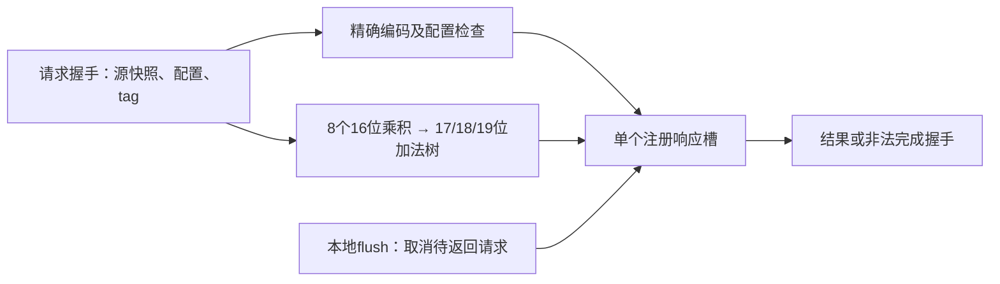

# 独立 vdot 硬件执行模块

合同 `vdot-s8x8-r32-v0.1`。生产源码：[VdotExec.scala](../../../src/main/scala/xiangshan/backend/fu/vector/VdotExec.scala)。采用精确的8路signed int8乘法和平衡加法树，可由处理器在退休前投机发射，响应携带身份并支持取消；不包含数值预测器或训练表。

本模块已能独立生成SystemVerilog并用Verilator仿真。当前不依赖香山参数或未初始化子模块；全核译码、调度、RF、写回、ROB及DiffTest接入仍待完成。这是T07的运算与局部控制实现，不等于T06/T07/T10整项验收。

## 接口与时序



| 输入 | 要求 |
| --- | --- |
| `in: Decoupled[VdotRequest]` | 仅在valid且ready时接受；阻塞时发送方保持请求 |
| `instruction` | 32位候选机器字，mask=`fe00707f`、match=`0200000b`；提取vd供适配层选择目的通路 |
| `src1/src2` | 各128位指令前源快照；低8字节参与，源数据必须由调用方正确重命名/读取，包括v0和别名 |
| `vl` | 8位实际VL，必须来自对应指令的物理VL源，合法值8 |
| `vtype/vstart/vs` | 对应指令的64位vtype、64位vstart及2位VS快照；vtype仅允许vta/vma两位，vstart=0，VS非Off |
| `tag` | 可配置宽度、默认16位；opaque标识，由适配层关联robIdx/pdest/PC等。模块不猜测这些元数据的格式 |
| `flush` | 对模块唯一pending请求的本地取消；优先于输入/输出握手，拉高时两种握手都被禁止，时钟沿清空pending |

`out: Decoupled[VdotResponse]` 返回tag、架构vd、完整128位data、illegal/cause、writeEnable及setVsDirty。合法低32位精确补码、高96位零；非法cause=2/data=0，两种副作用使能为0，但仍形成完成响应。非法data为占位值，适配层不得写RF或丢弃异常完成。

`pendingTag: Valid[tag]`输出槽内身份，其valid不受flush屏蔽；适配层可通过它查询ROB元数据并选择本地flush，避免将out.valid反馈到flush形成组合环。pendingTag.valid为0时bits无语义；它不是额外的完成通道。

空槽或旧响应即将握手时可接受新请求；无反压延迟为一个时钟，连续吞吐最多每周期一条。只有一个待返回槽，输出阻塞时停止接受输入并保持全部响应字段。时钟沿复位清空有效位，out.valid为0时data/tag不提供语义保证。

`writeEnable/setVsDirty`是随响应保持的控制字段，由适配层在out.fire时采样；架构目的/VS效果必须等对应指令成功退休。flush不会撤回此前已out.fire的响应，该请求的后续取消由处理器ROB/提交回滚机制负责。本地flush不能直接代替全核redirect：适配层应依据pendingTag关联的ROB年龄仅取消应被squash的pending请求，保留更老请求，并在发射入口过滤同周期应取消的新请求。

非匹配编码送到本模块端口会返回拒绝响应；全核译码只应路由精确vdot，其他编码由原译码处理，不能把本模块的防御性检查扩大成拒绝全部custom-0。

## 独立验证

Linux/WSL在仓库根执行：

```bash
bash team/scripts/vdot-hardware-tests.sh
```

需要Java、sbt、Verilator与g++；首次构建下载固定依赖。若使用单独的sbt launcher，可设置`VDOT_SBT_LAUNCH_JAR`，可选`VDOT_SBT_REPOSITORIES`指定本机仓库配置。`TEAM_EVIDENCE_DIR`调整输出目录，`BUILD_JOBS`默认2限制JVM可见处理器；脚本不安装或替换本机工具。

隔离构建采用当前根build.sc的Scala2.13.15、Chisel6.6.0、chiseltest6.0.0；独立sbt1.10.2、ScalaTest3.2.19。根build.sbt保留较老构建配置，因此本模块验证使用本目录build.sbt。该构建直接编译上面的生产源码，没有复制另一份运算实现。生成的SV记录firtool版本；默认不生成波形。

- 当前12022模型向量：expanded10304合法项（304定向及10000固定随机）、37异常项、64个vtype单bit、全部256种8位VL、64个vstart单bit、17个固定编码位翻转及1280个signed-byte乘法输入。11587项合法、435项拒绝；初次3022项记录保留为历史阶段。
- 期望来自现有独立Python模型；乘法额外遍历每个signed byte与-128/-1/0/1/127，轮换8个lane并污染被忽略的高半部分。没有穷举全部8项组合。
- 反压12周期全部字段稳定，旧响应退休/新请求接受可同周期发生；非法请求同样完成且无写使能。
- flush覆盖输出阻塞及输入/输出原本同时可握手的周期，重提交未接受请求、occupied reset均检查。
- 4000周期固定随机气泡/反压/取消，以真实握手维护scoreboard；返回时核对tag、完整结果、vd、异常及使能，并核对accepted=returned+cancelled。

脚本入口先失效旧check.json，再生成RTL并lint，运行四个接口测试；失败重跑不得保留旧PASS。保存实际命令、版本、源码/向量/RTL摘要、原始日志和绑定源码/向量的check.json；生成SV保留在忽略的team/out，按仓库规则不进入日常Git。测试过程末尾拒绝输入或源码漂移。失败信息展开指令、源值、配置、tag/编号及完整期望/实际目的，版本由向量manifest绑定。[本次证据](../../evidence/vdot-hardware-20261012/README.md)保留原始结果。

## 全核下一步

依 [rtl-interface.md](../../spec/rtl-interface.md) 完成精确译码/FU分类和源槽、物理VL依赖及配置快照；增加适配层关联ROB/pdest/PC，按年龄取消。随后接128位vec/v0写回，vdot结果绕开普通tail/mask合并，非法仍报ROB完成，成功退休置VS Dirty。最后验证W/V/E/C矩阵、全核DiffTest与真实硬件频率/面积，再决定是否增加流水级。本次周期数描述握手协议，未证明香山目标频率或性能收益。

复审问题、修复与最新验证见 [硬件模块审查](../../docs/vdot-hardware-review.md)。旧PASS失效及受控错误期望的负控验证失败检出能力，不能只以成功条数替代这些检查。
