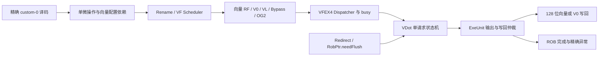

# vdot RTL 接口与香山接入设计（T06）

2026-10-13 T10/T11 本地 WIP：第 5 节所需的最小译码、固定单 uop、旧目的依赖关闭及 VFEX4 绑定已写入工作树，尚未完成 Scala 编译/RTL/全核验收。NEMU 补丁按 James 固定提交选择复用，未在本轮构建运行；当前结果和阻塞见 [本轮记录](../docs/t10-t11-20261013.md)。以下原 T06/T07 描述保留其历史时间边界，ISA 合同不变。

| 项目 | 内容 |
| --- | --- |
| 文档版本 | `0.1.0-draft`，2026-10-12 |
| 指令合同 | [`vdot-s8x8-r32-v0.1`](vdot.md)，本设计不改变语义或候选编码 |
| 硬件基线 | XiangShan `16ae9ddcda54fc9a2fddffad73174cf793ac7814` |
| 起草前团队提交 | `720dd3d668929123b8ab35e947c67f68ef595c65`，分支 `zjhwork` |
| 状态 | T07-A 算术与 T07-B 真实 FU 控制验证已通过；人工评审、译码/VFEX4 接入、NEMU 和全核验证待完成 |
| 责任 | A 负责接口和 RTL；B 复核合同、译码和 NEMU 对齐；C 复核时序、异常与验收；B/C 人工确认待记录 |

本文中的“源码事实”指已阅读锁定版本得到的结论，“拟实现”指下一步要写的代码，“验收要求”指尚未执行的检查。不得把拟实现的周期数、测试数量或预期信号写成实测结果。项目安排见[执行计划](../香山vdot赛题_执行计划.md)和[三人分工](../香山vdot赛题_三人分工与Git协作.md)。

2026-10-12 T07-A 更新：乘积/归约模块及组合连接顶层已经实现，见[算术单元说明](../rtl/vdot/README.md)和[通过证据](../evidence/rtl-datapath-20261012/README.md)。2026-10-13 T07-B 更新：第 3～4 节的真实 FU 接口/状态机及第 6 节的执行端配置检查已实现，通过 71,258 周期控制测试，见 [FU 说明](../rtl/vdot/FU.md)和[证据](../evidence/rtl-fu-20261013/README.md)。第 5 节的译码/资源接入与第 6 节的上游、ROB/CSR 集成仍待实现或验证。

## 1. 首版方案及边界

**已实现独立 `VDot` 功能单元，采用单请求在途、可反压、可取消的非流水接口；拟在 T10 接入现有 `VFEX4`。** 内部按输入寄存、乘法、加法树、响应保持推进；接入后复用香山的向量重命名、发射、读寄存器、写回和 ROB 异常通路。后续测量证明瓶颈后，再做可重叠流水或资源复用优化。

源码事实：`Parameters.scala:456` 的 `VFEX4` 已含 `VfdivCfg/VidivCfg`，有三路向量读、一路 V0 读、一路 VL 读以及向量/V0 写回资源。`ExeUnit.scala:127` 对不定延迟执行单元维护 busy，输出是 `Mux1H` 选择并断言最多一个 FU 有效，不能把它当成自动仲裁多结果的队列。

选择此处可沿用不定延迟的反压与 busy 协议，但会和向量除法竞争资源，且首版不是每拍接收一条指令。已有向量乘加 FU 使用通用 mask/tail 合并，本指令需要完整覆盖 128 位目的，因此首版新增小型算术通路，暂不复用其内部乘法器。是否共享乘法器应另做面积与时序实验，不能仅凭复用名称认定成本更低。

T06 首次交付设计文档；T07-A 算术和 T07-B 包装层独立测试现已通过，接下来按 T10 接入全核。T08 NEMU 由 B 按相同合同推进。接口草案形成不等于 T06 全部验收完成，编码包装的一致性和人工评审仍须完成。



## 2. 算术数据通路

| 项目 | 拟实现及必须验证的条件 |
| --- | --- |
| 两个输入 | 各 128 位；`src(0)=vs1`，`src(1)=vs2`；取各自 `[8*i+7:8*i]`，`i=0…7` |
| 有符号转换 | 每个切片先解释为 `SInt(8.W)`，再相乘；不能先做 UInt 乘法后补符号 |
| 乘积 | 8 个精确的 signed 16 位乘积 |
| 平衡加法树 | `8×16 → 4×17 → 2×18 → 1×19`；每一级用保留进位的有符号加法，例如 Chisel `+&` |
| 最终范围 | `[-130048, 131072]`；19 位有符号足够，18 位不足以表示正端点 |
| 结果格式 | 19 位和先符号扩展到 32 位，再拼接高 96 位零；输出总宽度 128 |
| 非输入内容 | 两源高 64 位、旧 vd、mask 内容、vxrm/vxsat 均不得参与算术 |

负数示例：和为 `-8` 时，完整结果必须为 `0x000000000000000000000000fffffff8`。不能直接把 19 位和符号扩展到 128 位，也不能按 SEW=8 截断。

已在 `VDotDatapath.scala` 定义两个纯组合子模块：`VDotProducts` 接受两个 128 位源、输出 8 个 16 位乘积；`VDotReduce` 接受这 8 个乘积、输出完整 128 位结果。`VDotDatapath` 顶层连接两者并用于算术测试。包装层 `VDot` 已在两者之间插入乘积寄存器，输入和输出也按第 4 节寄存。这样测试与实际包装层使用同一份算术模块，避免各维护一套算法。

位置：`src/main/scala/xiangshan/backend/fu/vector/VDotDatapath.scala` 与 `src/main/scala/xiangshan/backend/fu/wrapper/VDot.scala` 均已新增。未修改外部 yunsuan 子模块。

## 3. 功能单元接口

### 3.1 复用现有 Bundle

包装层已继承 `VecNonPipedFuncUnit`，对外保持 `FuncUnitIO`；不另造与后端脱节的顶层请求协议。下表字段路径以 `io.in.bits` / `io.out.bits` 为基准，实际可选字段由 `FuConfig` 决定。

| 接口 | 类型/宽度 | 数据来源与处理 |
| --- | --- | --- |
| `io.in.valid/ready` | Bool | 只在 `in.fire` 时接受一次请求；未接受的数据不得进入运算 |
| `data.src(0/1)` | 各 128 位 | 已经过重命名读数和旁路选择的 vs1/vs2，接受时同时快照 |
| `data.src(2)` | 128 位 | 为兼容通用五源形状保留槽位；译码令该源 `SrcType.no`，算术不读取旧 vd |
| `data.src(3)` | 128 位 V0 槽位 | 算术不使用掩码；保留端口，以支持 v0 作为普通 vs1/vs2 时的路由 |
| `data.src(4)` | `VlData()`，本基线 8 位 | 实际 VL 的重命名依赖；`vconfigWakeUp=true`，沿用 `srcVConfig.vl` 读取方式 |
| `ctrl.vpu` | 现有向量控制 Bundle | 使用随该指令传来的 vill、vsew、vlmul、vm、vstart、vta/vma；不能读取执行时的全局当前 CSR 替代快照 |
| `ctrl.robIdx` | `new RobPtr` | 与结果同存同出，包含环形队列信息；用于取消，禁止只按数值大小比较 |
| `ctrl.pdest` | `PhyRegIdxWidth` | 物理目的号，与本次请求绑定；不是 ISA 的 5 位 vd 编号 |
| `ctrl.vecWen/v0Wen` | 可选 Bool | 合法响应保留译码后选择的目的类型；异常响应按第 6 节处理 |
| `ctrl.fuOpType` | 现有 FU 操作类型宽度 | 拟增加 `VDotOpType.s8x8`；其内部取值由实现统一定义，不等同机器码 funct6 |
| `perfDebugInfo` | 现有调试 Bundle | 使用已有非流水控制锁存方法，与请求身份同步 |
| `io.flush` | `Valid[Redirect]` | 计算保存请求的 `robIdx.needFlush(io.flush)` |
| `io.out.valid/ready` | Bool | valid 不依赖 ready；有效结果保持到握手或被匹配的 redirect 取消 |
| `res.data` | 128 位 | 合法时为完整目的结果；非法时置零作为确定的非架构占位值 |
| `ctrl.exceptionVec` | 现有异常向量 | 使用 `ExceptionNO.illegalInstr` 位，不能把异常码 2 直接当作整个 exceptionVec 的数值 |

**VL 源的特别约束：** `DataConfig.scala:21` 的 `VlData` 实际只有 8 位，尽管部分注释写着“vtype&vl”，且别名方法把它转换成 `VConfig`。VDot 只从这条数据依赖取 `.vl`；SEW/LMUL/vill 必须取 `ctrl.vpu`。不能把扩展出来的 `.vtype` 当作当前 vtype。内部 `VType.vsew` 是 2 位，完整 CSR 的保留位检查已在上游 vset 路径完成，通过 vill 表达非法性。

`VecNonPipedFuncUnit` 已调用 `connectNonPipedCtrlSingal`（源码即此拼写），用 `in.fire` 保存 ROB/目的/写使能等控制。新增 FSM 仍须显式保存算术输入、乘积、结果和非法标志，不能认为继承后自动获得 ready/valid 状态机。基类给出的 vstart 非法判定应包含在完整非法条件内，避免后面的 Chisel 赋值将它覆盖丢失。

### 3.2 已新增 `VDotCfg`

| 配置项 | 初版值及原因 |
| --- | --- |
| `fuType / fuGen` | 新增 `FuType.vdot` / 包装层 `VDot` |
| `srcData` | `Seq(Seq(VecData(), VecData(), VecData(), V0Data(), VlData()))` |
| `piped / latency` | `false` / `UncertainLatency()`；结果可能因反压延后 |
| `writeVecRf / writeV0Rf` | 均为 true，表示支持两类目的端口；单次合法请求实际只使能一类 |
| `destDataBits` | 128，构建要求 `VLEN == 128` |
| `vconfigWakeUp / maskWakeUp` | 均为 true，保持现有五源数据接口和 V0 源路由 |
| `exceptionOut` | `Seq(illegalInstr)` |
| `writeIntRf/writeFpRf/writeVlRf` | false |
| `writeFflags/writeVxsat` | false，无舍入/饱和/浮点标志副作用 |
| `needSrcFrm/needSrcVxrm` | false |
| `maybeBlock` | 沿用 VidivCfg 的默认 false；本基线不能靠此字段自动生成反压逻辑 |

同时把 vdot 加入 `FuConfig.needVecCtrl` 和 `isVecArith`，使 `needOg2` 正确；把 `FuType.vdot` 加入 `vecOPI`，让 `vecArith/vecAll`、VS 禁用检查和向量提交分类包含它。`FuType` 是枚举/one-hot 体系，应使用已有 `addType` 机制并避免重排既有类型。

拟将 `VDotCfg` 加入 `allConfigs` 便于配置列举；`VecArithFuConfigs` 是另一个列表，当前并不含 Vidiv。若在该列表加入 VDot，应一并检查 `ExeUnitParams.hasVecFu` 的全部使用处，不能靠这个列表替代 `needVecCtrl/isVecArith` 的实际接入。本基线全源码搜索中 `hasVecFu` 只有定义，仍在实现时重查。

不改写 `CertainLatency(2)` 来表示两段内部计算：后者还影响 ExeUnit 的外部 ctrl/valid 管线。首版采用不定延迟接口，并在测试中单独测量“结果产生时间”和“响应被接收时间”。

## 4. 时序、反压和取消

### 4.1 状态机和周期定义

已实现四态 `IDLE → MUL → REDUCE → RESP → IDLE`，最多一个请求在途。不做 RESP 同拍接收下一条请求的旁路优化。实现额外在 reset 期间同时关闭 in.ready/out.valid。

| 当前状态 | 本拍动作及下一状态 |
| --- | --- |
| IDLE | `in.ready = !io.flush.valid`，`out.valid=0`；`in.fire` 时保存两个源、配置合法性、身份和控制，进入 MUL |
| MUL | `in.ready=0`；从保存的两个源生成并寄存 8 个 16 位有符号乘积，进入 REDUCE |
| REDUCE | `in.ready=0`；从保存的乘积求和，寄存 128 位结果和异常信息，进入 RESP |
| RESP | `in.ready=0`；若未取消则 `out.valid=1`；`out.ready=0` 时保持全部响应字段；`out.fire` 后回到 IDLE |

无反压、无取消时，以请求在上升沿 E0 被接受为起点：

| 上升沿/区间 | 可观察事件 |
| --- | --- |
| E0 | 输入握手，保存源与身份；沿后处于 MUL |
| E1 | 保存乘积；沿后处于 REDUCE |
| E2 | 保存完整结果；沿后处于 RESP，`out.valid` 开始为 1 |
| E3 | 最早的输出握手；沿后回到 IDLE |
| E4 | 最早的下一条输入握手 |

因此本方案的时序为：E0 到结果 valid 为 2 个完整周期，E0 到最早输出握手为 3 个周期，单元请求启动间隔最小 4 周期。T07-B 的逐拍测试已验证该接口时序及反压下的延后，采用“上升沿接受、沿后输出”的计数口径。它们不是 CPU 指令依赖延迟或全核吞吐；OG2、调度、读数、旁路和写回竞争还会增加全核时间。

非法配置也走一次有身份的响应，可把无用乘积和结果置零；不为异常设计第二套延迟承诺。有限时间内完成的活性要求以“未被取消且下游最终 ready”为前提；永久反压时不能承诺固定完成周期。

### 4.2 控制优先级

1. reset：清空有效状态并进入 IDLE，不产生响应。
2. 在途请求命中 `savedRobIdx.needFlush(io.flush)`：当拍屏蔽 `out.valid`，清除占用；取消优先于 out.ready 和计算推进。
3. RESP 下 `out.fire`：仅完成一次响应并释放占用。
4. 其他状态按表推进，IDLE 下仅 `in.fire` 才锁存请求。

该基线的 `RobPtr.needFlush` 包含环形年龄比较，以及 redirect 是否连自身一起取消。较老请求若不命中则继续运算；不能一见任意 redirect 就丢弃所有在途请求。首版对 redirect 当拍的新输入统一拉低 ready，允许上游以后重试，避免新接受与取消竞态；这个保守一拍阻塞不改变旧请求是否应存活的规则。

响应在反压期间必须保持 `res.data/robIdx/pdest/exceptionVec/写使能` 不变；如果中途发生匹配的取消，则允许撤销 valid，后续不得再输出该请求。valid 不能写成 `RESP && ready`，否则既破坏稳定性检查，也可能造成握手死锁。

### 4.3 与香山外层协议的对应

- `ExeUnit` 的不定延迟 busy 从输入握手保持到响应握手或 redirect 取消；VDot 的占用状态应与它一致。首版不允许本 FU 多请求在途。
- `ExeUnit.scala:322` 断言 FU 输出 one-hot。VDot 与同一 VFEX4 的除法 FU 交替工作、取消后切换 FU，也要保持该性质。
- `WbArbiter.scala:221` 为不定延迟结果返回仲裁 ready，说明结果确实可能等待。保持寄存结果是必要接口行为。
- `Og2ForVector.scala:55` 在执行端不 ready 时向 IQ 返回 block，走现有重试通路。不能假定 OG2 会一直保持一次失败请求，也不能把未发生 `in.fire` 的输入算作已接受。
- ExeUnit 的 FU 时钟使能也在输入/输出握手附近更新。取消后的重新发射、复位以及实际门控配置必须纳入接入验证，不能只测关闭门控的独立模块。

## 5. 译码、源依赖与接入文件

### 5.1 编码和单微操作

沿用候选常量 `MATCH=0x0200000b`、`MASK=0xfe00707f`，精确模式为 `b0000001??????????000?????0001011`。`vdot.vv v10,v8,v9` 的机器字为 `0x0284850b`。只有匹配精确模式才进入 vdot；不能把整个 custom-0 opcode 都标为向量。

拟使用独立 `UopSplitType.VEC_VDOT`，在现有 6 位空间选未占用值，保留 `needSplit` 所需的位判定，不在本文提前硬编码编号。`UopInfoGen` 明确返回 `numUops=1、numWB=1`，`DecodeUnitComp` 只生成一个 uop，`uopIdx/vuopIdx=0`，first/last 均为 true。

即使传入不支持的 LMUL，也不能先按普通 VEC_VVV 展开成多个 uop 再让各个 uop 报错。它应作为一条非法指令处理。也不能借用 VEC_VRED：其旧目的、局部写回、归约语义与本合同不同。

最终有效 uop 控制应满足：

| 控制/源 | 初版要求 |
| --- | --- |
| `srcType(0/1)` | 向量源 `SrcType.vp`，逻辑编号为 vs1/vs2，保持原顺序 |
| `srcType(2)` | `SrcType.no`，`isDependOldVd=false`，`isWritePartVd=false` |
| `srcType(3)` | 无掩码运算依赖；任一普通源为 v0 时，保留 DecodeStage 建立的 V0 依赖 |
| `srcType(4)` | `SrcType.vp`，逻辑源为 `Vl_IDX`；保留 VL 读依赖 |
| 目的 | 单个 vd，无寄存器组偏移；初始 vecWen=true，随后由现有 DecodeStage 把 vd=0 转换为 v0Wen |
| 其他写回 | rfWen/fpWen/vlWen=false，不写 vxsat/fflags |
| 其他行为 | 不交换源、不访问内存、不请求分支跳转；不主动制造 flushPipe/blockBackward，已有异常/序列化控制由原通路处理 |

`DecodeUnit` 和 `DecodeUnitComp` 有通用字段赋值，尤其非零 vstart 会设置序列化/flush 标志；实现要检查最后一次赋值后的有效 uop，不能只在译码表里填对后就认定成立。vstart 非法必须优先交给精确异常路径，不能借通用正常提交行为先清零后执行。

### 5.2 v0、别名和完整写回

源码事实：`DecodeStage.scala:236` 把 vd=0 路由到独立 v0Wen；`DecodeStage.scala:239` 为向量源 v0 设置第四源依赖。`DataPath.scala:686` 读取 V0，`BypassNetwork.scala:156` 和 `169` 在普通源需要 v0 时选择第三号槽位数据。因此，即使 `vm=1`，也不能删掉 `V0Data` 端口。

包装层看到的 src(0/1) 应已是替换后的最终数据，不要再次依据 ISA 编号自行从 mask 槽取数。接受时同时快照两源，目的寄存器的分配仍交给正常 Rename，支持 vd=vs1、vd=vs2、vs1=vs2、三者相同及 v0/v31。

本指令完整覆盖目的，不实例化通用 `Mgu`。不能复制 VIDiv 的 `vl==0 → oldVd` 分支，也不能让 vta/vma 决定保留旧尾部。`EntryBundles.scala:295` 的旧 vd 依赖消除与 vl/vta 有关，因此在本指令译码时就明确关闭 src(2) 依赖；不是寄希望于普通 tail 优化自动消除它。

### 5.3 按顺序修改的清单

下列均为仓库根相对路径；“核查”不代表必须改通用模块。首版优先局部增加分支，不改既有指令行为。

| 顺序 | 文件（`src/main/scala/xiangshan/` 下） | 具体工作与检查点 |
| --- | --- | --- |
| 1 | `backend/fu/vector/VDotDatapath.scala`（新增） | 有符号乘积、逐级扩位、完整输出；先跑 T05 数据 |
| 2 | `backend/fu/wrapper/VDot.scala`（新增） | 四态控制、元数据绑定、反压、取消、异常和合法输出 |
| 3 | `backend/fu/FuType.scala`、`FuConfig.scala` | 新类型、操作类型定义入口、配置及向量分类，检查可选 Bundle 字段实际存在 |
| 4 | `backend/decode/Instructions.scala`、`VecDecoder.scala` | 新精确 BitPat 与 OPIVV 类控制项，显式 `src3=SrcType.no`，禁止饱和标志 |
| 5 | `backend/decode/isa/bitfield/RiscvInst.scala` | `isVecArith` 增加精确模式；原来只识别 OP-V |
| 6 | `package.scala`、`backend/decode/UopInfoGen.scala`、`DecodeUnitComp.scala` | 专用 split 类型、恒定一个 uop/一次完成及最终源/目的字段 |
| 7 | `backend/decode/DecodeUnit.scala`、`VecExceptionGen.scala` | 核查默认赋值/VS Off；增加匹配 vdot 的 e8/m1 等限制，不影响标准 RVV |
| 8 | `Parameters.scala` | 仅在 VFEX4 的 FU 列表加入 VDotCfg，首版复用现有 RF 端口和优先级 |
| 9 | `backend/decode/DecodeStage.scala`、`backend/rename/`、`backend/issue/`、`backend/datapath/` | 核查 v0、旧 vd、VL 唤醒、OG2 阻塞重试和写回；只有证据显示通用路径不适用时才改 |
| 10 | `backend/exu/ExeUnit.scala`、`backend/rob/Rob.scala` | 核查 busy、one-hot、异常完成、取消和提交；预期复用现有机制 |

后续全核配置仍用现有 MinimalConfig，完整依赖见 [versions.env](../versions.env)。不新增大配置构建、不修改子模块引用、不将构建产物/波形加入日常提交。T07-A 算术入口为 `bash team/scripts/check-vdot-datapath.sh`；T07-B FU 入口为 `bash team/scripts/check-vdot-fu.sh`，编译真实香山 Scala 依赖但只发射 FU 测试顶层，不构建 CPU。

## 6. 配置检查和异常完成

| 检查位置 | 责任 |
| --- | --- |
| 构建/elaboration | `require(VLEN == 128)`，源/目的宽度断言；不支持的 VLEN 拒绝构建 |
| 精确译码 | 固定 opcode/funct/vm 位必须匹配；相邻模式按整个 CPU 的真实译码处理 |
| Decode/VecExceptionGen | 保留 VS Off、vill、vstart 检查；为 vdot 增加 `vsew==e8、vlmul==m1` 限制 |
| FU 接受时 | 对本请求检查 `vill==0、vsew==e8、vlmul==m1、vm==1、vstart==0、实际 vl==8`，将非法标志锁存 |
| FU 输出 | 合法给完整结果；非法给 exceptionVec，并禁止目的写入，但仍提供一次响应 |
| ROB/CSR | 接收完成与异常，保证精确 trap、正确 PC 和无架构部分更新；沿用既有向量置脏与提交控制 |

执行端不具备独立 mstatus.VS 输入，VS Off 属于既有译码/特权检查职责，不能伪造 FU 端对 VS 的检查。所有 vta/vma 组合均合法；它们不参与拒绝条件或输出合并。

**已实现并单元验证的异常响应：** 保留原 robIdx/pdest 和有效响应，设置 illegalInstr，清零实际 `vecWen/v0Wen`（其余写使能原本为零），结果数据置零。另对不支持的内部 `fuOpType` 做相同的防御性拒绝，不改变 ISA 编码。源码支持的依据是 `WbArbiter.scala:177` 存在所有写使能为零的 `notWrite` 路径，不定延迟端可据此 ready；`347–379` 将 EXU 的 `input.fire` 送往控制块，而非要求发生寄存器写入；`Rob.scala:1183` 从有效 writeback 记录异常。单元已验证一次响应，接入仿真仍须证明后续 ROB/忙表没有死锁。

前端已发现的非法状态可能直接进入已有异常处理路径，未必真正发射到 FU；单元测试可以直接注入对应控制以覆盖防御性检查。不要要求“每个非法全核用例都必须经过 VDot FU”来证明正确性。

异常时“无目的写入”与正常指令被后续 redirect 回滚是两种情况：后者可能已经做过物理寄存器推测写回，要求是不得提交为架构结果。尚在 FU 内且命中取消的请求应不再输出响应。测试应按这两个边界判断。

ROB 的向量置脏/vstart 清零与 commit 相关，`Rob.scala:691–715` 另有异常分支。VDot 不直接改 CSR；尤其非零 vstart 的非法指令须验证陷阱前后保留该值，不能以“正常向量指令会清零”替代异常测试。

## 7. 验证矩阵和断言

下表算术单元已在 T07-A 通过，见[算术证据](../evidence/rtl-datapath-20261012/README.md)；包装层配置、握手、反压、身份、取消/环绕及复位的独立 FU 场景已在 T07-B 通过，实际覆盖范围见 [FU 证据](../evidence/rtl-fu-20261013/README.md)。译码、真实寄存器依赖、共享 EXU/门控、全核/异常及回归项仍待 T10/T11。T05 Python 参考模型的[通过记录](../evidence/model-20261012/README.md)单独保留。不重新生成测试数据，不改变 manifest 或期望值来迁就 RTL。

| 层次 | 用例/刺激 | 必须比较或观察 |
| --- | --- | --- |
| 算术单元 | `directed.jsonl` 22 组 + `random.jsonl` 10,000 组 | 每一组完整 128 位与独立模型一致，包括负数、高位零、两源高半干扰 |
| 包装层配置 | 合法策略位四组合；逐项非法 SEW/LMUL/VL/vstart/vill/vm | 合法全覆盖；非法返回一次异常且写使能全零；不要把硬件配置错误当运行时 trap |
| 输入控制 | valid 连续为 1、忙时更换后续请求、插入空拍 | 只在 fire 快照；未接受请求不产生结果；无丢失或重复 |
| 输出控制 | ready 固定 1；RESP 阶段阻塞 1/2/7 拍；固定种子随机阻塞 | result/ROB/pdest/异常/写使能在等待时稳定；解除阻塞只完成一次 |
| 身份绑定 | 顺序改变 robIdx/pdest、合法非法交替、同目的连续请求 | 结果不串单；scoreboard 按已接受身份匹配，不只按输出顺序比数值 |
| 取消 | MUL、REDUCE、RESP 阻塞期间；RESP 且 ready=1 同拍 redirect | 被命中请求无后续响应；取消优先于输出握手；随后请求正常 |
| 取消边界 | 较老请求存活、redirect 自身两种 flush level、ROB 环绕、空闲时 redirect | 与 `RobPtr.needFlush` 一致，不使用普通整数大小近似 |
| 复位 | 各占用状态中 reset；取消后重新发射 | 无幽灵响应，计数和状态清空；门控配置下仍能恢复 |
| 译码/uop | 全部 32,768 组 vd/vs2/vs1 编号；固定模式位翻转；非法 LMUL | 精确匹配和字段还原；每条 vdot 一个 uop/一次完成，固定字段翻转不误识别 |
| 寄存器/依赖 | v0/v31、全部别名形式、四种策略位、vset 后紧接 vdot、源生产者后紧接 vdot | 用实际执行前源快照；等待正确 VL 与数据；TU/MU 不引入旧 vd 语义 |
| 共享 EXU | vdot 与 vdiv/vfdiv 交替、写回竞争、OG2 发射失败重试、取消后换 FU | busy 无死锁，FU 输出 one-hot，重试不造成重复执行 |
| 全核/异常 | `smoke.jsonl` 54 组；可达非法状态；目的/CSR 哨兵 | 完整结果及 trap PC/cause；无架构部分更新，CSR 副作用符合合同 |
| 回归 | 已有 hello/vadd；vdiv/vfdiv 相关用例；NEMU 扩展后的 DiffTest | 标准指令仍正确；未扩展的 NEMU 不能用于宣称 vdot DiffTest 通过 |

`state.jsonl` 的 69 组不能无差别全部变成 FU 事务：`ok/illegal_instruction` 根据适用字段测试；`decoder_reject` 属于译码层；`unsupported_configuration` 属于构建/模型配置层；人工注入的原始 CSR 非法状态不一定能由标准指令独立构造。相邻机器字可能是合法标量指令，应检查“不是 vdot”，而非强迫它们全部 trap。

拟添加的关键断言/scoreboard 条件：

- 任意时刻 `accepted - responded - killed` 为 0 或 1；各项按接受后的事务统计，reset 重置计数。
- `out.valid` 必有尚未响应且未取消的请求；没有 fire 不推进输入身份。
- `out.valid && !out.ready` 后下一拍若无 reset/命中取消，valid 与全部响应字段稳定。
- 命中取消当拍 `out.valid==0`；该身份不再响应。不能把它与已退休的同值 ROB 槽位混淆，需保留环绕标识。
- 合法响应的 `vecWen XOR v0Wen` 为真，其他寄存器类写使能为零；异常响应全部写使能为零。
- 合法结果 `[127:32]==0`；观察 19 位和与参考值，不以 8/16 位中间截断掩盖溢出。
- 不定延迟 VFEX4 内 `PopCount(fuOutValidOH)<=1`，外层已有断言必须保持开启。

有限仿真检查不等于形式证明；记录每个控制场景实际覆盖情况。后续故障注入应至少证明测试能抓到负数处理错误、高位污染和取消后错误响应。

## 8. 实施顺序、三人交接与完成标准

| 批次 | 主要负责人 | 可执行工作和交付 | 进入下一批的条件 |
| --- | --- | --- | --- |
| T06 评审 | A 起草，B/C 复核 | 核对本文件第 2～6 节；确认内部原型语义仍待官方澄清；留下姓名/日期/问题及处理 | 接口冲突已记录并解决，未解决项不标为冻结 |
| T07-A 算术 | A；C 验证 | 写算术模块和真实 RTL 测试入口；复用既有 JSONL，不复制 Python 模型成测试期望算法 | 22+10,000 组完整结果通过，保存命令/日志/提交 |
| T07-B 包装 | A；B/C 复核 | 写四态包装层和 FU 配置，补反压/取消/非法配置/身份测试 | 第 7 节对应单元项通过；独立 elaboration 成功 |
| T08 对齐 | B；C 验证 | 独立 custom-0 NEMU 分派、完整目的写入和非法状态检查；落实外部 NEMU 代码交付 | 可复现的 NEMU 单测和实际参考库版本记录；不误进 OP-V vadd 分派 |
| T10 接入 | A；B/C 复核 | 按第 5.3 节接译码/调度/写回；先编译最小配置，再构建全核 | hello/vadd 回归、真实 vdot 冒烟及异常/别名/共享 EXU 用例通过 |
| T11 及后续 | C 汇总，A/B 修复 | 正确参考库的 DiffTest、故障注入、RVV 等价基线与性能数据 | 先正确后优化；测量方法先成文，再解释加速来源 |

基线正确后，优化可以比较：去掉输入寄存级、分段加法树、允许响应与下一请求交叠、迁移到专用/流水执行资源、复用现有乘法资源。每次只改一个主要因素，重新验证握手/取消/one-hot 与结果。若改变延迟模型，要同步 `FuConfig`、busy/唤醒、写回竞争和测试；不能只把 `piped` 改成 true。

性能报告分别列单元结果产生延迟、接受间隔、全核依赖链周期、独立指令吞吐以及硬件成本。原型按单请求方案实现是正确性起点，不预先承诺加速倍数、频率、面积或比赛得分。

协作交付仍留在 `zjhwork`。提交 RTL 时附任务号、合同版本、依赖提交、验证命令、证据路径和已知限制；本机推送命令为 `git push team zjhwork`。核心接口最终合并前由另外两名成员共同确认，当前文档不代签人工评审。

| T06 检查项 | 当前状态 |
| --- | --- |
| 固定版本源码、输入/输出字段、状态依赖和接入位置已核对 | 已完成源码静态阅读 |
| 数据宽度、单请求时序、反压、取消、异常和测试矩阵已给出 | 已形成第一版设计 |
| 官方对 v0.1 歧义的回复、团队接口人工签字 | 待记录，参见 [vdot.md 第 9～10 节](vdot.md#9-歧义清单与变更流程) |
| 组合算术编译和 RTL 仿真 | T07-A 已通过 22+10,000 组完整结果及低/高位读回比较器自检 |
| FU 包装层独立仿真 | T07-B 已通过 6 类场景、71,258 周期及身份/取消读回故障自检 |
| 共享 EXU/门控、全核 vdot 和 NEMU DiffTest | 尚未开展，不能据单元通过标记完成 |

## 9. 源码依据与复核方法

下表链接均固定到硬件基线提交，行号是原始源码位置；后续修改后行号可能变化。本文依据本机固定检出内容阅读，没有把远端默认分支当成构建版本。

| 核查对象 | 固定源码 |
| --- | --- |
| VFEX4 的资源与 FU 列表 | [Parameters.scala:444](https://github.com/OpenXiangShan/XiangShan/blob/16ae9ddcda54fc9a2fddffad73174cf793ac7814/src/main/scala/xiangshan/Parameters.scala#L444) |
| FU 控制/数据/握手与非流水控制锁存 | [FuncUnit.scala:18](https://github.com/OpenXiangShan/XiangShan/blob/16ae9ddcda54fc9a2fddffad73174cf793ac7814/src/main/scala/xiangshan/backend/fu/FuncUnit.scala#L18) |
| 非流水向量包装基类 | [VecNonPipedFuncUnit.scala:13](https://github.com/OpenXiangShan/XiangShan/blob/16ae9ddcda54fc9a2fddffad73174cf793ac7814/src/main/scala/xiangshan/backend/fu/vector/VecNonPipedFuncUnit.scala#L13) |
| Vidiv 配置模板 | [FuConfig.scala:566](https://github.com/OpenXiangShan/XiangShan/blob/16ae9ddcda54fc9a2fddffad73174cf793ac7814/src/main/scala/xiangshan/backend/fu/FuConfig.scala#L566) |
| 实际 VL 数据宽度 | [DataConfig.scala:21](https://github.com/OpenXiangShan/XiangShan/blob/16ae9ddcda54fc9a2fddffad73174cf793ac7814/src/main/scala/xiangshan/backend/datapath/DataConfig.scala#L21) |
| V0 目的分类 | [DecodeStage.scala:236](https://github.com/OpenXiangShan/XiangShan/blob/16ae9ddcda54fc9a2fddffad73174cf793ac7814/src/main/scala/xiangshan/backend/decode/DecodeStage.scala#L236) |
| V0 作为普通源的旁路 | [BypassNetwork.scala:156](https://github.com/OpenXiangShan/XiangShan/blob/16ae9ddcda54fc9a2fddffad73174cf793ac7814/src/main/scala/xiangshan/backend/datapath/BypassNetwork.scala#L156) |
| busy 与输出 one-hot | [ExeUnit.scala:127](https://github.com/OpenXiangShan/XiangShan/blob/16ae9ddcda54fc9a2fddffad73174cf793ac7814/src/main/scala/xiangshan/backend/exu/ExeUnit.scala#L127)、[输出断言:322](https://github.com/OpenXiangShan/XiangShan/blob/16ae9ddcda54fc9a2fddffad73174cf793ac7814/src/main/scala/xiangshan/backend/exu/ExeUnit.scala#L322) |
| 取消年龄与 flush-self | [RobBundles.scala:193](https://github.com/OpenXiangShan/XiangShan/blob/16ae9ddcda54fc9a2fddffad73174cf793ac7814/src/main/scala/xiangshan/backend/rob/RobBundles.scala#L193) |
| 无目的写入的完成通路 | [WbArbiter.scala:177](https://github.com/OpenXiangShan/XiangShan/blob/16ae9ddcda54fc9a2fddffad73174cf793ac7814/src/main/scala/xiangshan/backend/datapath/WbArbiter.scala#L177)、[完成传递:347](https://github.com/OpenXiangShan/XiangShan/blob/16ae9ddcda54fc9a2fddffad73174cf793ac7814/src/main/scala/xiangshan/backend/datapath/WbArbiter.scala#L347) |
| ROB 异常接收 | [Rob.scala:1183](https://github.com/OpenXiangShan/XiangShan/blob/16ae9ddcda54fc9a2fddffad73174cf793ac7814/src/main/scala/xiangshan/backend/rob/Rob.scala#L1183) |

在完整 WSL 仓库中可复核版本和源码差异：

```bash
cd /home/riscv/riscv-lab/xs-env/XiangShan
git branch --show-current
git rev-parse HEAD
git diff 16ae9ddcda54fc9a2fddffad73174cf793ac7814 -- src build.sc Makefile
rg -n 'VidivCfg|needVecCtrl|isVecArith' src/main/scala/xiangshan/backend/fu/FuConfig.scala
rg -n 'busyReg|fuOutValidOH' src/main/scala/xiangshan/backend/exu/ExeUnit.scala
rg -n 'notWrite|input.fire' src/main/scala/xiangshan/backend/datapath/WbArbiter.scala
```

原 T06 起草时上述硬件差异为空，HEAD 如文首所列；当次只更新文档。T07-A 后该差异包含新增组合算术文件和独立构建入口。两次均未重建 NEMU 或 emu；既有 hello/vadd 证据只能证明原基线，不代表 vdot 已接入。

原 T06 文档自检包括：表中的 13 处固定源码链接及行号与本机基线对应；本地 Markdown 目标和章节锚点存在；三份改动文档为 UTF-8/LF；当次未修改模型、测试向量或硬件源码。上述静态检查与 T07-A 新增的 RTL 仿真证据分别记录。
