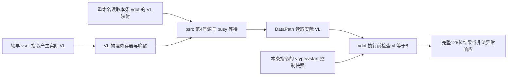
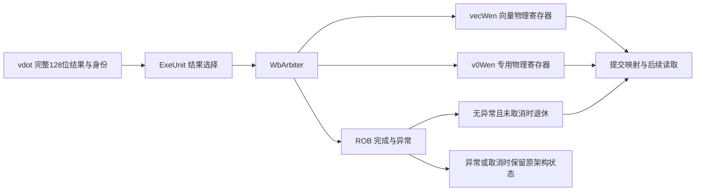

# vdot RTL 接入与验证接口草案

版本：`0.1.0-draft`，2026-10-11。适用合同：`vdot-s8x8-r32-v0.1`。

状态：已依据当前源码起草，尚无 vdot RTL 接入或仿真证据；本文件是 T06 的评审输入，不代表 T06 已验收。A 确定最终单元、端口和时序，B/C 复核配置、异常和测试；成员尚未签字。

关联：[指令合同](vdot.md)、[异常测试](exception-tests.md)、[进度](../progress.md)。阅读基线为团队提交 `c1ef31d81d50c209bf0e102af8ad7713c2da6dab`，硬件内容基于 `16ae9ddcda54fc9a2fddffad73174cf793ac7814`。下文区分已存在的通路与拟新增的 vdot 行为。

## 1. 源码证据与接入位置

| 已确认的现有实现 | 对 vdot 接入的约束 |
| --- | --- |
| [RiscvInst.scala](../../src/main/scala/xiangshan/backend/decode/isa/bitfield/RiscvInst.scala) 的 `isVecArith` 只分类 OP-V；[DecodeUnit.scala](../../src/main/scala/xiangshan/backend/decode/DecodeUnit.scala) 的 VS Off 检查依赖 `FuType.vecAll` | 精确识别候选 custom-0 编码，并进入向量分类、特权检查及微操作生成；不能把全部 custom-0 归为向量 |
| DecodeUnit 为第 4 号源设置 `Vl_IDX` / `SrcType.vp`；[Rename.scala](../../src/main/scala/xiangshan/backend/rename/Rename.scala) 为 `psrc(4)` 读取 VL 映射并做同批次旁路 | 保留本条指令的 VL 物理源依赖；不能从全局最新 CSR 读取替代 |
| [NewDispatch.scala](../../src/main/scala/xiangshan/backend/dispatch/NewDispatch.scala) 使用 `vlBusyTable`；[DataPath.scala](../../src/main/scala/xiangshan/backend/datapath/DataPath.scala) 第 4 号源读取 VL 物理寄存器 | 等待正确生产者写回，再发射；实际 VL 是数据依赖 |
| [DataConfig.scala](../../src/main/scala/xiangshan/backend/datapath/DataConfig.scala) 中 `VecData/V0Data` 是 128 位，`VlData` 是 8 位；[VSet.scala](../../src/main/scala/xiangshan/backend/fu/wrapper/VSet.scala) 分别输出 vl 数据和 vtype | VL 数据端口没有携带完整 vtype，必须分别核查两者 |
| DecodeUnit 从 `io.enq.vtype/vstart` 填入控制；[VTypeGen.scala](../../src/main/scala/xiangshan/backend/decode/VTypeGen.scala) 维护 speculative/architectural vtype，DecodeStage 接入恢复信号 | vtype/vstart 使用对应指令控制快照；沿用并验证配置更新与恢复机制 |
| [DecodeStage.scala](../../src/main/scala/xiangshan/backend/decode/DecodeStage.scala) 将目的 v0 转为 `v0Wen`；源包含 v0 时启用第 3 号源的 v0 通路 | vm=1 仍可能需要 v0 数据依赖，因为 v0 可作为普通源；不能删除该端口后默认别名成立 |
| [FuConfig.scala](../../src/main/scala/xiangshan/backend/fu/FuConfig.scala) 的 `VimacCfg` 实例化 [wrapper/VIMacU.scala](../../src/main/scala/xiangshan/backend/fu/wrapper/VIMacU.scala)，经 [Mgu.scala](../../src/main/scala/xiangshan/backend/fu/vector/Mgu.scala) 合并 tail/mask | 不机械复用普通向量合并；它可能恢复旧高位或写全 1 |
| [ExeUnit.scala](../../src/main/scala/xiangshan/backend/exu/ExeUnit.scala) 输出 data/robIdx/pdest/写使能/exceptionVec；[WbArbiter.scala](../../src/main/scala/xiangshan/backend/datapath/WbArbiter.scala) 分开向量、v0 和控制写回 | 128 位数据、请求身份、异常和对应写使能需要贯穿到写回及提交 |

上述是只读源码检查，没有证明新增单元已经获得调度端口或配置依赖。

## 2. VL 与配置来源

拟沿用的实际 VL 数据路径：

请求信息按现有接口组织；这不是已实现的新 Bundle 定义：

| 信息 | 候选来源与要求 |
| --- | --- |
| vs1/vs2 | 沿现有重命名与读数路径获得两个指令前 128 位源；低 8 字节参与运算 |
| 实际 vl | 保持第 4 号源 `VlData` 依赖，`vconfigWakeUp=true`，由本条指令绑定的物理源读取；值必须为 8 |
| vill/vsew/vlmul/vta/vma | 从本条指令控制中的 vtype 字段取得；合法要求 vill=0、vsew=e8、vlmul=m1；四种策略均接受 |
| vstart | 使用本条指令控制快照，合法要求为 0；核查 CSR 写入及已有序列化行为，不额外假设它也是 VL RF 数据 |
| vm/编码 | 精确译码为本版候选模式，vm=1；邻近编码独立检查占用后走原有译码 |
| VS/特权状态 | 接入原有向量分类与特权检查，在禁止状态下形成非法异常；不能仅靠乘加单元判断 |
| 请求身份 | 沿现有 robIdx、pdest、操作控制和取消标识传递；身份与源数据、配置同批接受和流水 |

`VecPipedFuncUnit.scala` 将 `getSrcVConfig` 转为 `VConfig` 并取 `.vl`，但 `VConfig` 类型含有 vtype，不等于 8 位物理端口传输了 vtype。vdot 的合法性判断必须分别取得实际 VL 和控制快照，不能从该 cast 的 vtype 字段推导 e8/m1/vill。

禁止用 AVL 常量、译码时假定值或较新 vset 的全局配置代替实际 VL。也不能为满足高位清零而把架构 vl 偷改成 16。A 应在 T06 记录每个检查发生的位置与快照来源，核验同批次重命名旁路、配置更新、异常恢复及 redirect 后的配置恢复。

建议先沿用现有源槽结构，再按证据减少依赖。算术不使用旧 vd，但通用派发仍可能保留旧目的依赖；保留时注明性能成本，删除时验证旧目的唤醒、别名和共享调度逻辑。不能只将 `srcData` 槽换成 `NoData`：FuConfig 的源位宽生成对寄存器类型集合取最大值，需同步验证生成逻辑。

## 3. 执行响应、异常与时序

建议为 vdot 设置专用运算与完整结果路径。选择独立 FU type 或既有向量 FU 内专用操作，由 A 结合资源决定；若新增 type，至少核查 `FuType.vecAll`、`FuConfig.needVecCtrl`、译码、微操作、参数、调度与写回端口，不能只增加算术类。

| 配置项 | vdot 所需行为 |
| --- | --- |
| 源数据 | 两个 128 位向量源、实际 VL；保留正确的 v0 读源通路和经确认的源槽结构 |
| 写回资源 | `writeVecRf=true`、`writeV0Rf=true`、`destDataBits=128`；每条合法指令只选一个实际目的通路 |
| 不写状态 | 不写整数/浮点/VL 寄存器，不写 vtype、vxsat 或 fflags；无舍入，不需要 vxrm 操作数 |
| 异常接口 | `exceptionOut` 包含 `illegalInstr`；非法配置仍形成有身份的完成/异常响应 |
| 流水配置 | 明确 `piped`、声明延迟、发射间隔与反压策略；本草案不填未测量周期数 |

在接受请求时关联合法性与身份，或将配置沿流水传至检查级；不能在输出阶段重新查询最新全局状态。正常结果为 `Cat(0.U(96.W), sum32)`；负数只在低 32 位内取补码。

晚发现非法配置时，输出 exceptionVec 的 illegalInstr，保留正常异常完成路径和请求身份，禁止目的及其他架构副作用。候选实现将故障响应的 vecWen/v0Wen 等目的写使能清零；必须同时验证无数据写回路径仍向 ROB 报告完成和异常、不会产生错误唤醒或等待死锁。不能单纯压低 out.valid 丢弃故障指令。

[FuncUnit.scala](../../src/main/scala/xiangshan/backend/fu/FuncUnit.scala) 的流水基类包含非零 vstart 的非法判断。新 wrapper 应明确汇总 `vstartIllegal/configIllegal` 等原因，不能用后一处赋值覆盖前一处条件。避免对输出 exceptionVec 自引用组合 OR；从独立条件构造最终值。

反压期间保持结果和身份。沿用基类 flush/ROB 取消机制，但测试必须证明各级取消后既无错误完成也无提交。较老异常前允许较年轻指令曾经投机执行；验收对象是精确架构状态，不能把“曾写过未提交的物理寄存器”直接判为架构提交。

## 4. 完整写回路径

1. **源及目的映射**：源绑定指令前物理寄存器，目的分配新映射；vd=vs1/vs2 时仍读取旧源。v0 源通过既有特殊源路径取得，不把 v0 当作零寄存器。
2. **算术与布局**：按 signed int8 乘法和足够宽的加法计算，符号扩展到 32 位，显式拼接 96 个零。不把完整结果当作普通 e8 的单个元素。
3. **tail/mask 边界**：建议 vdot 专用结果绕开普通 Mgu 合并；若在共享 wrapper 内选择，旁路只对精确 vdot 操作生效，旧指令继续原路径。不得修改 vta/vma/vl 后假称满足整寄存器合同。
4. **EXU 与仲裁**：核对 ExeUnit 输出 128 位未截断，robIdx/pdest/exceptionVec 与结果对应；在 WbArbiter 中正确进入 vec 或 v0 写回，同时发送控制完成。不能只接数据而遗漏完成。
5. **物理写回与架构退休**：普通目的使用 vecWen，目的 v0 使用 v0Wen，不能双写。核对 RF 读回与唤醒；[Rob.scala](../../src/main/scala/xiangshan/backend/rob/Rob.scala) / [ExceptionGen.scala](../../src/main/scala/xiangshan/backend/rob/ExceptionGen.scala) 按身份完成、选择异常和取消。A 仍需在接入后确认提交映射更新/回滚、VS 置脏及实际 DiffTest 状态导出。
6. **失败与观察**：配置非法和取消不得退休目的更新。按异常方案先捕获 CSR，再设置合法读回配置，保存完整 16 字节；不能只比较低 32 位。

## 5. 接入验收矩阵

下列编号细化规格 C01/L03/L04/L05 与配置用例；属于必需覆盖计划，尚未执行。

| ID | 层次与触发 | 观察与通过条件 |
| --- | --- | --- |
| V01 | 全核：vset 得到 vl8 后立即 vdot；然后 vl9 后 vdot；恢复 vl8 再 vdot | 三条分别成功/精确非法/成功，各使用自己的物理 VL；保存 PC、实际源 VL 与配置控制 |
| V02 | 全核：交替 e8/m1、e16/m1、e8/m2、e8/m1；补充实际 vill | 每条使用自己的 vtype 快照，非法不写目的；记录状态联动 |
| V03 | 全核：配置与 vdot 紧邻、同批次重命名、较老分支误预测后恢复配置 | 定位实际旁路/恢复事件；仅有短程序运行成功而没有触发证据不算覆盖 |
| W01 | 单元及全核：旧 vd 为 FF/交替位，正负和边界结果，四种 vta/vma | 全 128 位精确；高 96 位全零，低 32 位未截成 e8 |
| W02 | 全核：vd=vs1、vd=vs2、两源相同、三者相同 | 指令前源快照与 oracle 一致，未读取新目的映射 |
| W03 | 全核：v0 作源、作目的、源目的重叠；目的 v31 | 正确读源及 vec/v0 通路；后续立即消费结果也正确 |
| W04 | 全核：写同一目的后立即消费，再连续覆盖；交错普通 vadd/乘法/归约 | RAW/WAW 依赖正确，无串错身份；共享通路旧指令仍正常 |
| E01 | NEMU/全核：异常方案 X00～X10 的必需子例 | 精确 cause/PC、完整目的与 CSR 无部分更新，合法对照正常 |
| C01a | 单元：out.ready 拉低，输入连续送入 | 依据实际握手计数，结果及身份稳定、不丢失不重复 |
| C01b | 单元：连续接受不同输入、不同目的请求 | 每个已接受请求恰好一个对应响应；测量延迟和发射间隔 |
| C01c | 单元：在各有效流水级触发可取消的 redirect，包含反压 | 被取消身份无后续错误响应/提交，未取消较老请求正常完成 |
| C01d | 全核：较老分支误预测或较老异常，较年轻 vdot 已进入执行 | 明确观察到执行后 squash；较年轻目的不成为架构结果 |

VL/vtype 依赖压力测试在目标配置与 vdot 之间不插入 CSR 读回或其他可能序列化的观测操作；基础状态构造测试可读 CSR。压力测试从 RTL 依赖/执行日志记录实际 VL、快照、生产者/消费者身份，并在批次之后观察结果，否则容易用测试自身的序列化掩盖错误。

单元 scoreboard 按实际接受、响应、取消身份判定，定义同时发生 flush/握手时的优先级。全核记录退休、异常、redirect、目的通路与完整结果；新增临时观测点的名称由实现确定，本文不虚构已有日志字段。配置异常测试中，发生过投机写入不等于可接受部分架构结果。

## 6. T06 待决与交付

- [ ] A/B/C 复核本草案，确定独立 FU type 或已有 FU 内专用操作，以及精确译码/微操作数。
- [ ] 记录实际源槽、v0 普通源路由、VL 依赖、vtype/vstart 快照和特权检查的位置。
- [ ] 确定流水级、声明延迟、发射间隔、调度/读写资源及异常无数据完成机制。
- [ ] 最小接入验证 V01、W01、W03、E01；同时证明原有 hello/vadd 正常。
- [ ] 补齐 V02/V03、别名/依赖及 C01a～C01d 的触发证据，不能只以随机算术覆盖代替。
- [ ] 核对完整提交/回滚、VS 置脏和 DiffTest 的 128 位观察范围，保存配套 SHA、配置及日志。

T05 模型及 T05-E harness 已交付；T08 NEMU 扩展已通过 standalone 验收，参考库构建/加载通过，详见 [T08 记录](../docs/t08-nemu.md)。下一步 A 按本接口评审及接入，B/C 复核 T08 并推进 T09 baseline，C 推进真实全核差分验收；本接口的 RTL 实现检查项仍未完成。
