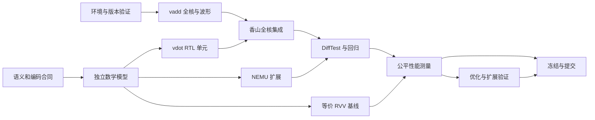

# 香山 vdot 赛题：执行计划

> **T15 交付进度（2026-10-17）：** T15 独立单元参数扩展已通过自动验收，用户已授权本批次上传至 zjhwork。T14/T15 的 G5 开发验证工作均完成；下一项为 T16 材料整合。详见 [最新进度](docs/progress-t15-20261017.md)。人工复核仍待完成；下方原阶段状态按历史时点保留。

> **实际进度（2026-10-17）：** T14 单一优化及消融已通过自动验收，当前位于 G5，T15 参数扩展尚未开始。完整完成项、待确认项及后续任务见 [项目进度表](docs/progress-20261017.md)；下文原计划和排期保留。

目标：在香山昆明湖 V2 上完成 vdot 自定义向量点积指令的设计、实现、协同验证和性能分析，并用可复现证据争取各评分项的优秀档。  
编制与联网核查日期：2026-10-09。  
配套文档：[三人分工与 Git 协作](香山vdot赛题_三人分工与Git协作.md)。

角色：A—RTL，B—语义/NEMU/baseline，C—验证/性能/集成交付。已知团队只有个人电脑，可用 Linux/WSL2；暂按每人每日 3–4 小时规划。下面是实施计划，**不是已经完成的开发或测试报告**。所列新脚本、新程序和新增模块需要团队按任务实现；构建命令已根据仓库和官方文档核对，但尚未在三位成员电脑上运行。

## 1. 总体策略与时间边界

官网当前报名及材料提交截止为 **2026-11-08 23:59:59，北京时间**。内部安排 **11 月 7 日完成提交**，11 月 8 日只处理提交补救。来源：[香山赛道](https://rv.cie.org.cn/direction?id=8)，2026-10-09 另通过官网公开接口核对。

先交付正确、完整、能复现的三阶段作品，再进行一项有数据支撑的硬件优化和一项可验证的扩展。完整性占 60 分，可行性占 20 分，探索性占 10 分，创新性占 10 分；九项详细证据清单见分工文档。内部可以按“争取 90 分以上的作品质量”检查，但不能把自评当作官方分数或获奖保证。

首版范围建议限定为：**单核、固定的昆明湖 V2 兼容基线、官方要求的点积语义、一条自定义指令、现有 RVV 组合基线、NEMU+RTL 协同仿真。** 额外模型演示、复杂编译器后端、FPGA 或完整大模型部署不进入首版关键路径。

本计划中的“阶段一/二/三”指赛题的技术递进阶段，并不等同于赛事的预赛、选拔赛、总决赛时间。高完成度目标是在首次截止前完成全部三个技术阶段。

## 2. 仓库调查结论与候选版本

### 2.1 两个入口仓库分别做什么

- **xs-env** 组织 XiangShan、NEMU、nexus-am 等子模块及开发环境。真正的处理器实现主要在 `XiangShan/`，参考模型在 `NEMU/`。
- **XiangShanLab** 提供课程、练习、比赛说明和提交入口。当前比赛目录为 `2026-CIE-RISC-V-Contest-Application-Track/`。
- 当前 xs-env 的 `setup.sh` 负责初始化等准备工作；`env-test.sh` 使用 NutShell。两者不能代替本项目所需的昆明湖向量程序验收。

来源：[xs-env 固定版本](https://github.com/OpenXiangShan/xs-env/tree/b0b506481e839a5df8a580e76f5aa246dc60fe7c)、[setup.sh](https://github.com/OpenXiangShan/xs-env/blob/b0b506481e839a5df8a580e76f5aa246dc60fe7c/setup.sh)、[env-test.sh](https://github.com/OpenXiangShan/xs-env/blob/b0b506481e839a5df8a580e76f5aa246dc60fe7c/env-test.sh)、[研习仓库比赛入口](https://github.com/OpenXiangShan/XiangShanLab/blob/master/2026-CIE-RISC-V-Contest-Application-Track/README.md)。

### 2.2 先锁定整组版本，再做兼容性验收

2026-10-09 读取官方仓库得到以下快照，建议作为首轮环境验证的**候选组合**：

| 仓库 | 固定提交 SHA |
| --- | --- |
| xs-env | `b0b506481e839a5df8a580e76f5aa246dc60fe7c` |
| XiangShan | `16ae9ddcda54fc9a2fddffad73174cf793ac7814` |
| NEMU | `a48a11f208ff81ad765591d83271d1b339fb3861` |
| nexus-am | `086a238062fdfb3281b745a537b361983d0154b5` |
| XiangShan/difftest | `62e4540c03c03aa947bdb67f4b6bf66f1a29c5d0` |
| XiangShan/yunsuan | `cadd3c2f43096e253d61296b33ac697be8354e29` |
| XiangShanLab，研习/提交资料快照 | `047b4479583f6c813c98f88992448ca3a88d36ad` |

当前 XiangShan 默认分支已是 `kunminghu-v3`，但上表 xs-env 固定的 XiangShan 提交属于 V2 分支历史。**不要直接克隆 XiangShan 默认最新分支，也不要把最新 V2 与旧 NEMU 任意混搭。** 若命题方提供特定教学提交，以该指定组合优先，并重新通过 G0。

C 在 `team/env/lock.md` 中记录所有顶层和递归子模块 SHA、工具版本、配置和来源。后续只升级确有必要的依赖；升级必须走独立 PR 和完整回归。正式提交前单独重新核对最新赛规/提交说明，不因此随意升级处理器源码。

版本依据：[xs-env 子模块配置](https://github.com/OpenXiangShan/xs-env/blob/b0b506481e839a5df8a580e76f5aa246dc60fe7c/.gitmodules)、[XiangShan 固定树](https://github.com/OpenXiangShan/XiangShan/tree/16ae9ddcda54fc9a2fddffad73174cf793ac7814)、[该提交与 V2 的比较](https://github.com/OpenXiangShan/XiangShan/compare/16ae9ddcda54fc9a2fddffad73174cf793ac7814...kunminghu-v2)。

## 3. 里程碑与依赖关系

| 门槛 | 日期 | 必须完成的结果 | 未通过时的处理 |
| --- | --- | --- | --- |
| G0 环境与合同 | 10/09–10/12 | 主机器能做向量全核冒烟；版本锁定；语义合同确认状态明确 | 当天处理资源/版本问题，继续模型和单元工作 |
| G1 阶段一 | 10/13–10/15 | hello、部署日志、vadd 波形与执行说明 | 不同时展开大量硬件改动，先获得可用调试基线 |
| G2 单元与参考模型 | 10/16–10/19 | vdot 单元与 NEMU 分别通过定向测试 | 用独立模型定位；暂不做性能优化 |
| G3 阶段二与差分接通 | 10/20–10/24，故障检出最迟 10/25 | 全核 vdot 正/负/边界通过，接通真实 DiffTest | 优先解决译码、状态和写回问题 |
| G4 阶段三 | 10/25–10/29 | 回归通过、等价 baseline、延迟与吞吐报告 | 暂停扩展，把完整三阶段做稳 |
| G5 优化与扩展 | 10/30–11/02 | 一项消融优化、一个额外参数配置验证 | 可撤回优化，保留稳定完整版本 |
| G6 冻结与复现 | 11/03–11/05 | 新目录复现通过、报告与版本一致 | 只修影响交付的缺陷 |
| G7 演示与提交 | 11/06–11/07 | 演示、作品仓库、加密信息 PR 和比赛系统提交 | 11/08 仅作提交补救 |



图中的 RTL、NEMU、baseline 可并行推进，但共同依赖语义合同。T09 只依赖 T03/T05：先在现有 RVV 平台对照独立模型验收 baseline，不等待 T07/T08/T11。T09 与 T12 均通过后，T13 再完成 baseline/vdot 的出口状态等价性检查和性能比较。优化不应阻塞稳定版本的提交。

## 4. G0：个人电脑准备、版本锁定和语义确认

### 4.1 第一件事是核查资源

官方环境文档列出 Ubuntu 22.04 LTS、最低 32 GB 内存、推荐 64 GB 及以上、至少 20 GB 磁盘。团队建议另留 **80–120 GB 空闲 SSD**，用于依赖、构建和少量波形，这是工程预留值，不是官方新要求。[官方环境要求](https://docs.xiangshan.cc/zh-cn/latest/tools/xsenv/)。

| 实际资源 | 计划安排 |
| --- | --- |
| 至少一台机器可向 Linux 提供约 32 GB 以上可用内存 | 作为主构建机，先单线程构建，再根据峰值内存调整 |
| 物理内存 32 GB 的 Windows 电脑 | 注意宿主系统还要占内存；不能等同于 WSL 获得 32 GB，先测实际配额和构建峰值 |
| 全部机器低于 32 GB | 模型、NEMU和小单元照常开发；尽早向实验室/命题方询问可用构建资源，或评估内存升级和临时计算资源 |
| 只有 8–16 GB 且无额外资源 | 全核构建属于关键风险，不能承诺靠 swap 一定解决；10/12 前必须落实可运行方案 |

不需要为了这道题优先购买 FPGA 或 RISC-V 板卡。核心交付可围绕软件仿真完成。算力不足时也不能把单元仿真包装成已经完成全核验证。

三人各执行并记录资源信息：

```powershell
# Windows PowerShell：只读检查
Get-CimInstance Win32_ComputerSystem | Select-Object TotalPhysicalMemory
Get-CimInstance Win32_Processor | Select-Object Name,NumberOfCores,NumberOfLogicalProcessors
Get-PSDrive -PSProvider FileSystem
wsl --status
wsl --list --verbose
```

尚未安装 WSL 时，先用 `wsl --list --online` 确认发行版名称，再按微软文档安装 Ubuntu 22.04，例如管理员 PowerShell 下执行 `wsl --install -d Ubuntu-22.04`。安装和重启由成员在自己的电脑上进行。使用 WSL2；内存/swap 配额根据机器实际资源配置，给 Windows 留出空间。[微软安装文档](https://learn.microsoft.com/en-us/windows/wsl/install)、[WSL 资源配置](https://learn.microsoft.com/en-us/windows/wsl/wsl-config)。

源码与构建放在 WSL 的 Linux 文件系统，例如 `~/riscv-lab/`，以减少跨文件系统开销。当前 Windows 目录可继续保存方案文档，不建议直接在 `/mnt/d/` 的共享工作树中进行大规模 Linux 构建。[微软文件存储建议](https://learn.microsoft.com/en-us/windows/wsl/filesystems)。

```bash
# 以下 Linux 检查和后续构建均在 Ubuntu/WSL2 Bash 中执行。
uname -a
lsb_release -ds
nproc
free -h
df -h .
```

### 4.2 环境安装与候选构建命令

A 负责主机器，C 同步记录，B 同时准备小型向量冒烟程序。以下命令用于候选基线；正式团队仓库建立后，改从团队顶层库检出相同提交组合。

```bash
mkdir -p ~/riscv-lab
cd ~/riscv-lab
git clone https://github.com/OpenXiangShan/xs-env.git
cd xs-env
git checkout --detach b0b506481e839a5df8a580e76f5aa246dc60fe7c
git submodule update --init --recursive

# 先检查该版本安装脚本；按其要求安装依赖。
less setup-tools.sh
sudo -s ./setup-tools.sh
# 锁定版本安装脚本使用以下工具路径；sudo 子进程的 export 不会传回当前 shell。
# 若实际安装路径不同，按安装日志调整后再执行。
export JAVA_HOME=/opt/graalvm-jdk-21
export PATH="$JAVA_HOME/bin:/usr/local/llvm/bin:$PATH"
source ./setup.sh
source ./env.sh

git rev-parse HEAD
git submodule status --recursive
verilator --version
java -version
clang --version
mill --version
```

环境入口设置 `XS_PROJECT_ROOT`、`NOOP_HOME`、`NEMU_HOME`、`AM_HOME` 等项目路径，不负责补全安装工具的 PATH。验证工具可用后，将所需工具路径配置到用户自己的 shell 初始化文件；后续每个终端使用环境前，在顶层重新 `source ./env.sh`。根据本次候选版本及实际生成的工具记录编译器、Mill、Java、Verilator 等版本，不混装另一篇教程的版本号。依据：[锁定版本环境说明](https://github.com/OpenXiangShan/xs-env/blob/b0b506481e839a5df8a580e76f5aa246dc60fe7c/README.md)、[JDK 安装脚本](https://github.com/OpenXiangShan/xs-env/blob/b0b506481e839a5df8a580e76f5aa246dc60fe7c/install-scripts/jdk.sh)。

先构建参考模型，再构建仿真器：

```bash
cd "$NEMU_HOME"
make riscv64-xs-ref_defconfig
make -j1

cd "$NOOP_HOME"
make emu CONFIG=MinimalConfig EMU_THREADS=1 JVM_XMX=12G -j1
./build/emu --help
```

候选 NEMU 配置已在源码中启用 RVV、向量 CSR 检查及共享参考模型。候选 XiangShan 的 `Parameters.scala` 设置 VLEN=128、HasVPU=true，`MinimalConfig` 没有将其关闭，**2026-10-09 已在本机完成 hello/vadd + NEMU DiffTest 验收；其他组员仍须使用相同启动镜像复现**。[NEMU 配置](https://github.com/OpenXiangShan/NEMU/blob/a48a11f208ff81ad765591d83271d1b339fb3861/configs/riscv64-xs-ref_defconfig)、[参数](https://github.com/OpenXiangShan/XiangShan/blob/16ae9ddcda54fc9a2fddffad73174cf793ac7814/src/main/scala/xiangshan/Parameters.scala)、[配置](https://github.com/OpenXiangShan/XiangShan/blob/16ae9ddcda54fc9a2fddffad73174cf793ac7814/src/main/scala/top/Configs.scala)。

`-j1` 控制构建并行度，`EMU_THREADS=1` 控制仿真器线程配置，二者用途不同。通过后可尝试 `-j2` 并记录峰值内存。不要直接照搬服务器上的 `-j32`。

通过 `/usr/bin/time -v` 等方式记录重型构建耗时和峰值内存；保证日志命令不掩盖编译失败。若使用 `tee`，脚本应开启 `set -o pipefail`。第一次先不输出全程波形。

### 4.3 最小向量冒烟验收

B 在 `team/workloads/hello-vadd/` 编写程序和 Makefile，使用锁定的 nexus-am、`ARCH=riscv64-xs` 构建；程序需要：

1. 完成必要的裸机启动和向量状态启用。
2. 设置合法 `vtype/vl`，加载两组小整数。
3. 执行 `vadd.vv`，将结果保存到内存并逐项核对。
4. 正常输出结果并通过仿真环境退出机制结束。

用实际交叉工具链反汇编，确认二进制含目标向量指令，而不是被编译器转换成标量循环。编译参数、ABI、启动代码与 ISA 支持要匹配。

```bash
# 模板：先由 B 实现 workload 和 Makefile，再替换实际产物路径。
cd "$XS_PROJECT_ROOT"
make -C team/workloads/hello-vadd ARCH=riscv64-xs

cd "$NOOP_HOME"
./build/emu -i <向量冒烟程序的绝对路径.bin> \
  --flash <两端共用的启动镜像.bin> --ram-size=128MB \
  --diff "$NEMU_HOME/build/riscv64-nemu-interpreter-so"
```

**G0 环境验收：** 有向量指令、运行结果正确、没有非法指令或未解释的差分错误；保存构建和运行命令、日志、版本、仿真配置和资源记录。`env-test.sh` 通过不能替代此验收。

**2026-10-09 实机补充：** 本机 WSL 已配置 20 GB 内存 / 16 GB swap，构建务必限制 `JVM_XMX`，避免使用 Makefile 默认的 40G。已编译阶段一测试位于 `/home/riscv/riscv-lab/workloads/hello-vadd`，Windows 归档位于 `doc/阶段一材料/workloads/hello-vadd`。固定 NEMU 与 DiffTest 的默认 flash 不同，运行必须显式传入共同的 `boot-flash.bin`；否则会在启动 ROM 阶段产生差分错误。使用本次 [构建与运行记录](docs/stage1.md) 和保存的脚本复现，不再直接套用缺少 flash 参数的模板。

### 4.4 同步完成指令语义合同

B 起草，三人共同复核，保存在 `team/spec/vdot.md`。当前官网示例使用 **8 对 int8**，不能因为 VLEN=128 就擅自改为 16 对；目的寄存器“第一个元素”具体位宽也需要确认。

| 合同项目 | 必须决定的内容 |
| --- | --- |
| 元素范围 | 参与计算的 lane 数及编号；源寄存器高半部分是否忽略 |
| 数值规则 | 有符号 int8、从零累加、是否精确累加、内部与结果位宽 |
| 结果布局 | 写入 `vd` 的具体位段；其他位如何清零；是否符号扩展 |
| 向量状态 | `vl`、SEW、LMUL、mask、`vstart` 的合法范围和不支持时的行为 |
| 副作用 | `vstart/vxsat/vxrm/vcsr` 等状态是否变化 |
| 编码 | opcode/funct、源目的寄存器字段、保留字段 |
| 寄存器别名 | `vd=vs1`、`vd=vs2`、`vs1=vs2` 的处理 |
| 硬件接口 | 请求/响应、反压、flush、标识、延迟与吞吐 |

明确的数学边界：8×127×127=129032；8×(-128)×127=-130048；8×(-128)×(-128)=131072。因此精确结果至少需要 19 位有符号表示。**32 位累加是候选工程方案；“低 32 位写结果、高 96 位清零”只能作为待确认建议，不是官网已明确规定。**

10/09 提出歧义清单并通过比赛咨询渠道确认，归档来源和答复。若 10/12 尚未得到答复，把内部原型假设显式登记、将位宽和 lane 数做成可调整参数，继续独立模型和单元工作；不得将未答复自动解释为官方认可，也不应在最终材料中隐藏假设。

## 5. G1：先完成可展示的阶段一

目标日期：10/15。A 主导波形和路径，B 主导程序，C 整理证据。

### 5.1 学习顺序

先掌握 Git/子模块与基本构建，再读 RVV 的寄存器、SEW/LMUL/VL、向量加载/存储和算术操作；随后跟踪一条 vadd。Chisel 学习只先覆盖 Bundle、Module、位宽、有符号运算、寄存器和握手接口。

阅读入口：[开发环境课程](https://github.com/OpenXiangShan/XiangShanLab/tree/master/xiangshan-course/docs/1-xiangshan-development-environment)、[编程课程](https://github.com/OpenXiangShan/XiangShanLab/tree/master/xiangshan-course/docs)、[官方 RVV 规范](https://docs.riscv.org/reference/isa/v20260120/unpriv/v-st-ext.html)。每学一个知识点，都在小程序或短波形中找到对应证据。

### 5.2 阶段一交付清单

- 按赛题要求输出 `hello xiangshan，我是xxx，IPaddress`，将 xxx 替换为团队/个人标识，IPaddress 替换为实际环境 IP；记录输出来自主机环境还是目标程序，按操作手册要求展示，不伪造运行来源。
- 完整部署与运行日志；除了最终成功截图，也记录重要问题和修复过程。
- 向量加法执行过程文档：指令字/PC、源数据、译码、发射、执行、写回、提交及最终结果。
- 一段可复现的操作录屏，能看到程序运行与主要结果。

### 5.3 短窗口波形

在独立调试工作目录或确认重新构建的配置中加入 FST 支持：

```bash
cd "$NOOP_HOME"
make emu CONFIG=MinimalConfig EMU_THREADS=1 EMU_TRACE=fst JVM_XMX=12G -j1
./build/emu -i <实际程序.bin> \
  --flash <两端共用的启动镜像.bin> --ram-size=128MB \
  --diff "$NEMU_HOME/build/riscv64-nemu-interpreter-so" \
  --dump-wave -b <开始周期> -e <结束周期>
```

周期窗口先由运行日志确定。配置变化后核对仿真器确实重新构建，不混用旧产物。报告中的信号名称以实际生成 RTL 为准；给信号附含义、位宽、所在模块和对应源码，避免只贴一张看不清的波形。

**G1 验收：** B/C 中至少一人从 A 的说明重跑程序；三人能够指着波形说明 vadd 从输入到提交的过程。阶段一材料先形成可提交版本，再继续深化。

## 6. G2：独立模型、RTL 单元和 NEMU 并行实现

目标日期：10/19。先做可验证的最小实现，再接入整个处理器。

### 6.1 B：数学模型与 NEMU

数学模型使用明确的有符号整数计算，先生成数值结果，再按合同编码到目的寄存器。不要照抄 RTL 的分组、截断或树形求和过程，保留参考实现的独立性。

NEMU 先读全体源操作数，再写目的，避免 `vd` 与源重叠时覆盖未读数据。配置检查、异常和 CSR 副作用都按合同实现。以下为锁定提交中的源码入口，而非要求全部修改：

| NEMU 相对路径 | 查看内容 |
| --- | --- |
| `src/isa/riscv64/instr/decode.c` | 主 opcode 分派 |
| `src/isa/riscv64/instr/rvv/decode.h` | 向量子译码 |
| `src/isa/riscv64/instr/rvv/exec.h` | 向量执行入口组织 |
| `src/isa/riscv64/instr/rvv/vcompute.h`、`vcompute_impl.c` | 向量运算入口与实现 |
| `src/isa/riscv64/instr/rvv/vreg.h`、`vreg_impl.c` | 向量寄存器访问 |
| `src/isa/riscv64/include/isa-all-instr.h` | 指令执行入口的声明组织 |
| `src/isa/riscv64/difftest/ref.c` | 参考状态同步 |

来源：[锁定 NEMU 的 RVV 目录](https://github.com/OpenXiangShan/NEMU/tree/a48a11f208ff81ad765591d83271d1b339fb3861/src/isa/riscv64/instr/rvv)、[主译码](https://github.com/OpenXiangShan/NEMU/blob/a48a11f208ff81ad765591d83271d1b339fb3861/src/isa/riscv64/instr/decode.c)。

自定义编码由合同集中管理。起步使用 `.insn` 或其他工具链支持的编码封装，检查实际机器码；不把修改 GCC/LLVM 后端作为首版前置条件。使用 custom 主 opcode 时，A/B 都要检查主译码与向量预分类；不能只在 RVV 子表新增一行。

第 4 节的 `riscv64-xs-ref_defconfig` 构建产物是供 DiffTest 加载的共享库，不是可以直接执行测试程序的 NEMU 命令。G2 优先在同一 NEMU 提交的独立工作目录构建 standalone 解释器，避免覆盖全核正在使用的共享库配置：

```bash
# 模板：独立工作目录已检出与共享库相同的 NEMU 源码提交。
(
  set -e
  cd "<NEMU独立工作目录>"
  export NEMU_HOME="$PWD"
  make riscv64-xs_defconfig
  make -j1
  ./build/riscv64-nemu-interpreter --help
  ./build/riscv64-nemu-interpreter -b "<测试程序绝对路径.bin>"
)
```

该配置启用 RVV；B 的裸机程序负责合法启动、启用向量状态、执行测试、存出完整结果并检查退出结果。先以 vadd 冒烟验证启动和设备地址，再跑 vdot。保存两个构建的配置和 SHA，G3 仍须重验实际共享库路径。来源：[standalone 配置](https://github.com/OpenXiangShan/NEMU/blob/a48a11f208ff81ad765591d83271d1b339fb3861/configs/riscv64-xs_defconfig)、[运行参数与初始化](https://github.com/OpenXiangShan/NEMU/blob/a48a11f208ff81ad765591d83271d1b339fb3861/src/monitor/monitor.c)。

若需要在 G2 直接测试共享参考库，可另做 `team/tests/nemu-driver/`：按锁定版本的 `difftest_init_v2`、`difftest_memcpy`、`difftest_regcpy`、`difftest_exec` 等接口初始化、加载、有限步执行并读取结果。严格匹配状态结构与复制方向，不猜测 ABI；不要把编写完整驱动变成首版额外前置任务。来源：[参考接口实现](https://github.com/OpenXiangShan/NEMU/blob/a48a11f208ff81ad765591d83271d1b339fb3861/src/cpu/difftest/ref.c)。

### 6.2 A：独立 vdot 运算单元

推荐结构为输入拆分与符号解释、乘积生成、扩展累加、结果布局、控制接口。具体乘法资源数量和流水级先选容易验证的方案，保留后续优化空间。

- 显式处理有符号乘法和中间位宽，禁止依靠不清楚的默认截断。
- 将 `elementBits`、`pairs`、`accBits` 等参数集中定义，参与元素数按合同设置，不自动等于 VLEN/SEW。
- 先验证算术和全宽清零，再加入/验证握手、反压及取消请求。
- 复用香山现有向量寄存器、发射、写回体系，不将 vdot 绕到一个与向量路径无关的外置演示模块。

### 6.3 C：便宜测试先行

为数学模型、RTL 单元、NEMU 使用同一输入集合，但预期值只来自独立模型。建议先完成下表定向测试，然后增加固定种子的随机测试；随机数量是团队计划目标，不是官方规定。

配置非法验证另落实 T05-E，按 [异常测试方案](spec/exception-tests.md) 实现 workload、预期陷阱入口、现场观察与失败汇总。方案在 10/14 前复核，基础设施目标 10/18；B 编写，C 验收，A 复核异常路径。先以已有指令自测入口及负控，合法 vdot 对照和异常执行等待扩展实现，在 T08/T11/T12 分层验收。VS Off、vstart 和 vill 用例须按方案安排准备/观察顺序，不能用非零退出码或未实现平台拒绝合法 vdot 作为通过证据。

| 用例类 | 最小代表例及目的 |
| --- | --- |
| 正数 | 全 1 点积为 8；[1…8] 与自身点积为 204 |
| 负数 | 全 -1 与全 1 为 -8；全 -1 与自身为 8 |
| 边界 | 129032、-130048、131072；全零和零乘任意输入 |
| 符号混合 | 正负抵消、正负交替 |
| lane 定位 | 每个参与 lane 单独非零，识别遗漏/交换 |
| 不参与位 | 若合同为 8 项，改动源高半部分不应影响结果 |
| 完整写回 | 先把 `vd` 填成非零，检查结果及其余清零位 |
| 寄存器别名 | 合同允许的源目的重叠 |
| 控制 | 连续请求、反压、取消后禁止错误结果 |
| 配置边界 | 按合同测试合法/非法 `vl/vtype/mask/vstart` |

**G2 验收：** 数学模型、RTL 单元与 NEMU 分别通过全部定向用例；至少一个固定随机种子可重跑；失败时能打印输入、期望、实际值和版本。接口、编码和语义没有未记录的临时改动。

## 7. G3：接入香山全核，完成阶段二并接通 DiffTest

目标日期：10/24 全核正/负/边界通过，最迟 10/25 验证差分机制确实能检出错误。

### 7.1 A 的源码阅读和接入顺序

以下路径相对于锁定版本的 `XiangShan/`。先跟踪一条已工作的向量乘法/归约指令，再决定复用现有执行单元还是增加单元；不是要求逐个文件都修改。

| 顺序 | 源码入口 | 要查清的问题 |
| --- | --- | --- |
| 1 | `src/main/scala/xiangshan/backend/decode/Instructions.scala` | 新指令匹配位和现有指令是否冲突 |
| 2 | `backend/decode/isa/bitfield/RiscvInst.scala`、`backend/decode/DecodeUnit.scala` | 自定义主 opcode 能否被正确分类并进入向量路径 |
| 3 | `backend/decode/VecDecoder.scala` | 源寄存器、向量目的、操作类型、旧目的依赖等译码控制 |
| 4 | `backend/decode/UopInfoGen.scala`、`VecExceptionGen.scala` | LMUL/微操作拆分和不支持配置的处理 |
| 5 | `backend/fu/FuType.scala`、`FuConfig.scala` | 单元选择、源类型、延迟、写回及流水属性 |
| 6 | `src/main/scala/xiangshan/Parameters.scala` | 执行队列和向量执行端口的配置 |
| 7 | `backend/fu/wrapper/VIMacU.scala`、`VIPU.scala` | 实际启用的向量乘法/归约包装和运算单元接口 |
| 8 | `backend/fu/vector/VecPipedFuncUnit.scala`、`Mgu.scala` | 向量功能单元接口及 mask/tail 合并对结果的影响 |

表中以 `backend/` 开头的路径，完整前缀均为 `src/main/scala/xiangshan/`。特别注意：本版本的 `backend/fu/vector/VIMacU.scala` 等存在旧代码/注释，不能只按文件名修改；应从 `FuConfig.scala` 中实际实例化关系跟到 `wrapper/` 下的实现。

来源：[锁定版本译码目录](https://github.com/OpenXiangShan/XiangShan/tree/16ae9ddcda54fc9a2fddffad73174cf793ac7814/src/main/scala/xiangshan/backend/decode)、[FuConfig](https://github.com/OpenXiangShan/XiangShan/blob/16ae9ddcda54fc9a2fddffad73174cf793ac7814/src/main/scala/xiangshan/backend/fu/FuConfig.scala)、[实际 wrapper 目录](https://github.com/OpenXiangShan/XiangShan/tree/16ae9ddcda54fc9a2fddffad73174cf793ac7814/src/main/scala/xiangshan/backend/fu/wrapper)、[向量公共实现目录](https://github.com/OpenXiangShan/XiangShan/tree/16ae9ddcda54fc9a2fddffad73174cf793ac7814/src/main/scala/xiangshan/backend/fu/vector)。

实施顺序：

1. 用反汇编和译码日志确认同一个机器码在 RTL 与 NEMU 中都被识别为 vdot。
2. 只运行一个无寄存器重叠的正数例子，检查操作数完整进入单元。
3. 接入 G2 已验证的算术逻辑，核对全宽目的寄存器和写回使能。
4. 核对声明延迟、valid/ready、请求身份和 flush/kill，避免数值正确但写错指令。
5. 运行负数、边界和目的预填非零用例，再加入别名、连续指令和数据依赖。
6. 检查现有向量指令仍正常执行，再合入团队主线。

T06 依据 [RTL 接入接口草案](spec/rtl-interface.md) 明确实际 VL 的重命名/等待/读取、vtype/vstart 快照、v0 通路及完整写回至提交/回滚。该草案尚未签字或实现验证；接入时先完成 V01、W01、W03、E01 的最小验证，再补齐配置恢复、别名、依赖及分层控制覆盖。配置非法必须形成异常完成响应，不得直接丢弃请求。

不能只实现最终低位结果而让通用 mask/tail 合并把其他位恢复成旧值；也不能忽略多微操作情形中的重复写回。首版不支持的配置应按合同明确拒绝，不能静默产生另一种结果。

### 7.2 B/C 联合验证参考模型确实参与比较

参考模型不是只负责“让程序继续跑”。C 需确认当前构建启用了向量寄存器状态比较，B 确认 NEMU 维护相关状态。锁定 DiffTest 的 `difftest.cpp` 包含 `CONFIG_DIFFTEST_ARCHVECREGSTATE`、`arch_vecreg` 和向量写回相关路径；NEMU 的 `difftest/ref.c` 包含向量 CSR 同步逻辑。配置与实际生成的状态接口要同时核对。

来源：[DiffTest 比较实现](https://github.com/OpenXiangShan/difftest/blob/62e4540c03c03aa947bdb67f4b6bf66f1a29c5d0/src/test/csrc/difftest/difftest.cpp)、[NEMU 状态同步](https://github.com/OpenXiangShan/NEMU/blob/a48a11f208ff81ad765591d83271d1b339fb3861/src/isa/riscv64/difftest/ref.c)。

在临时故障分支做一次可控实验：

1. 正确实现运行指定用例，保存通过日志。
2. 故意改变 RTL 或参考模型的一处 vdot 结果，使**非结果位或高 64 位**与合同不符，重新构建相应产物。
3. 确认 DiffTest 在对应指令附近报告向量状态失配，并保存 PC、期望值和实际值。
4. 若报告声称覆盖向量 CSR，再对一项应比较的 CSR 做独立故障检出实验。
5. 恢复正确实现，确认 SHA/工作区与构建产物一致，重新运行通过；故障代码不得进入发布版本。

不通过跳过 vdot、屏蔽向量比较或不检查目的高位来获得“通过”。允许在调试时暂时隔离问题，但正式通过必须恢复约定的完整比较。

**G3 验收：** 同一机器码、同一输入在全核 RTL 与 NEMU 中一致；正数、负数和边界测试有全宽结果证据；配置依赖、v0/完整写回及精确异常按配套方案取得证据；受控错误能被 DiffTest 检出；阶段二设计文档和源码路径对应实际实现。

## 8. G4：回归、等价 RVV 基线与公平性能实验

目标日期：10/29。先证明功能等价，再计算加速比。

### 8.1 C 建立分层回归

下列数量是适合三人起步的内部目标，不是官方门槛；根据实测成本调整，并说明覆盖范围。优先保证不同错误类型能被发现，而非追求一个大的用例计数。

| 层次 | 运行内容 | 建议频率与规模 |
| --- | --- | --- |
| 数学/编码检查 | 数值边界、结果编码、机器码一致性 | 每次相关 PR；全部定向用例 |
| RTL 单元 | 算术、反压、连续请求、取消 | 每次 RTL PR；定向集合及累计至少 10000 组固定种子随机输入 |
| NEMU | 指令识别、语义、合法/非法配置 | 每次参考模型 PR；定向集合及至少 1000 组固定种子输入 |
| 全核 DiffTest | 代表性算术、全宽写回、别名、依赖、控制与旧指令回归 | 集成时冒烟，夜间完整回归；约 200 组有代表性的输入可打包在一个或少数程序中 |
| 性能 | 相同输入上的 baseline/vdot，基础版/优化版 | 正确性通过后，对固定版本集中测量 |

不能用 200 组纯随机算术代替别名、异常或取消覆盖。特殊控制场景可主要在单元层可控复现，全核补充能够触发的代表例，并在覆盖表中写清层次。全核日志要能定位到具体测试编号，避免只留下一个总 PASS。

回归保留原来的 vadd、乘法和归约用例；共享译码、写回或合并逻辑的修改可能影响旧指令。每次失败先缩减到一个固定输入/短指令序列，再修复和增加对应回归。

### 8.2 B 实现真正等价的向量组合基线

官方要求使用已有 RISC-V 向量指令组合完成相同功能。C 标量循环可用作额外正确性参考，不能代替计分所需的 RVV baseline。

T09 开发安排在 T03/T05 之后，与 RTL/NEMU 工作并行；本节列在 G4 是说明最终等价性要求，不表示 baseline 必须等到 G3 才启动。T09 的通过条件是 baseline 对照独立模型得到正确完整结果，并验证约定的入口/出口状态及 scratch 破坏范围。真实 baseline/vdot 配对等价性和计时属于 T13，必须等待 T09/T12 都通过。

推荐验证以下思路，而不是直接把它当作已经能运行的汇编：

1. 按合同设置输入配置、参与 lane 数和初态。
2. 用有符号扩宽乘法 `vwmul.vv`，将 int8 乘积保存在足够宽的元素中。
3. 调整相应向量配置，以零为归约初值，通过扩宽归约 `vwredsum.vs` 得到足够宽的总和。
4. 将结果放到与 vdot 完全相同的目的位段，清零合同要求的其余位；满足要求的最终 CSR/寄存器状态。
5. 正确处理 LMUL/EMUL、寄存器组占用及别名限制，用反汇编和测试确认所有指令合法。

普通 e8 `vmul` 再 e8 `vredsum` 可能截断乘积与总和，不是本题精确点积的等价实现。扩宽操作和向量类型切换也不是零成本，应记录真实序列。具体尾部策略、状态恢复和指令数由最终合同决定。

来源：[RISC-V 官方向量指令规范](https://docs.riscv.org/reference/isa/v20260120/unpriv/v-st-ext.html)。上述组合是团队实施建议，需以锁定平台支持情况和实际汇编结果验收。

等价性验收至少检查：相同输入、参与元素数、符号解释、所有目的位、允许的寄存器破坏范围和合同要求的 CSR 状态。全部边界用例都要同时经过 baseline 与 vdot。

DiffTest 分别检查各指令序列与 NEMU 的一致性；baseline/vdot 之间比较合同规定的出口状态，不将两个不同指令流逐条对齐。

### 8.3 C 按四个口径测量，报告中分开呈现

| 口径 | 起止事件/比较对象 | 能说明什么 |
| --- | --- | --- |
| 功能单元延迟 | 操作数被接受到结果有效；注明是否含反压 | 算术与流水本身的代价 |
| 完整等价序列延迟 | 相同规定初态到相同可观察结果完成；包含必要配置/清零/恢复 | 官方 baseline 与专用单元的延迟比较依据 |
| 独立点积吞吐 | 多个互不依赖点积的稳定完成速率，注明并发与寄存器安排 | 流水并行处理能力 |
| 可选小内核 | 含实际载入/计算/存储的短点积循环 | 端到端收益及数据搬运影响 |

乱序核上“发射、写回、提交”不是同一事件。利用波形/日志中的 PC、指令序号或请求身份关联被测指令；报告明确选用哪一组事件，不把某条指令的写回与另一条的发射相减。

`rdcycle` 可辅助测量，但前后放两条计数指令不自动保证所需排序；应通过平台实际行为和波形校准测量边界。不能把一批重叠执行的平均周期叫作单次依赖延迟。若给出循环测量，报告循环控制开销、依赖链设计和测量开销的处理方法。

实验分为以下步骤：

1. 固定 CPU 配置、各仓库 SHA、编译选项、输入、种子、缓存/预热条件和仿真选项。
2. 先验证两条路径都通过正确性检查，再运行计时版本。
3. 对不同输入及冷/暖条件分别记录，不只展示最有利样本；确定性仿真重复 3 次主要用于确认可复现，并非自动获得统计显著性。
4. 若另报“已配置好向量状态”的核心计算收益，同时报告包含必要设置的完整序列收益，标明适用场景。
5. 保存原始周期数并由脚本计算：`加速比 = baseline 周期 / vdot 周期`；周期减少比例为 `1 - vdot 周期 / baseline 周期`。
6. C 生成表格/图，A 从流水深度、资源、发射限制和依赖解释差异，B 复核两边工作量相同。

如果加速比不大或小于 1，先检查固定开销、调度和瓶颈，真实报告后再决定优化。Verilator 的宿主运行秒数只用来安排资源，不能当作处理器执行性能；没有综合/时序数据时不声称面积、功耗或主频提升。

建议 CSV 字段：

```text
run_id,variant,top_sha,rtl_sha,nemu_sha,config,test_id,seed,
measurement_scope,start_event,end_event,cycles,repeat,correct,log_path
```

**G4 验收：** 阶段三要求的 NEMU 扩展、有效协同仿真、等价向量 baseline 和延迟分析都有源码、运行命令及原始数据；另一位成员能重新算出报告中的加速比。

## 9. G5：用一项可信优化争取创新分

10/30 才进入本阶段，前提是 G4 已通过；11/02 截止。创新性占 10 分，不应以失去完整性与验证为代价。

### 9.1 主优化：围绕已测瓶颈选择一个方案

A 先画出基础版数据通路和关键依赖，C 给出 G4 的周期证据，然后从以下候选中选一个：

| 候选 | 适用前提 | 必须展示的代价与证据 |
| --- | --- | --- |
| 位宽明确的平衡归约树 | 基础版存在较长的串行累加依赖 | 树深、各级位宽、实际延迟；不能仅把“用了加法树”称为原创 |
| 增加或重排流水级 | 时序/级间组合路径或启动间隔是主要问题 | 单次延迟、吞吐、级数及取消/反压回归，不能只报吞吐提高 |
| 复用现有乘法资源或调整并行度 | 专用并行单元成本明显、接口允许复用 | 周期与结构资源数量的取舍；未综合时不把结构计数等同于面积 |

不要三条路线同时重写。基础版和优化版保持完全相同的 ISA 合同、测试与测量边界；分别固定提交或标签，保存两者结果。只有等价回归全过、收益或权衡能解释，才把优化并入最终版本。

建议消融表包含：实现版本、改变的唯一设计点、结果正确性、FU 延迟、完整序列延迟、吞吐、结构资源计数、已知代价。无 EDA 条件时，把探索重点放在可观察的周期与数据通路分析。

### 9.2 扩展：证明参数化能力，但区分验证层次

优先保持最终确认的基础合同稳定；当前官方图示为 `SEW=8、8 对输入、VLEN=128`，结果位段等仍按第 4.4 节确认。在独立单元层增加**一个**参数配置，例如更宽的元素或更多的乘加项。若选择 8 对 int16，数学结果需要至少 35 位有符号数；16 对 int8 至少需要 20 位。计算位宽时同时检查最大正值和最小负值，不能简单使用经验公式少留一位。

每个扩展都应包含参数约束、独立模型、边界测试和资源/周期对照。报告明确标注：

- 仅实现并验证了单元参数扩展；或
- 已完成扩展编码、全核译码、NEMU、DiffTest 和软件调用。

只有第二种才可宣称完整处理器支持扩展 ISA。单元支持更多位宽并不代表香山的 VLEN 配置已成功改变。原题未要求的 mask、多种 LMUL、任意 VL、大模型端到端部署，不在截止前临时加入。

### 9.3 停止条件

出现以下任何一项即暂停新优化：G4 未完成、引入无法在一天内定位的回归、需要大范围修改发射/重命名体系、关键波形与报告来不及复核。将探索结论写入报告，保留稳定版本。11/03 起原则上不再加入新功能。

## 10. 把计划落实为脚本和日常任务

以下是**待团队实现的统一接口建议**，不是现有仓库命令。C 创建骨架，A/B 补各自构建与运行入口。脚本从团队仓库根目录运行，失败返回非零值，不把失败日志中的一条 PASS 当成整体通过。

| 计划脚本 | 负责人 | 输入、输出与完成条件 |
| --- | --- | --- |
| `team/scripts/check-env.sh` | C/A | 检查版本、子模块、环境路径和资源，生成环境记录，不自动替用户重装工具 |
| `team/scripts/build.sh` | A/B | 明确选择模型/单元/参考模型/全核目标，保存命令、版本、耗时和退出码 |
| `team/scripts/test-unit.sh` | A/C | 定向集、随机种子、断言，输出失败最小案例 |
| `team/scripts/run-diff.sh` | B/C | 固定 RTL+NEMU+workload 配套版本，执行真实差分并汇总通过/失败 |
| `team/scripts/run-bench.sh` | C/B | 正确性先行，分别运行 baseline/vdot，生成原始 CSV 和运行元数据 |
| `team/scripts/summarize.py` | C | 从 CSV 重新生成报告表格/图，拒绝缺失或失败样本被误记为加速结果 |
| `team/scripts/check-release.sh` | C | 检查必需文档、证据、版本、递归子模块与链接，生成缺项清单 |

不要一次写完框架再开发功能。G0 做环境和最小构建入口，G2 增加单元/NEMU 测试，G3 增加差分，G4 增加性能，G6 增加交付检查。脚本帮助重复执行已经确认的流程，不隐藏尚未理解的步骤。

个人电脑建议运行策略：

- 提交前跑轻量模型/编码检查和与改动相关的单元测试；C 在 PR 中核对结果。
- 全核任务由主构建机排队执行，每次记录输入 SHA；不能在同一个构建目录里边运行边切分支。
- 基础版、优化版使用独立工作目录或明确清理并重建，避免旧产物污染对比。
- 夜间回归设置超时与磁盘配额；先跑不带波形的测试，只给失败案例/指定演示窗口生成波形。
- 公共 GitHub Actions 可选用于轻量检查；不要默认免费 runner 能完成香山全量构建。自建 runner 只处理团队可信分支，不自动执行陌生 PR。
- 大型二进制和波形存到有索引的制品位置；仓库保留产生方式、校验和和可访问链接，评委需要的关键小型证据直接纳入交付。

## 11. G6/G7：冻结、重新复现和按官方流程交付

### 11.1 11/03–11/05：干净复现，冻结源代码

C 建立候选发布标签，例如 `v0.9-stage3-complete`；A/B 复核后建立最终标签，例如 `v1.0-cie2026-submission`。标签对应团队顶层库，顶层 gitlink 固定所有子库提交。

由非主开发者在新目录执行以下步骤：

1. 检出最终标签并递归初始化子模块，核对锁文件与实际 SHA。
2. 从文档完成环境检查、必要构建、hello/vadd、vdot 代表用例、DiffTest 和 baseline/vdot 实验。
3. 对比日志、全宽结果、周期口径及报告表格；有差异则说明原因或修正文档。
4. 确认团队修改的 XiangShan、NEMU 及任何嵌套子库均可访问，不能只有本机未推送 commit。
5. 在没有 GitHub 登录凭据的独立环境测试公开 HTTPS 克隆及递归子模块，防止“队员能拉、评委不能拉”。

GitHub 自动源码压缩包和顶层 `git archive` 通常不带子模块工作树内容，不能把它们当作完整作品源码。若还需上传完整源码包，先在新目录递归检出固定版本，再打包实际子模块文件。

```bash
# Ubuntu Bash 模板：替换团队 URL 和最终标签，保存为独立脚本执行。
set -euo pipefail
TEAM_REPO="https://github.com/<团队>/<顶层仓库>.git"
FINAL_TAG="v1.0-cie2026-submission"
release_tmp="$(mktemp -d)"

git clone --branch "$FINAL_TAG" --recurse-submodules "$TEAM_REPO" "$release_tmp/source"
git -C "$release_tmp/source" submodule sync --recursive
git -C "$release_tmp/source" submodule update --init --recursive
git -C "$release_tmp/source" rev-parse HEAD > "$release_tmp/top-sha.txt"
git -C "$release_tmp/source" submodule status --recursive > "$release_tmp/submodules.txt"
git -C "$release_tmp/source" status --porcelain --untracked-files=all > "$release_tmp/status.txt"
test ! -s "$release_tmp/status.txt" || { echo "源码工作区不干净，停止打包"; exit 1; }
if grep -Eq '^[-+U]' "$release_tmp/submodules.txt"; then
  echo "子模块未初始化、偏离版本或有冲突，停止打包"
  exit 1
fi
test "$(git -C "$release_tmp/source" rev-parse HEAD)" = \
     "$(git -C "$release_tmp/source" rev-parse "refs/tags/$FINAL_TAG^{commit}")"

# 在构建前打源码包，排除所有名为 .git 的目录/文件，保留实际源码。
tar --exclude='.git' -czf "$release_tmp/source.tar.gz" -C "$release_tmp" source
sha256sum "$release_tmp/source.tar.gz" > "$release_tmp/source.tar.gz.sha256"
tar -tzf "$release_tmp/source.tar.gz" > "$release_tmp/archive-files.txt"
```

检查包中确有修改后的 RTL、NEMU 和所需嵌套库源码。部分构建流程依赖 Git 元数据，因此主要复现路径仍为固定标签的递归 Git 克隆；若声称压缩包可独立构建，必须单独完成该路径验收。最终一并保存/交付源码包、`top-sha.txt`、`submodules.txt`、归档清单和 SHA256，它们在上例中不是全部包含在 tar 包内。不把代码打包当作运行复现。

### 11.2 需要交出的证据包

| 官方要求 | 建议交付位置与内容 | 检查人 |
| --- | --- | --- |
| 阶段一文档 | `team/docs/stage1.md`：环境、hello、日志、vadd 执行路径和波形 | B |
| 阶段二文档 | `team/docs/stage2.md`：指令合同、编码、微架构、RTL 对照、正/负/边界 | C |
| 阶段三文档 | `team/docs/stage3.md`：NEMU、DiffTest、baseline、延迟、机制和限制 | A |
| 测试与性能原始证据 | `team/results/` 索引、CSV、小日志、复现命令、关键波形及制品链接 | 三人交叉检查 |
| 三阶段视频 | 环境操作；设计讲解；波形与性能分析，各自对应同一最终版本 | C |
| 开源代码 | 顶层仓库 README、最终 tag、递归子模块、许可证和上游来源 | B/C |
| 提交信息 | 加密后的 `submission.asc` 及官方入口要求的信息 | C 操作，A/B 核对 |
| 答辩材料 | 与最终源码/数据一致的 PPT；按照最终通知调整时长 | 三人 |

README 第一屏说明题目、实现范围、版本、运行入口、结果摘要和文档导航。把尚未支持或未经验证的配置集中写清楚；不让评委从大量日志中猜测完成了什么。若网页不接受 Markdown，按当时允许格式导出，不只上传无法预览的原始文件。

### 11.3 研习仓库的提交操作

调研时，比赛目录为 `2026-CIE-RISC-V-Contest-Application-Track/`。官方指南要求提交含团队信息、作品仓库 URL 等字段的文本，通过 `submit.sh` 加密后提交 PR。**该脚本加密的是提交信息，不是整个源代码，也不会替你上传作品仓库或完成官网提交。**

当前资料存在两个需要执行前复核的细节：指南有 `base: main` 表述，但仓库当前默认分支是 `master`；公开仓库要求与模板中的个别“私有”措辞不一致。按明确的公开作品要求准备可访问代码，PR 目标以提交时上游实际分支和最新公告为准。不要因文案差异把代码只放在评委无权访问的私库。

以下流程由 C 在正式交付时执行，本次编写计划没有替团队建库、推送或提交：

1. Fork XiangShanLab，建立独立提交分支并进入比赛目录。
2. 阅读该版本 `SUBMISSION_GUIDE.md`、`submit.sh` 和公钥位置，安装/确认 GPG。
3. 在本地编写 UTF-8 的 `my_submission.txt`。按官方模板填写 `team-name`、`repo-url`、`github-username`、`contact-email`、不超过 100 字的 `project-description`，以及所需可选成员信息；备注最终标签/提交 SHA。
4. 从比赛目录运行脚本，按交互提示生成密文；先核对文本中的 URL、身份和最终版本。此前试生成过同名密文时先移到仓库外备份，避免本次生成失败后误提交旧文件。
5. 只提交本队密文，检查暂存列表，确保没有公开上传明文联系方式等提交表内容。

```bash
# 当前目录：XiangShanLab/2026-CIE-RISC-V-Contest-Application-Track
submission_path="01_参赛选手提交区/<团队名>/submission.asc"
if [ -e "$submission_path" ]; then
  submission_backup_dir="$(mktemp -d)"
  mv -- "$submission_path" "$submission_backup_dir/submission.asc"
  echo "旧密文备份：$submission_backup_dir/submission.asc"
fi
source ./submit.sh my_submission.txt
test -s "$submission_path" || { echo "未生成本次密文，请检查脚本输出"; exit 1; }
git add -- "$submission_path"
git diff --cached --name-only
git diff --cached --check
git diff --cached -- "$submission_path"
# 核对后再 commit、push，并按指南创建 PR。
```

上述 `test -s` 只检查本次产物存在，不能证明密文对应信息正确；还须核对本次输入文本、脚本/GPG 成功输出及新生成文件。脚本通过不代表仓库可访问或功能正确；这些由 G6 复现证明。不要向 PR 附上私钥或明文提交表。PR 标题按指南形如 `[2026CIE大赛] 团队名称 - 项目名称`；正文按模板填写完成阶段、功能概述和链接，评审区留给评委。

来源：[提交指南](https://github.com/OpenXiangShan/XiangShanLab/blob/master/2026-CIE-RISC-V-Contest-Application-Track/SUBMISSION_GUIDE.md)、[实际加密脚本](https://github.com/OpenXiangShan/XiangShanLab/blob/master/2026-CIE-RISC-V-Contest-Application-Track/submit.sh)、[比赛目录](https://github.com/OpenXiangShan/XiangShanLab/tree/master/2026-CIE-RISC-V-Contest-Application-Track)。正式操作前重读最新版。

### 11.4 11/06–11/07：演示与最终检查

三人各录一段自己能解释的内容，由 C 合并整理；所有演示均显示版本或与实验清单关联。优先使用短小、清晰的真实日志和波形，不在正式录制时临时重编整核。若需回放预先生成的仿真结果，要明确说明来源。

- [ ] 15/20/25 分三阶段完整性都有相应源码、文档、视频和结果。
- [ ] 正/负/边界、全宽清零、别名、控制等测试可定位到证据。
- [ ] 协同仿真是真实状态比较，受控错误检出有记录。
- [ ] baseline 功能等价，延迟与吞吐口径分开，报告数据能复算。
- [ ] 优化和扩展的实际验证层次、收益与代价写清楚。
- [ ] 新目录递归克隆通过，最终标签与报告/视频一致。
- [ ] GitHub 作品库可访问，提交信息 PR 链接已记录。
- [ ] 比赛系统相应位置上传文档、视频和代码链接；不把 GitHub PR 当作全部提交完成。
- [ ] 保存官网提交状态、材料清单与时间记录，三人共同复核没有漏项。

## 12. 风险、降级与后续赛程

| 风险/触发点 | 立即行动 | 应保留的结果 |
| --- | --- | --- |
| 10/12 仍不能全核构建或运行向量程序 | 区分资源不足与版本问题；降低构建并行度，核对固定组合，尽快落实额外可用算力 | 环境日志、独立模型、单元和 NEMU 工作；不声称全核通过 |
| 官方语义尚未答复 | 维护已确认/假设清单，采用集中参数和位段定义，推进不依赖歧义部分 | 问题清单、假设版本与变更记录 |
| RTL 与 NEMU 同时出同一个错 | 引入独立数学模型、人工算出的边界和故障检出实验 | 多条独立证据链 |
| 10/24 全核仍失配 | A/B/C 一起缩减用例，检查编码、源值、微操作、写回、CSR，不追加优化 | 能复现的最小失败与已通过阶段 |
| 10/29 基线或性能仍不可信 | 优先补足完整阶段三；取消非必要扩展 | 等价性与诚实性能结论 |
| 优化收益不足或引入回归 | 回退到稳定实现，保留实验和原因分析 | 正确完整作品、可解释的取舍 |
| 波形爆盘或仿真过慢 | 不带波形跑回归；失败定位后只抓短窗口 | 最小可复现输入和关键窗口 |
| 某成员临时无法投入 | 使用分工文档的备份角色；交接当前 SHA、失败用例和下一步 | 可独立运行的交接记录 |
| 提交入口、格式或日期变动 | 以官网/命题方最新通知为准，更新交付清单，不随意改硬件基线 | 新旧要求差异与最终提交凭证 |

后续若进入选拔/决赛，依据通知在首次提交版本上继续：优先扩大有针对性的覆盖、补充综合/时序证据或有代表性的小内核实验，再考虑更广的 SEW/VLEN 或工具链支持。当前官网阶段时间字段并非完全统一，本计划不把后续评审时间误写成新增开发截止日。每一轮保留独立发布标签和报告，不能覆盖首次提交记录。

## 13. 从今天开始的 48 小时清单

**第 1 天：** 三人登记资源和可投入时间；C 建立任务与证据目录；A 安装/检查 Linux 环境、检出候选版本；B 写语义问题清单和独立数学模型，准备最小向量冒烟程序。

**第 2 天：** A 构建 NEMU/香山并记录资源峰值；B 完成冒烟程序、反汇编核对和关键边界期望；C 固定全部版本、写可重跑命令、让另一位成员试跑轻量检查。若全核构建已经暴露明显资源瓶颈，当天处理，不拖到正式 RTL 集成。

48 小时内暂不改复杂发射逻辑、不改编译器后端、不做完整 LLM 部署。第一份有价值的成果应是：**环境可验证、语义可讨论、测试可重复、三人的代码有明确接口。** 此后按 G0–G7 逐项验收推进。

## 14. 主要依据与使用方式

- [第二届大赛香山赛道及题目](https://rv.cie.org.cn/direction?id=8)：题目范围、阶段交付、评分及当前截止时间；本次另核对公开接口 `https://api.rv.cie.org.cn/api/race/detail?id=8` 和该赛道题目列表，用户截图用于交叉核对。
- [xs-env](https://github.com/OpenXiangShan/xs-env)：环境组织、子模块和启动脚本，本文具体版本见第 2 节。
- [XiangShanLab 比赛入口](https://github.com/OpenXiangShan/XiangShanLab/tree/master/2026-CIE-RISC-V-Contest-Application-Track)：学习与提交要求。
- [香山官方环境文档](https://docs.xiangshan.cc/zh-cn/latest/tools/xsenv/)：平台资源与环境说明。
- [RISC-V 官方向量规范](https://docs.riscv.org/reference/isa/v20260120/unpriv/v-st-ext.html)：向量配置、扩宽乘法、归约与相关状态的依据。
- [Git submodule 官方文档](https://git-scm.com/docs/git-submodule)：递归依赖与固定版本协作。

官网要求、静态源码事实、团队建议和待确认语义在文中分别标明。资源评估、里程碑和测试数量是本团队执行建议；实际开发完成情况只能由后续提交与运行证据证明。
